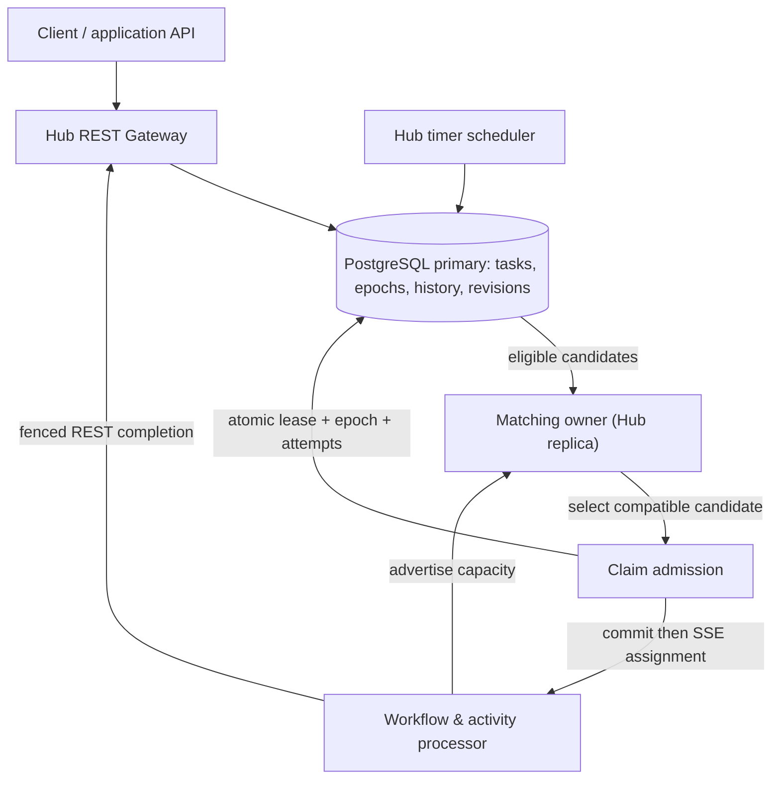

# Architecture: Hub-native execution

The current distributed runtime uses **partition-owned, in-memory candidate matching**, committed PostgreSQL task leases, and SSE assignment delivery.

## Who owns what?

| Component | Authority | Important boundary |
| --- | --- | --- |
| PostgreSQL primary | Task state, workflow revisions, lease owner/epoch, retry attempts, durable history | **All** writable Hub replicas must use the same authority |
| Matching owner | Cached candidates, connected worker credits, owner-generation routing | Candidate cache and notifications are advisory |
| Hub REST Gateway | Management, admission, commit endpoints, authorization boundary | Does not execute business workflow C# |
| Native Provisioner / processor | Versioned workflow definitions, step bodies, routed activity code, downstream idempotency | No database credentials |
| Embedded scheduler | Durable timers, retries and readiness | Not the worker matching authority |

## Main invariants

- Every claimed task is fenced by the PostgreSQL lease owner and epoch.
- Matching ownership is fenced separately by partition-owner generation.
- Only **committed leases** are delivered over SSE.
- Lost notifications trigger bounded PostgreSQL reconciliation; they do not lose authoritative work.
- Workflow-native snapshot commits, dispatch history and inbox transitions remain atomic.
- External effects are **at least once**; use dispatch identity / downstream idempotency.

## Architecture versus historical experiments

The repository also retains investigations of earlier matching paths, FIFO/resource policies and direct-PostgreSQL workers. Those are useful research evidence, but the current primary path is described in [the canonical runtime document](https://github.com/thanhhaictld/workflow-core/blob/thanhhaictld/hub-memory-candidates-luna/scaling/docs/current-runtime.md), not older benchmark proposals.

Continue with [matching and leases](matching-and-leases.md) or [two-Hub deployment](../tutorials/day-2-multi-hub.md).
