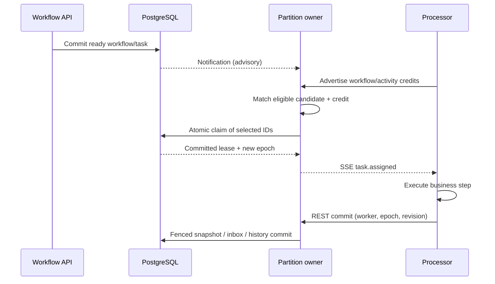

# Matching, task leases and SSE

## One execution cycle

### Partition ownership does not mean strict FIFO

`partition_id % matching_partition_count` determines **which Hub owner** coordinates a task's matching. It does not impose business ordering across all tasks in that partition. Worker capacity and application-specific dependencies can be satisfied independently. Use appropriate persisted resource policies if strict business constraints are required by your application.

### What happens after failures?

| Failure | Recovery rule |
| --- | --- |
| Hub owner disappears before claim | Next owner reloads committed candidates and fresh worker credits |
| Hub crashes after PostgreSQL COMMIT, before SSE | Lease still exists; it is recovered through expiry/fencing |
| Processor disconnects | Existing committed leases remain authoritative; uncertain delivery is reconciled |
| Completion response is lost | Exact, fenced replay acknowledges the already-committed result |
| PostgreSQL becomes unavailable | No in-memory-only admission or completion is allowed |

### What to measure

Monitor candidate admission latency, SQL claim duration, Npgsql pool waits, worker demand-to-assignment, schedule-to-start p95/p99, completion ACK p95/p99, expired leases and workflow completion p95/p99. Large batches may reduce database work per task while increasing the tail latency of individual assignments.

**Source of truth:** [Current runtime details](https://github.com/thanhhaictld/workflow-core/blob/thanhhaictld/hub-memory-candidates-luna/scaling/docs/current-runtime.md) · [Claim-flow diagrams](https://github.com/thanhhaictld/workflow-core/blob/thanhhaictld/hub-memory-candidates-luna/scaling/docs/hub-matching-claim-flow.md).
