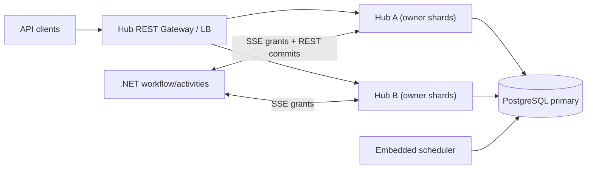

# Distributed Workflow Core Hub

A **code-first .NET 10 workflow runtime** with REST/SSE application hosts, PostgreSQL-authoritative task leasing and workflow history, and partition-owned matching. This is the distributed **Hub-native** path in this fork, not the original embedded `IWorkflowHost` runtime.

## Choose a starting point

| Goal | Start here |
| --- | --- |
| Run a real workflow from an empty laptop | [Day 1: first durable workflow](tutorials/day-1-first-workflow.md) |
| Add a second Hub and scale processor replicas | [Day 2: two Hubs](tutorials/day-2-multi-hub.md) |
| Tune throughput without hiding p95/p99 regressions | [Day 2: batching](tutorials/day-2-batching.md) |
| Understand one versus two PostgreSQL nodes | [Day 2: database topologies](tutorials/day-2-postgresql.md) |
| Understand matching, fencing and recovery | [Runtime architecture](architecture/index.md) |
| Bring up the full lab or monitor it | [Deploy and observe](operations/deployment.md) |
| Find environment variables and benchmark controls | [Configuration reference](reference/configuration.md) |

[Follow the two-day learning path](learning-path.md){ .md-button .md-button--primary }

## Runtime at a glance

PostgreSQL is the **single lease and commit authority**. Matching buffers candidate metadata in Hub memory but cannot grant durable work without a PostgreSQL-fenced transaction. Business workflow code executes in a separate application/processor host with no PostgreSQL connection string.

!!! warning "Lab and production boundaries"
    The tutorial is a local development and benchmarking guide, **not a production deployment certification**. Two Hubs sharing a PostgreSQL primary are supported in the repository Compose overlays. A PostgreSQL standby requires separate HA provisioning and does not add another writable workflow database. Multi-primary workflow sharding is a future architecture proposal, not a supplied feature.

## Original Workflow Core versus this fork

The [Original Workflow Core](../getting-started.md) pages describe the embedded engine and providers. The Distributed Hub pages describe the REST/SSE Hub runtime under `scaling/`. The two runtimes have different registration, execution and database boundaries; follow the appropriate documentation rather than mixing setup steps.

See also the [repository's engineering documentation](reference/engineering-archive.md) for investigations and CI evidence.
