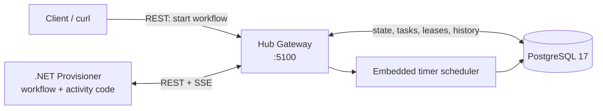

> [Distributed Hub learning path](../learning-path.md) · [Source code](https://github.com/thanhhaictld/workflow-core/tree/thanhhaictld/hub-memory-candidates-luna/scaling) · Development lab, not a production runbook.

# Day 1 — First durable workflow

## 1. The mental model



The **Hub is a control plane**, not a place to run your C# business steps. It owns durable work, revisions, attempts, fencing and history. The **Provisioner** knows the code-first workflow and runs ordinary steps or registered remote activities. Only the Hub receives PostgreSQL credentials. SSE is an assignment transport; PostgreSQL is the authority for any lease or result.

### Prerequisites

- Git; .NET SDK **10**; PowerShell **7+** (`pwsh`); Docker Engine/Desktop with Compose v2.
- Node.js 22+ and Corepack are needed only for the optional developer UI/bootstrap path.
- Free loopback ports **5100** (Hub) and **55432** (Day 1 PostgreSQL).
- Run commands from the **repository root**. The code below uses PowerShell syntax on Windows, macOS or Linux.

```powershell
# The Hub work is on the PR #41 branch at the time of this guide.
git clone https://github.com/thanhhaictld/workflow-core.git
cd workflow-core
git switch thanhhaictld/hub-memory-candidates-luna

dotnet --version        # expect 10.x
docker compose version
pwsh --version
```

## 2. Start PostgreSQL and install the Hub schema

```powershell
# PostgreSQL 17 on localhost:55432; forward-only EF + Hub SQL migrations.
pwsh -NoProfile -File scripts/dev.ps1 db-schema

# Optional: verify the local database container.
docker compose -f scaling/compose.monitor.yaml ps postgres
```

`db-schema` uses the repository's migration list, including the native runtime and matching indexes; **do not run every historical `scaling/sql/*.sql` file yourself**. Retired migrations are deliberately omitted. This setup keeps data in the named `monitor_postgres_data` Docker volume.

## 3. Start one Hub (Terminal A)

```powershell
$env:WFC_HUB_AUTH_TOKEN = 'local-development-token-change-me-2026'
$env:WFC_HUB_PUSH_ENABLED = 'true'
$env:WFC_HUB_MATCHING_CANDIDATES_ENABLED = 'true'
pwsh -NoProfile -File scripts/dev.ps1 hub
```

The Hub listens at `http://127.0.0.1:5100`. This command also ensures the database schema is available. Do not reuse this local bearer token in a shared environment.

## 4. Start your first application (Terminal B)

The repository already contains a working application, [`WorkflowCore.Provisioner.Host`](https://github.com/thanhhaictld/workflow-core/blob/thanhhaictld/hub-memory-candidates-luna/scaling/sample/onboarding/WorkflowCore.Provisioner.Host/Program.cs). It publishes native workflow definitions and activity capabilities to the Hub, without connecting to PostgreSQL itself.

```powershell
$env:WFC_HUB_AUTH_TOKEN = 'local-development-token-change-me-2026'
$env:WFC_HUB_URL = 'http://127.0.0.1:5100'
$env:WFC_HUB_ALLOW_INSECURE_HTTP = 'true'  # localhost only
$env:WFC_HUB_PUSH_ENABLED = 'true'
$env:WORKFLOW_WORKERS = '2'
$env:ACTIVITY_WORKERS = '4'
pwsh -NoProfile -File scripts/dev.ps1 provisioner
```

The sample registers `tenant-onboarding` **v5** (validate → provision → configure access → welcome), plus a timer workflow and a parallel onboarding workflow. Actual definitions and step bodies live in [`WorkflowCore.Provisioner.Workflows`](https://github.com/thanhhaictld/workflow-core/blob/thanhhaictld/hub-memory-candidates-luna/scaling/sample/onboarding/WorkflowCore.Provisioner.Workflows/OnboardingWorkflow.cs).

> [!TIP]
> You do **not** start the legacy `IWorkflowHost` poller for the native Hub path. Register the workflow using `AddHubWorkflowRuntime(...)` and run the application host. `WORKFLOW_WORKERS` and `ACTIVITY_WORKERS` are independent execution budgets.

## 5. Start a workflow and inspect its result (Terminal C)

```powershell
$base = 'http://127.0.0.1:5100'
$token = 'local-development-token-change-me-2026'
$headers = @{ Authorization = "Bearer $token" }

# Readiness and registered definitions.
Invoke-RestMethod "$base/health/ready"
Invoke-RestMethod "$base/api/hub/definitions" -Headers $headers |
  Where-Object { $_.hubId -eq 'onboarding' }

$run = 'day1-' + [guid]::NewGuid().ToString('N').Substring(0,10)
$body = @{
  hubId = 'onboarding'
  definitionId = 'tenant-onboarding'
  version = 5
  runId = $run
  idempotencyKey = "$($run):tenant-001"
  input = @{ tenantId = 'tenant-001'; organizationName = 'Day One Demo' }
} | ConvertTo-Json -Depth 10

$created = Invoke-RestMethod "$base/api/hub/workflows" `
  -Method Post -Headers $headers -ContentType 'application/json' -Body $body
$created
$id = $created.workflowId

# Repeat while the sample executes, until state becomes Complete.
Invoke-RestMethod "$base/api/hub/workflows/$id" -Headers $headers
Invoke-RestMethod "$base/api/hub/workflows/$id/native-runtime" -Headers $headers
Invoke-RestMethod "$base/api/hub/runs/$run/summary" -Headers $headers
```

The start endpoint responds **HTTP 202** with a `workflowId`. The status endpoint tracks durable progress; `native-runtime` exposes the persisted snapshot. The `run` summary includes completed counts and workflow completion percentiles. Keep a unique `runId` and `idempotencyKey` for each new test.

### Want to write your own simple workflow?

Use the same Workflow Core fluent builder. This is a **minimal adaptation example**, not a new standalone scaffold or a command that creates a project:

```csharp
using WorkflowCore.Interface;
using WorkflowCore.Models;

public sealed class HelloData
{
    public string Name { get; set; } = "";
}

public sealed class SayHello : StepBodyAsync
{
    public override Task<ExecutionResult> RunAsync(IStepExecutionContext context)
    {
        Console.WriteLine("Hello from a Hub-native workflow!");
        return Task.FromResult(ExecutionResult.Next());
    }
}

public sealed class HelloWorkflow : IWorkflow<HelloData>
{
    public string Id => "hello-workflow";
    public int Version => 1;
    public void Build(IWorkflowBuilder<HelloData> builder) =>
        builder.StartWith<SayHello>();
}

// Add to your existing Provisioner host's registration chain:
// .AddWorkflow<HelloWorkflow, HelloData>("demo", partitions: 4)
```

The host must reference the workflow assembly and run `AddHubWorkflowRuntime`; starting this workflow requires `hubId: demo`, `definitionId: hello-workflow`, `version: 1`. For a working host-registration template, copy the actual [Provisioner `Program.cs`](https://github.com/thanhhaictld/workflow-core/blob/thanhhaictld/hub-memory-candidates-luna/scaling/sample/onboarding/WorkflowCore.Provisioner.Host/Program.cs).

### Day 1 checkpoint

- [ ] Hub `/health/ready` responds successfully.
- [ ] `tenant-onboarding` v5 appears in the registered definitions.
- [ ] A workflow returns HTTP 202 and eventually reaches `Complete`.
- [ ] Native snapshot/history is persisted in PostgreSQL.
- [ ] Stopping and restarting the Provisioner does **not** erase completed workflow state.

---

