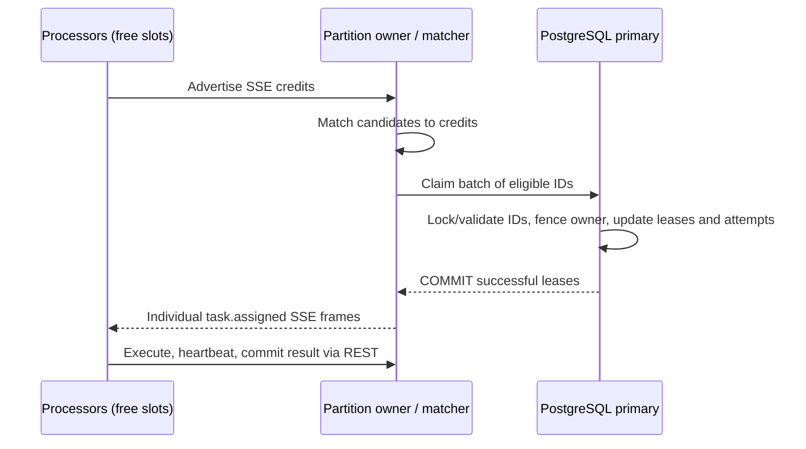

> [Distributed Hub learning path](../learning-path.md) · [Source code](https://github.com/thanhhaictld/workflow-core/tree/thanhhaictld/hub-memory-candidates-luna/scaling) · Development lab, not a production runbook.

# Day 2 — Batch claims, throughput and latency

Continue after [two-Hub setup](day-2-multi-hub.md). In a new PowerShell terminal, recreate the `$compose` array from that tutorial before running the commands below.

## Part B. Improve throughput without hiding latency regressions

### 1. Understand task claim batching

The current matcher buffers **candidate metadata in memory**, pairs it with worker capacity and asks PostgreSQL to **atomically lease** the selected task IDs. The worker only receives a task after the lease transaction commits.



**Claim batch size** means how many tasks may share a lease-admission transaction. It is not the same as **activity completion batch size** (several already-executed results committed together), nor the number of concurrent workflow executions.

| Knob (apply consistently to both Hubs) | What it controls | Caution |
| --- | --- | --- |
| `WFC_HUB_CANDIDATE_BATCH_SIZE=1/8/32` | Upper bound for a candidate admission group (golden preset: `32`) | It is a **cap**, not a guarantee that batches fill |
| `WFC_HUB_CANDIDATE_CROSS_WORKER_BATCH=true` | Combine eligible credits from different processors in the owner's acquisition turn | Watch fairness, batch fill and per-credit assignment delay |
| `WFC_HUB_CANDIDATE_CONCURRENT_ADMISSION=true` | Allow concurrent admission work under the configured rules | Does not remove ownership fencing or PostgreSQL claim limits |
| `WFC_HUB_CANDIDATE_ADMISSION_CONCURRENCY=2` | Admission groups allowed per Hub | Too many groups increase database contention |
| `WFC_HUB_CLAIM_ADMISSION_MODE=demand` | Defer surplus speculative claims before opening PostgreSQL connections | Better DB efficiency can shift waiting into schedule-to-start latency |
| `WFC_HUB_CLAIM_ADMISSION_LIMIT=3` / `WFC_HUB_DB_POOL=12` | Protect the shared per-Hub connection pool for completions | Pools are per Hub, so total DB sessions grow with replicas |
| `WFC_HUB_BATCH_UNCONSTRAINED_CLAIMS=true` | Optional set-based claim path for tasks **without** resource constraints | Separate mechanism from in-memory cross-worker candidate batching; test independently |

The current `make ups-16` golden preset enables cross-worker candidate batching, candidate backpressure, concurrent admission, split candidate claims, and demand-aware SQL admission. **It leaves `WFC_HUB_BATCH_UNCONSTRAINED_CLAIMS=false`**, so do not assume that switch is already active.

### 2. Run a controlled 1 → 8 → 32 candidate-batch comparison

Use the **same** Day 2 stack and 1,000-workflow offboarding workload. Start with only one changed knob per cohort and warm up each mode. Example from PowerShell:

```powershell
# Baseline: small groups. This is a benchmark control, not a production preset.
$env:WFC_HUB_CANDIDATE_BATCH_SIZE = '1'
$env:WFC_HUB_CANDIDATE_CROSS_WORKER_BATCH = 'false'
pwsh -NoProfile -File scaling/observability/compose.ps1 @compose `
  up -d --force-recreate hub hub-2

# Run the 1,000-workflow command from Part A; record output and flags.

# Experiment: cross-worker batches, capped at 8.
$env:WFC_HUB_CANDIDATE_BATCH_SIZE = '8'
$env:WFC_HUB_CANDIDATE_CROSS_WORKER_BATCH = 'true'
pwsh -NoProfile -File scaling/observability/compose.ps1 @compose `
  up -d --force-recreate hub hub-2

# Repeat 1,000 workflows; then try a cap of 32 with otherwise identical settings.
$env:WFC_HUB_CANDIDATE_BATCH_SIZE = '32'
pwsh -NoProfile -File scaling/observability/compose.ps1 @compose `
  up -d --force-recreate hub hub-2
```

Re-run the k6 command with a **new run ID** for each configuration. Verify the resolved values with `compose.ps1 @compose config`, and ensure the processors reconnect. For a proper A/B experiment, run baseline → optimized → optimized → baseline, repeat it, and keep the PostgreSQL dataset and available CPU consistent. **Do not use `down -v`** on a database containing data you care about.

| Measure | Why it matters |
| --- | --- |
| `durably completed workflows / second` | Actual capacity, not accepted HTTP requests |
| Workflow completion p50 / **p95 / p99** | User-facing elapsed time, **including backlog** |
| Ready → lease and lease → worker-start p95/p99 | Detect delayed assignment or mismatched capacity |
| Tasks per claim / claims per second / empty claims | Show whether larger batches actually reduce SQL work |
| PostgreSQL CPU-ms / workflow, WAL / workflow, lock time | Detect database savings or write amplification |
| Completion ACK p95/p99 and connection-pool wait | Avoid starving committed workflow progress with speculative claims |
| Failed tasks, retries, duplicate dispatch effects | Safety and correctness gates |

**Do not optimize solely for tasks/sec.** Larger batch requests can reduce per-task database overhead under sustained backlog. But collecting/grouping work, holding row locks longer, or exhausting the pool can hurt small-workload p95/p99. The current matcher may send a *partially filled batch immediately*; a higher cap does not inherently add a fixed delay. Measure the actual effect rather than assuming either improvement or regression.

### 3. Separate experiment: batch *completion* versus single completion

The repository contains a **persistence microbenchmark** for committing completed native activities. This is **not a feature enabled in the live Gateway**:

```powershell
# Requires an isolated, migrated PostgreSQL database accessible to the host.
$env:WFC_TEST_PG = 'Host=localhost;Port=55432;Database=workflow;Username=workflow;Password=workflow_dev_only'
$env:BENCH_COUNT = '600'
$env:BENCH_CONCURRENCY = '8'
$env:BENCH_BATCH_SIZE = '16'
dotnet run -c Release --project `
  scaling/benchmarks/native-completion-commit-ab/NativeCompletionCommitAb.csproj
```

Measured CI example (600 independent completion tasks per arm; PostgreSQL 17, 8 concurrent callers):

| Metric | Single commit | Batch of 16 |
| --- | ---: | ---: |
| Native activity persistence throughput | ~1,226 tasks/s | **~1,536 tasks/s** (+25.3%) |
| PostgreSQL CPU per task | 2.008 ms | **1.577 ms** (−21.5%) |
| Explicit completion commits / 600 tasks | 600 | **38** |
| Activity completion ACK p95 | **9.4 ms** | **103.5 ms** |

**Lesson:** a larger batch can increase aggregate throughput while making a *single caller* wait longer for acknowledgment. The test excludes workflow scheduling/network and is not evidence of a live Gateway throughput increase. See [the exact experiment](https://github.com/thanhhaictld/workflow-core/blob/thanhhaictld/hub-memory-candidates-luna/scaling/docs/native-task-completion-batch-commit-experiment.md) and [CI evidence](https://github.com/thanhhaictld/workflow-core/actions/runs/45638130814).

### 4. Native commit optimizations A–D (an independent tuning track)

The merged PR #50–#56 code supports separate optional flags:

| Phase | Flag | Effect |
| --- | --- | --- |
| A | `WFC_HUB_NATIVE_SKIP_EMPTY_SUBS_SQL` | Avoid unnecessary subscription SQL |
| B | `WFC_HUB_NATIVE_BULK_EVENT_SQL` | Bulk inbox consumption and subscription inserts |
| C | `WFC_HUB_NATIVE_BULK_ACTIVITIES` | Bulk scheduled activity and history inserts |
| D | `WFC_HUB_NATIVE_COMPACT_RECEIPT` | Hash-based compact idempotent commit receipt |

The repository provides [`compose.native-commit-abcd.yaml`](https://github.com/thanhhaictld/workflow-core/blob/thanhhaictld/hub-memory-candidates-luna/scaling/observability/compose.native-commit-abcd.yaml) for an **opt-in** two-Hub all-on lab. Append it **after** the base + HA + shard Compose files:

```powershell
# Include the optional overlay after HA and matching-shard settings.
$optimized = @(
  '-f', 'scaling/observability/compose.yaml',
  '-f', 'scaling/observability/compose.matching-ha.yaml',
  '-f', 'scaling/observability/compose.matching-shards.yaml',
  '-f', 'scaling/observability/compose.native-commit-abcd.yaml',
  '--env-file', 'scaling/observability/.env'
)
pwsh -NoProfile -File scaling/observability/compose.ps1 @optimized `
  up -d --force-recreate hub hub-2
```

> [!CAUTION]
> Deploy the updated **v1/v2 receipt reader to every Hub replica first**, with D writes OFF. Only then enable D's compact receipt format. An older Hub cannot verify v2 receipts after a lost response; do not mix versions under the all-on overlay.

Two matched, 1,000-workflow-per-arm offboarding end-to-end CI comparisons found **+3.6–4.9% workflow throughput, −1.3–3.3% workflow p95, −10.9–11.2% PostgreSQL CPU/workflow and −17.6–18.0% WAL/workflow** with A–D enabled together. These are directional shared-runner results, not capacity SLOs; the fast local-step workload does **not** exercise B's external-event or C's remote-activity paths. [Run 1](https://github.com/thanhhaictld/workflow-core/actions/runs/45651153700) · [Run 2](https://github.com/thanhhaictld/workflow-core/actions/runs/45651333066).

---

