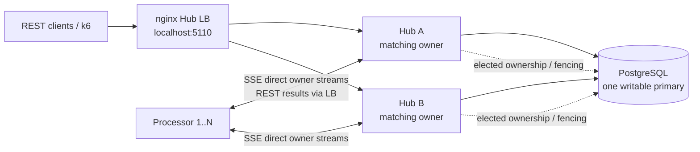

> [Distributed Hub learning path](../learning-path.md) · [Source code](https://github.com/thanhhaictld/workflow-core/tree/thanhhaictld/hub-memory-candidates-luna/scaling) · Development lab, not a production runbook.

# Day 2 — Two Hub replicas and one PostgreSQL primary

## Deployment topology



**Why two Hubs help:** distributed availability and ownership of matching shards; multiple processors can advertise execution credits to the appropriate owner. **Why they cannot bypass PostgreSQL:** every task lease, epoch, workflow revision, history write and completion still commits against the same writable database.

### 1. Create the isolated observability environment

First stop the Day 1 Hub and Provisioner terminals with **Ctrl+C** (otherwise the Day 2 Hub will compete for port 5100). The Day 2 observability stack is **separate from** Day 1's `workflow-core-monitor` database. Its PostgreSQL volume is not shared with the developer stack. The repository's Compose launcher sets a stable project name per worktree.

```powershell
if (-not (Test-Path scaling/observability/.env)) {
  Copy-Item scaling/observability/.env.example scaling/observability/.env
}
# Edit .env: WFC_HUB_AUTH_TOKEN, PG_PASSWORD and any occupied ports.
# Do not use test secrets in production.

$compose = @(
  '-f', 'scaling/observability/compose.yaml',
  '-f', 'scaling/observability/compose.matching-ha.yaml',
  '-f', 'scaling/observability/compose.matching-shards.yaml',
  '--env-file', 'scaling/observability/.env'
)

# Start PostgreSQL, migrations, two Hubs and the load balancer.
pwsh -NoProfile -File scaling/observability/compose.ps1 @compose `
  up -d --build hub hub-2 hub-lb

pwsh -NoProfile -File scaling/observability/compose.ps1 @compose ps
Invoke-RestMethod 'http://127.0.0.1:5110/health/ready'
```

The matching overlays configure **four** matching partitions, unique Hub nodes and direct peer URLs. An ownership partition routes work to an elected Hub; it is **not** a business FIFO ordering requirement. The processor must reach each owner's direct SSE address; the load balancer must not buffer SSE.

**Repository shortcut (full 16-processor golden preset):** if you prefer the maintained end-to-end orchestration script to the smaller manual steps above, use `make obs-setup`, then `make ups-16`, `make obs-ps`, and `make obs-test-4k`. This starts a larger monitoring/HA lab and applies its golden flags; use it **instead of**, not simultaneously with, the manual Compose setup on the same ports. It requires GNU Make in addition to PowerShell 7.

### 2. Add application processors

Use the dedicated offboarding sample to isolate **Hub-native execution overhead**. It has three synchronous processor-local steps and **no remote activities, explicit FIFO or external API delays**. This makes it a better throughput baseline than routed onboarding, which has network hops and intentional delays.

```powershell
$env:OFFBOARD_PROCESSOR_WORKERS = '8'
pwsh -NoProfile -File scaling/observability/compose.ps1 @compose `
  --profile offboarding-load up -d --build --scale processor=2 processor

# Confirm the 'tenant-offboarding-fast' v1 definition is registered.
$token = (Get-Content scaling/observability/.env |
  Where-Object { $_ -match '^WFC_HUB_AUTH_TOKEN=' }) -replace '^WFC_HUB_AUTH_TOKEN=', ''
Invoke-RestMethod 'http://127.0.0.1:5110/api/hub/definitions' `
  -Headers @{ Authorization = "Bearer $token" } |
  Where-Object { $_.definitionId -eq 'tenant-offboarding-fast' }
```

> [!NOTE]
> The `processor` service is a dedicated **offboarding** benchmark application; it is not the Day 1 onboarding Provisioner. To scale your own C# Provisioner, package the same host in a container, connect it to `http://hub-lb:5100`, allow the Hub owner addresses `http://hub:5100,http://hub-2:5100`, and keep PostgreSQL credentials out of the processor.

### 3. Run 100 workflows first, then 1,000

```powershell
pwsh -NoProfile -File scaling/observability/compose.ps1 @compose `
  --profile offboarding-k6 run --rm `
  -e K6_OFFBOARD_COUNT=100 `
  -e K6_OFFBOARD_VUS=20 `
  -e K6_OFFBOARD_TIMEOUT_SECONDS=360 k6-offboarding

pwsh -NoProfile -File scaling/observability/compose.ps1 @compose `
  --profile offboarding-k6 run --rm `
  -e K6_OFFBOARD_COUNT=1000 `
  -e K6_OFFBOARD_VUS=100 `
  -e K6_OFFBOARD_TIMEOUT_SECONDS=900 k6-offboarding
```

The k6 script submits work first and polls the **run summary**, rather than making 1,000 clients continually poll individual workflows. On success, inspect `scaling/observability/results/k6-offboarding-summary.json` and the k6 output for durable completions, server-window workflows/sec, p95 and p99. A thousand submissions do not mean a thousand tasks are simultaneously waiting.

To compare processor scaling, vary `--scale processor=1`, `2`, `4`, `8`, `16` while keeping the submission pattern, hardware, flags, database and run size constant. Measure the actual completed workflow rate; do not extrapolate linearity from a shared GitHub runner.

### 4. Observe PostgreSQL and both Hubs

```powershell
# Database transaction and cache counters (cumulative; take before/after deltas).
pwsh -NoProfile -File scaling/observability/compose.ps1 @compose `
  exec -T postgres psql -U workflow -d workflow -c `
  'SELECT xact_commit, xact_rollback, blks_hit, blks_read, deadlocks FROM pg_stat_database WHERE datname=current_database();'

# WAL since last stats reset.
pwsh -NoProfile -File scaling/observability/compose.ps1 @compose `
  exec -T postgres psql -U workflow -d workflow -c `
  'SELECT wal_bytes, wal_records, wal_write, wal_sync FROM pg_stat_wal;'
```

Also watch the bundled Grafana dashboard (default `http://localhost:3001`), Prometheus (`:9090`), and Next.js monitor (`:3002`) when those services are started. Useful signals: backlog and oldest ready age, **schedule-to-start p95/p99**, lease expiration, matching-owner changes, Npgsql pool wait, PostgreSQL CPU, WAL bytes/workflow, deadlocks, and workflow completion p95/p99.

### Day 2 Part A checkpoint

- [ ] Two Hub containers and `hub-lb` are healthy.
- [ ] Both Hubs share the **same** PostgreSQL primary and schema.
- [ ] Processors connect to the direct elected owner over SSE and complete work via REST.
- [ ] One Hub can be stopped and the surviving Hub can recover ownership without losing committed workflow state (verify with the repo's failover suite).

---

