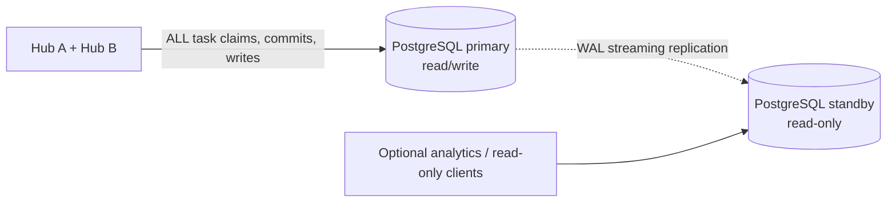
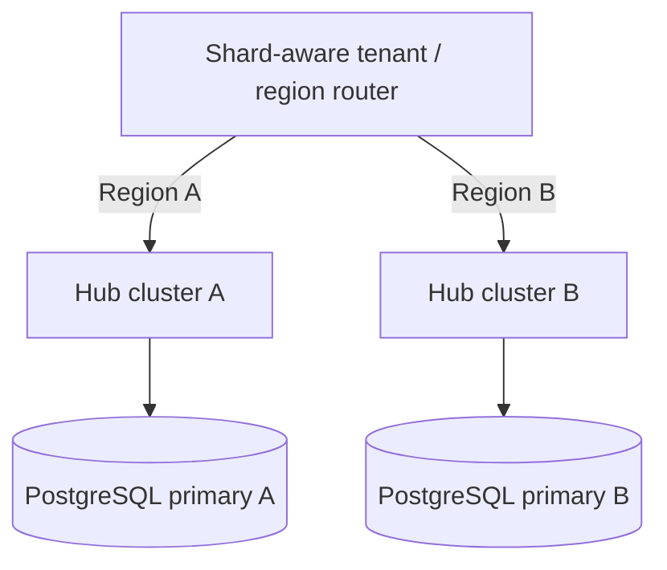

> [Distributed Hub learning path](../learning-path.md) · [Source code](https://github.com/thanhhaictld/workflow-core/tree/thanhhaictld/hub-memory-candidates-luna/scaling) · Development lab, not a production runbook.

# Day 2 — Two PostgreSQL nodes: availability versus write scaling

Complete [two-Hub setup](day-2-multi-hub.md) first. The commands below assume the `$compose` PowerShell array defined on that page is available in the current terminal.

## Part C. What does a **second PostgreSQL instance** actually buy us?

### Option 1: one primary + one standby — HA/read scaling



- **Supported application invariant:** all Hubs must agree on a **single writable lease authority**. Point both Hubs at the same active primary, including after failover.
- A standby may improve **recovery options** and allow selected eventually consistent reports/read-only queries. It does **not** double write throughput or permit claiming from a read replica.
- Replication mode matters: **asynchronous** replication can lose acknowledged writes on promotion; **synchronous** replication increases commit latency but can reduce that data-loss window when configured and operated correctly.
- Failover requires a database HA mechanism that **fences the old primary**, promotes the standby, switches the write endpoint, and reconnects both Hubs. The repository's Compose files do **not** provision this PostgreSQL HA manager.

### Optional hands-on: a second PostgreSQL 17 container as a standby

The main repository **does not ship this overlay**. The following is an **illustrative, development-only PostgreSQL 17 replication lab** derived from PostgreSQL's `pg_basebackup -R` procedure. Save the YAML file yourself. This path has **not** been exercised by the workflow-core CI; use it only on a disposable lab, never as an HA deployment without testing failover, authentication and backups.

First allow a dedicated replication login on the **existing primary**:

```powershell
# From the same Day 2 repository root; use the $compose array defined above.
$primary = (pwsh -NoProfile -File scaling/observability/compose.ps1 @compose ps -q postgres).Trim()
# Development-only example secret, identical to PG_REPLICATION_PASSWORD below.
docker exec $primary psql -U workflow -d workflow -v ON_ERROR_STOP=1 `
  -c "CREATE ROLE tutorial_repl WITH REPLICATION LOGIN PASSWORD 'local-repl-change-me';"
# 'samenet' limits this rule to directly connected interfaces (the Compose network).
docker exec $primary sh -c `
  "echo 'host replication tutorial_repl samenet scram-sha-256' >> /var/lib/postgresql/data/pg_hba.conf"
docker exec $primary psql -U workflow -d workflow -c 'SELECT pg_reload_conf();'
```

Create `scaling/observability/compose.pg-standby-lab.yaml`:

```yaml
# EXAMPLE ONLY: add to the base + HA + shards Compose files.
services:
  postgres-standby:
    image: postgres:17
    depends_on:
      postgres:
        condition: service_healthy
    environment:
      PGDATA: /var/lib/postgresql/data/pgdata
      PGPASSWORD: ${PG_REPLICATION_PASSWORD:?Set a development-only replication password}
    volumes:
      - tutorial_standby_data:/var/lib/postgresql/data
    entrypoint: ["bash", "-euc"]
    command:
      - |
        mkdir -p "$$PGDATA"
        chown -R postgres:postgres "$$PGDATA"
        chmod 700 "$$PGDATA"
        if [ ! -f "$$PGDATA/PG_VERSION" ]; then
          gosu postgres pg_basebackup -h postgres -p 5432 \
            -U tutorial_repl -D "$$PGDATA" -Fp -Xs -P -R
        fi
        exec gosu postgres postgres -D "$$PGDATA"
volumes:
  tutorial_standby_data:
```

Then start the **standby only**:

```powershell
$env:PG_REPLICATION_PASSWORD = 'local-repl-change-me'
$replicated = @(
  '-f', 'scaling/observability/compose.yaml',
  '-f', 'scaling/observability/compose.matching-ha.yaml',
  '-f', 'scaling/observability/compose.matching-shards.yaml',
  '-f', 'scaling/observability/compose.pg-standby-lab.yaml',
  '--env-file', 'scaling/observability/.env'
)
pwsh -NoProfile -File scaling/observability/compose.ps1 @replicated `
  up -d postgres-standby

pwsh -NoProfile -File scaling/observability/compose.ps1 @replicated `
  exec -T postgres-standby psql -U workflow -d workflow -c `
  'SELECT pg_is_in_recovery();'
```

**Expected:** standby returns `true`, and the primary reports a `streaming` connection below. All Hubs still use `Host=postgres` for **writes**. The lab intentionally does **not** switch any Hub to the standby or configure automatic promotion. On real infrastructure, use a managed PostgreSQL HA service or an HA controller, store secrets outside environment variables, restrict replication access, configure WAL retention and backup/recovery, and test fencing before failover.

Provision the standby using your PostgreSQL platform (or a separately managed PostgreSQL streaming-replication lab). When ready, verify:

```sql
-- On PRIMARY: check WAL receiver(s) and replication health.
SELECT application_name, state, sync_state, sent_lsn, replay_lsn, replay_lag
FROM pg_stat_replication;

-- On STANDBY: must return true.
SELECT pg_is_in_recovery();

-- On PRIMARY: should be false.
SELECT pg_is_in_recovery();
```

**Operational checkpoint:** apply schema migrations only to the current writable primary; verify standby lag, recovery/promotion and consistency before pointing any Hub at the newly promoted primary. This tutorial does **not** pretend a second `postgres:17` container automatically becomes a streaming standby.

### Option 2: two writable PostgreSQL primaries — independent clusters, not a replica



This topology can scale **aggregate writes across independent workflow namespaces**, but requires explicit routing, identity ownership, migration, observability and failure semantics. **A single workflow must never be claimed concurrently against both databases.** The current Hub runtime and supplied Compose preset **do not implement cross-database sharding or multi-primary task leasing**. Treat this as a future architecture project, not a one-line scale flag.

**Decision table**

| Configuration | Available today in repo? | Primary benefit | Does workflow write throughput scale automatically? |
| --- | --- | --- | --- |
| 1 Hub + 1 PostgreSQL | Yes | Simple local development | No |
| 2 Hubs + 1 PostgreSQL | Yes, HA overlay | Hub failover, matching scale-out | **Only until DB/other shared limits** |
| 2 Hubs + PG primary + standby | External PG HA provisioning required | Database HA, possible read offload | **No** |
| Multiple isolated Hub+PG primary shards | Requires new routing/ownership architecture | Potential aggregate write scale | **Only with correct sharding and measured capacity** |

---

