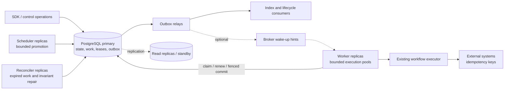

# PostgreSQL durable execution: implementation plan

Status: proposed; implementation has not started.

This document is the repository-owned plan and task tracker for scaling Workflow
Core. Check tasks only when their acceptance checks pass, and record evidence and
the implementing commit or PR in the execution log at the end. Each task is sized
as a reviewable change; split it further if its implementation becomes too large.

## Scope and evidence

Baseline inspected: `76a882b533f73ebdb4e4bbc10c664864bfd6140a` in the available
`thanhhaictld/workflow-core` checkout. This is not a verification of a separately
named `workflowcore-actual-fork`; compare its intended commit before porting work.

The first release provides opt-in PostgreSQL durable execution for one writable
primary per shard. Preserve workflow definitions, execution pointers, current
provider defaults, and the existing public interfaces for legacy deployments.
New capabilities are additive. This plan authorizes preparation of implementation
work; upstream merges/releases follow the repository's maintenance process.

Observed implementation points:

| Responsibility | Existing source | Consequence for implementation |
| --- | --- | --- |
| Polling | `src/WorkflowCore/Services/BackgroundTasks/RunnablePoller.cs` | Global locks guard runnable/event/command scans; replace these for durable mode with bounded concurrent claims. |
| Runnable selection | `src/providers/WorkflowCore.Persistence.EntityFramework/Services/EntityFrameworkPersistenceProvider.cs`, `GetRunnableInstances` | Current query materializes all due IDs; new PostgreSQL path must use bounded indexed work queries. |
| Worker dispatch | `src/WorkflowCore/Services/BackgroundTasks/QueueConsumer.cs` | Current concurrency is CPU-derived; add explicit bounded concurrency by work kind. |
| Execution | `src/WorkflowCore/Services/BackgroundTasks/WorkflowConsumer.cs` | Lock, execute, persist, index publication and future scheduling are separate; replace the persistence boundary in durable mode. |
| Authoring/executor | `src/WorkflowCore/Services/WorkflowExecutor.cs` | Reuse execution semantics; verify middleware and lifecycle publication before treating a transition as committed. |
| Other writers | `src/WorkflowCore/Services/WorkflowController.cs`, `EventConsumer.cs`, `ActivityController.cs`, `SyncWorkflowRunner.cs` | All writers to migrated workflows must participate in ownership/version checks. |
| Provider wiring | `src/providers/WorkflowCore.Persistence.PostgreSQL/ServiceCollectionExtensions.cs` | Existing provider uses shared EF persistence and has a large-data option; keep durable behavior explicitly selected. |
| Schema | `src/providers/WorkflowCore.Persistence.PostgreSQL/PostgresContext.cs`, `Migrations/` | Existing tables use names such as `Workflow` and a configurable schema; SQL must match actual quoted identifiers. |
| DI/options | `src/WorkflowCore/ServiceCollectionExtensions.cs`, `src/WorkflowCore/Models/WorkflowOptions.cs` | Register exactly one execution path per ownership scope and validate incompatible options. |
| Contracts | `src/WorkflowCore/Interface/IQueueProvider.cs`, `IDistributedLockProvider.cs` | String dequeue and Boolean locks cannot express receipts/fencing; add capability interfaces. |
| PostgreSQL tests | `test/WorkflowCore.Tests.PostgreSQL/` | Extend existing provider scenarios with real database concurrency/failure tests. |

## Architecture and correctness contract

The database owns work availability. Start with direct PostgreSQL claims; broker
notifications are a later optimization. No notification is the only record of work.

1. A runnable state transition and its next work item commit in one transaction.
2. One valid workflow lease serializes every mutation for that workflow. Work-row
   receipts alone do not serialize different work generations for the same entity.
3. A transition commits only with the expected workflow version and an unexpired,
   matching owner/fence. Commit, lease validation, subscriptions, errors, next work,
   outbox, and current delivery completion share a transaction.
4. Lock the authoritative workflow lease row during commit validation and hold it
   until commit. Lease acquisition/recovery locks the same row: a successor cannot
   acquire between validation and the old transaction's commit. Define one lock
   order for all mutation paths to avoid deadlocks.
5. User step code never executes inside a database transaction. Lease loss requests
   cancellation; fencing rejects stale state but cannot retract external effects.
6. Execution and notification delivery are at least once. A stable application
   idempotency key is required for effectively-once external business effects.
7. Eligible abandoned work is recovered in bounded batches. Database time controls
   eligibility/expiry; host clocks do not grant ownership.
8. Legacy and durable writers never concurrently own the same migrated shard.

## Initial data and contract decisions

Use PostgreSQL-specific entities/services alongside existing EF models so changes
do not accidentally alter other providers. Final names and mapping belong to S02.

| Record | Required fields and constraints |
| --- | --- |
| Workflow execution metadata | Tenant, workflow ID, state version, scheduling generation; unique entity identity. |
| Durable work | ID, kind, entity ID, tenant/shard, generation, available-at, state, delivery owner/token/expiry, attempt, timestamps, error code. Permanent uniqueness on logical work identity; do not remove deduplication protection on completion. |
| Workflow lease | Entity identity, owner, expiry, monotonic fence. Retain fence history across lease expiry; define safe lifecycle on workflow deletion. |
| Outbox | Stable message ID, aggregate/version, type, versioned payload, relay owner/token/expiry, published-at and attempts. |
| Event delivery | Unique event/subscription delivery identity, target workflow, delivery state; deduplication retained for the event retention period. |
| API idempotency | Tenant, producer, key, request hash, resulting entity ID, expiry; conflicting reuse is rejected. |

Index ready work by `(available_at, work_id)` with a static ready-state predicate;
index leased work by expiry. Never use current time in a partial-index predicate.
Add shard/kind prefixes where query plans justify them. Select text versus numeric
state representations once and use them consistently in mappings, SQL and tests.

Add capability contracts for claim/renew/abandon, workflow acquisition/renew/release,
and atomic transition commit. Every receipt includes identity, owner and acquisition
token/fence; every method takes a cancellation token. Commit explicitly accepts
the work receipt, workflow lease, expected state version and transition. Return
distinct stale ownership, expired lease, version conflict and committed outcomes.
Keep infrastructure failures distinguishable from business-step outcomes.

## Milestones and task breakdown

Dependency order: `M0 -> M1 -> M2 -> M3 -> M4 -> M5`. Start each milestone only
after its correctness gate; deployment preparation can proceed alongside M3/M4.

### M0 — baseline and design closure

- [ ] **S01: capture baseline and writer inventory.** Record actual schema/versions,
  query plans, workflow sizes and queue/lock options. Trace workflow, event,
  activity, synchronous, purge, middleware and lifecycle paths, including custom
  persistence implementations. Record existing test counts and benchmark load.
  Acceptance: each writer is mapped to a transaction/ownership strategy; capture
  reproducible baseline throughput, lag and database utilization.
- [ ] **S02: finalize protocol and migration ADR.** Specify SQL mappings, isolation
  level (start with READ COMMITTED plus explicit row locks), lock order, generation
  rules, versions, deduplication retention, legacy tenant mapping and shard routing.
  Decide how to execute missing definition versions (quarantine), stale work
  (complete without execution), and unsupported custom writers (startup rejection).
  Define retries after ambiguous commits: query receipt/transition identity before
  attempting execution again. Acceptance: protocol covers every crash boundary and
  concurrent event/control operation; no unresolved correctness decision remains.

M0 gate: approved local design decision record and a reproducible baseline. The
approval here is a project review milestone, not a request to interrupt drafting.

### M1 — contracts, storage and transaction foundation

- [ ] **S03: introduce additive capabilities and options** (depends S02). Add models
  and interfaces under `src/WorkflowCore/Models/` and `Interface/`, with proposed
  `UsePostgreSqlDurableExecution` registration in the PostgreSQL provider. Expose
  role flags, per-kind concurrency, batch size, lease/renew intervals, shard scope,
  tenant resolver and legacy/shadow/durable modes. Acceptance: legacy registration
  behavior stays unchanged; unsafe mixed modes fail at startup; contract tests
  cover receipt validation and invalid settings.
- [ ] **S04: add schema and restartable migrations** (depends S02). Add work, lease,
  metadata, outbox, delivery and idempotency mappings/migrations in the PostgreSQL
  provider. Preserve original workflow data serialization. Add UTC tick conversion
  tests for `NextExecution`, including nulls, limits and precision. Separate online
  index creation where PostgreSQL disallows transactional execution. Acceptance:
  fresh install and upgrades work with default/custom schemas; legacy reads work;
  backfill restarts safely without resetting versions or fences.
- [ ] **S05: implement atomic persistence unit** (depends S03, S04). Add a
  PostgreSQL transaction service that loads state/version and commits pointers,
  subscriptions, errors, next work, outbox and delivery completion together. Inspect
  both default and large-data EF paths; share the transaction/connection explicitly
  or reject unsupported combinations. Acceptance: injected failure at each write
  rolls back all writes; a repeated committed transition returns its stored result
  without creating another generation.

M1 gate: atomicity demonstrated on real PostgreSQL; no production execution yet.

### M2 — claims, leases and durable workers

- [ ] **S06: implement bounded work claims** (depends S04, S05). Use a short
  `SELECT ... FOR UPDATE SKIP LOCKED` plus update/return transaction; increment
  delivery acquisition tokens and attempts. Claim only free execution capacity.
  Acceptance: concurrent claimers do not share valid receipts; batch limits hold;
  future work is not claimed; expired receipts cannot renew/abandon successors.
- [ ] **S07: implement workflow fencing** (depends S05). Acquire/renew/release the
  per-workflow lease using database time and owner/fence checks. Serialize commit
  with lease acquisition using the shared row-lock protocol. Acceptance: two work
  generations cannot concurrently commit one workflow; forced expiry, stale
  release, renewal races and version conflicts reject the stale operation.
- [ ] **S08: integrate a durable worker path** (depends S06, S07). Add dedicated
  background tasks under `Services/BackgroundTasks/` and wire them through DI;
  reuse `WorkflowExecutor`. Validate definition, workflow status, due time and
  generation after acquiring ownership. Bound concurrency, renew in a supervised
  task, cancel on ownership loss, drain on shutdown and observe all tasks/errors.
  Acceptance: duplicate/stale work executes no extra transition; no database
  transaction spans step execution; killed workers recover with stale commits
  rejected. Durable scheduling does not depend on `FutureQueue` fire-and-forget work.
- [ ] **S09: migrate control and synchronous writes** (depends S08). Route start,
  suspend/resume/terminate and `SyncWorkflowRunner` through fenced transactions;
  integrate activity/subscription writers and constrain purging. Persist start
  idempotency and state/work together. Acceptance: API retries create one logical
  workflow; conflicting control versions return explicit outcomes; incompatible
  legacy writers cannot operate on a durable shard.

M2 gate: start-to-completion works under crash injection; every non-event writer
is fenced or explicitly disabled in durable mode.

### M3 — scheduling, events and recovery

- [ ] **S10: durable timers and command promotion** (depends S08, S09). Insert future
  work atomically on transitions; implement bounded scheduled-command promotion
  with stable deduplication identities. Acceptance: multiple schedulers operate
  without the legacy global poll lock; restart and promotion races lose no timers
  and create no extra logical generations.
- [ ] **S11: transactional event and activity delivery** (depends S09, S10). Persist
  events/work atomically, materialize unique subscription deliveries in bounded
  batches, then update each workflow under its fence. Preserve subscribe-as-of,
  activity tokens and compensation semantics. Acceptance: publish/subscribe races,
  duplicate events and activity completion retries neither lose a matching delivery
  nor apply it twice; document ordering across producers and retention boundaries.
- [ ] **S12: outbox and consumer integration** (depends S05, S11). Move durable-mode
  indexing/lifecycle notifications behind committed outbox records; use bounded
  relay claims and stable IDs. Publish before marking delivered; handle duplicates
  downstream. Acceptance: rollback emits no committed notification; a relay crash
  after publication yields a safe duplicate; payloads have versions and size limits.
- [ ] **S13: reconciliation, retries and quarantine** (depends S10–S12). Recover
  expired deliveries/leases, repair missing due work using deterministic identity,
  and alert on old unpublished outbox. Separate delivery retry from logical step
  retry; use capped jitter, preserve suspend/terminate/compensate, and quarantine
  deterministic poison work with audited replay. Acceptance: repeated repair is
  idempotent; infrastructure outages do not exhaust business retries; replay
  preserves external idempotency identity unless a new operation is explicit.

M3 gate: all durable writers use the same protocol; no accepted workflow/event is
stranded in the failure matrix; notifications follow committed state.

### M4 — verification, capacity and operations

- [ ] **S14: add distributed conformance tests** (depends M3). Extend PostgreSQL
  tests with multiple processes and deterministic barriers/fault injection. Cover
  crashes before/after claim, effects, commit and publication; long GC pauses;
  database outages; races; lease loss; tenant isolation; migration/reverse migration.
  Run existing unit/in-memory suites across supported targets and PostgreSQL tests
  against a declared minimum/current version matrix. Acceptance: assert state,
  generations, receipts and downstream effects, not only process exit codes.
- [ ] **S15: add benchmark harness and k6 scenarios** (depends S14). Proposed
  locations: `benchmarks/WorkflowCore.Benchmarks.Api/` and `benchmarks/k6/`.
  Measure offered/accepted/completed rates and due-to-start/end-to-end lag at
  100/500/1,000 starts per second, then saturation. Include 1M waiting timers,
  10k due-event bursts, mixed workloads, worker kills and a 24-hour soak.
  Acceptance: reproducible commands, hardware/DB settings, payload distribution,
  warmup and raw results are recorded; dropped k6 iterations and failures count.
- [ ] **S16: add metrics and runbooks** (depends S08; finish after S15). Export work
  age, completion rate, renewal failures, stale fences, quarantine, outbox age,
  database pool/query/lock/WAL/replication metrics with bounded labels. Correlate
  IDs in traces instead. Document tenant fairness, pool budgets, retention,
  autovacuum, backups, graceful shutdown and autoscaling by lag with DB limits.
  Acceptance: load and fault drills trigger actionable alerts and recovery steps;
  completed-work/outbox retention preserves required deduplication evidence.

M4 gate: reference environment meets agreed targets; correctness tests pass.

### M5 — rollout, rollback and regional recovery

- [ ] **S17: shadow backfill and canary cutover tools** (depends M4). Add bounded,
  checkpointed backfill and due-set comparison; shadow work never executes. Define
  routing/ownership per shard, stop and drain legacy writers, capture a watermark,
  reconcile the final delta, then enable durable execution for that shard.
  Acceptance: zero unexplained shadow omissions; a rehearsed canary prevents all
  legacy writes to its ownership scope. Do not rely on a new table flag to fence
  old binaries that do not read it.
- [ ] **S18: implement reverse migration and recovery drills** (depends S17).
  Stop claims, fence durable writers, drain/expire leases, capture a watermark,
  translate outstanding work/events into legacy-compatible state/commands and
  validate before enabling legacy writers. Preserve new state; define explicit
  blockers where reverse translation is impossible. Acceptance: rollback rehearsal
  loses no acknowledged logical work; backup restore has a separately declared RPO.
- [ ] **S19: horizontal/region deployment and release gates** (depends S18). Define
  independent worker/scheduler/relay roles, resource and connection budgets, shard
  routing and home region. Rehearse supported PostgreSQL promotion with old-primary
  and old-worker fencing before resuming claims. Acceptance: measured RTO/RPO and
  replication policy are documented; regional partitions cannot produce two writable
  authorities. Roll out shards incrementally and retain additive schema until the
  rollback window expires.

M5 gate: canary, rollback and failover evidence is reviewed before broad rollout.

## Validation targets and release acceptance

Proposed targets must be ratified against S01/S15 reference hardware and workload;
they are not claims about current repository performance.

| Measure | Initial gate |
| --- | --- |
| Correctness | Zero stale-fence commits; zero lost accepted logical work in single-primary crash tests. |
| Side effects | Duplicate attempts are observable; an idempotent test downstream records one business effect per logical operation. |
| Scheduling at 500 accepted starts/s | 99% of eligible no-op work starts within 2s; 99.9% within 10s. |
| Worker recovery | p99 retry eligibility within lease duration + 30s after worker death. |
| Capacity | Stable backlog/storage during steady load and soak; record saturation and backlog drain time. |
| API availability | Proposed 99.9% monthly; define denominator, maintenance and overload behavior before adoption. |
| Migration | Repeatable upgrades/backfill; exclusive ownership demonstrated; reverse conversion rehearsed. |
| Regions | Declare and measure RPO/RTO. Async replication cannot promise zero lost acknowledged writes on promotion. |

Keep passed, failed, skipped and unrun tests separate. Upstream PRs follow
`.github/MAINTAINING.md` review/CI requirements; local benchmark success does not
establish that all provider CI jobs passed.

## Deferred work and tradeoffs

External broker wake-ups are optional after profiling: they reduce idle polling
but add relay operations and duplicates without removing PostgreSQL write limits.
Cross-region active-active writes for the same workflow require a separate design.
A standalone production REST service, dashboard, other durable database providers,
and automatic shard rebalancing are separate follow-ups; S15's API is a benchmark
harness, not that production service. Publish capability guarantees per provider.

The main risks are bypass writers, repeated external effects, lease churn, database
saturation, SKIP LOCKED fairness, migration locks and replication loss. S02/S07/S09
address ownership; S11–S14 address delivery; S15/S16 establish capacity and fairness;
S17–S19 establish operational migration and recovery. Never promise exactly-once
external execution or lossless asynchronous regional failover.

## Execution log

| Task | Status | Commit / PR | Verification evidence / remaining issue |
| --- | --- | --- | --- |
| Plan | Prepared | Pending | Repository paths inspected; no runtime implementation changes in this document. |
| S01 | In progress | Pending | Preliminary writer inventory in `docs/scaling-baseline-notes.md`; performance and database measurements remain outstanding. |

First implementation action: S01, followed by S02. After those gates, S03 and S04
can proceed in parallel; S05 is the first transaction-level integration point.
