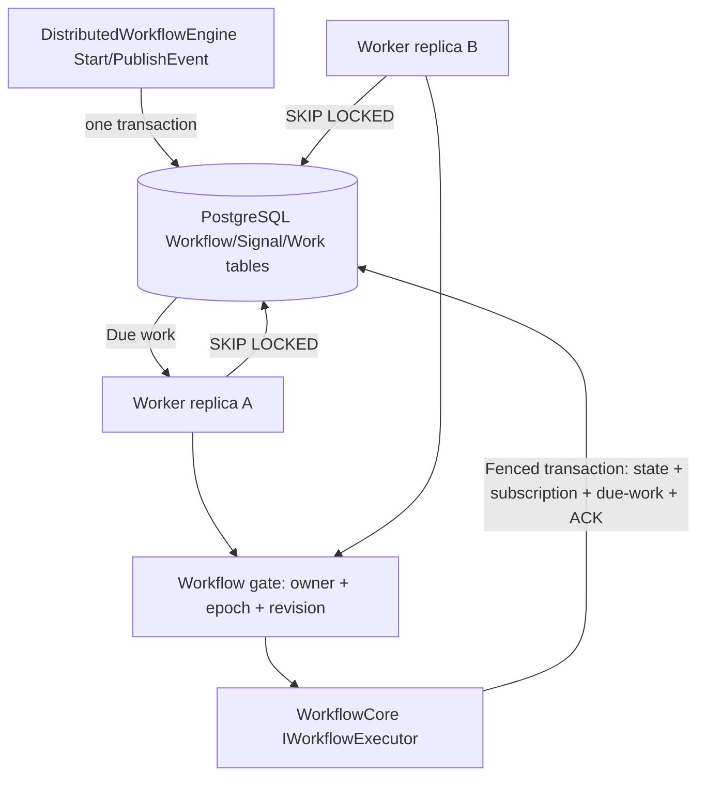

# Distributed Workflow Core runtime (PostgreSQL)

> **Full documentation:** [Architecture, design decisions, persistence, APIs, operations, deployment, testing, and risks](docs/README.md).

This branch introduces a **new .NET 10-only execution runtime** for Workflow Core.
It intentionally does not preserve compatibility with the legacy queue/lock
contracts. The original engine, workflow definitions, and execution pointers
are reused, but workers must never run the old background consumers alongside
the new `DistributedWorkPump`.

## Architecture



## Setup

1. Provide PostgreSQL 17 or newer. Apply EF migrations from the original
   `WorkflowCore.Persistence.PostgreSQL` provider and the new SQL files in order:
   `scaling/sql/002_distributed_runtime.sql`,
   `scaling/sql/003_signal_delivery.sql`,
   `scaling/sql/004_request_dedupe.sql`,
   `scaling/sql/005_execution_history.sql`.
2. Add project reference to `src/providers/WorkflowCore.Scaling.PostgreSQL`.
3. Configure DI:

```csharp
builder.Services.AddDistributedWorkflowCore(connectionString, options =>
{
    options.Concurrency = 16;
    options.MaxAttempts = 12;
});
```

4. Register workflows through `IWorkflowHost.RegisterWorkflow<T>()`
   without calling `IWorkflowHost.Start()`. Start the .NET Generic Host
   to run the new hosted `DistributedWorkPump`.
5. Start using `DistributedWorkflowEngine.StartAsync`,
   `PublishEventAsync`, and `ChangeStatusAsync`. Supply an optional
   idempotency key to StartAsync/PublishEventAsync to safely retry client calls.

Do not call legacy `IWorkflowHost.StartWorkflow`, `PublishEvent`, or
`Start` on this deployment: these paths bypass the transactional ledger.

## Execution history

The distributed runtime now journals workflow and step lifecycle events in
`wfc_scale.execution_history`. Use the `ExecutionHistoryReader` registered in
DI to query by workflow ID with an exclusive, monotonically increasing cursor:

```csharp
var reader = services.GetRequiredService<ExecutionHistoryReader>();
var page = await reader.ReadAsync(workflowId, afterId: 0, limit: 100);
var nextCursor = page.Count == 0 ? 0 : page[^1].Id;
```

A `StepAttemptDispatched` entry is written and committed **before** invoking
the executor; a corresponding `StepAttemptCommitted` appears only when the
workflow/pointer updates and queue ACK succeed. A dispatch without a commit
means an **unknown** outcome, not definitely a failed step. External side
effects are still at-least-once; the journal is not Temporal-style replay.
Details intentionally omit workflow data, payloads and exception messages.

See [execution history semantics](docs/execution-history.md) for caveats,
query and retention guidance.

## Guarantees

* Atomic creation of workflow and work item.
* Concurrent work claims use PostgreSQL `FOR UPDATE SKIP LOCKED`.
* Leases and fencing versions reject stale workflow commits.
* Workflow execution mutations, subscriptions, errors, follow-up dispatch and
  work acknowledgement share a single EF PostgreSQL transaction.
* Expired leases are reclaimed. After maximum attempts work enters dead-letter
  state (3) for operator intervention.
* Event delivery is deduplicated per event/subscription and replays previously
  received events when a new subscription is created.

This is **at-least-once**, not exactly-once external execution. Provisioning
steps must use idempotency keys and reconcile uncertain external outcomes.
No multi-region active/active deployment is supported.

## Test

```bash
dotnet test tests/WorkflowCore.Scaling.PostgreSQL.Tests/WorkflowCore.Scaling.PostgreSQL.Tests.csproj
```

The GitHub Actions workflow supplies PostgreSQL and applies SQL migrations.
A dedicated PostgreSQL schema is recommended for each performance benchmark.

## Deployment caveats

* Branch is under development and must pass CI and failure-injection tests
  before being used for production traffic.
* Do not run legacy and v2 hosts against the same workflow rows.
* Existing legacy runtime definitions can be registered unchanged, but
  cross-runtime migration of live workflow instances is NOT implemented.
* Serializer uses Workflow Core's Newtonsoft type metadata; restrict
  deserialization types and never ingest untrusted payloads without validation.

## Operations

Use `FencedWorkQueue.GetStatsAsync("workflow")` and
`GetStatsAsync("event")` to inspect backlog, in-flight leases, dead letters,
and oldest ready-work age. Dead letters are terminal until an authorized
operator calls `RequeueDeadAsync(workId)`. Replayed steps may perform external
actions again; reconcile provisioning state before replay.
