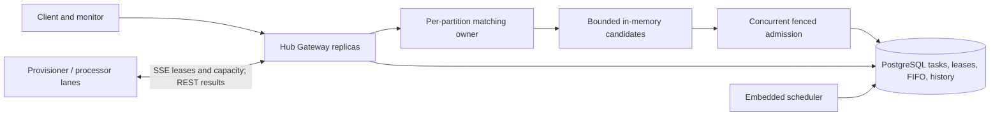
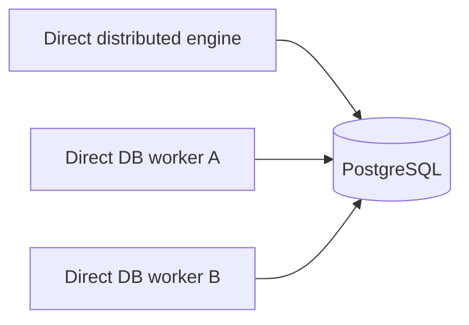

# Distributed Workflow Core runtime (PostgreSQL)

## Isolated .NET project layout

All **new** .NET projects added after upstream `master` live under `scaling/`.
The original Workflow Core projects remain untouched under repository `src/` and `test/`.

```text
scaling/
├── WorkflowCore.Scaling.slnx       # scaling projects
├── src/                            # Hub, Gateway, Telemetry, PostgreSQL runtime
├── tests/                          # PostgreSQL integration tests
├── monitor/                        # Monitoring UI and development API host
└── sample/
    └── onboarding/                 # Gateway host, Processor and Provisioner, API, samples, load test
```

Build the new projects without loading the upstream solution:

```bash
dotnet build scaling/WorkflowCore.Scaling.slnx -c Release
dotnet test scaling/tests/WorkflowCore.Scaling.PostgreSQL.Tests/WorkflowCore.Scaling.PostgreSQL.Tests.csproj -c Release
```

The `scaling/src` projects reference original Workflow Core assemblies from
`src/`; assembly names, namespaces, HTTP endpoints, and Docker service names
are unchanged. Build/deployment paths in CI, scripts, and Compose are updated.


> **Start here:** [Primary distributed Hub architecture](docs/current-runtime.md).
> Hub-owned bounded candidate matching and owner-fenced SSE lease delivery
> are the selected runtime; PostgreSQL remains the durable authority.

## Main architecture



The default development target uses **two Hub replicas, four matching shards,
PostgreSQL-backed fenced claims and SSE worker assignments**. Older claim
polling code remains an emergency rollback path rather than a parallel
recommended design.

```bash
make obs-setup
make obs-up
make ups-16              # 16 processor containers
make obs-matcher-failover # three owner-crash windows, isolated test databases
```

Detailed [runtime behavior and failure recovery](docs/current-runtime.md),
[native workflow authoring](docs/hub-native-fluent-runtime.md),
[operations dashboard](docs/operations-dashboard.md) and
[documentation index](docs/README.md) are maintained separately.

## Legacy direct-PostgreSQL runtime (not the Hub default)

The older `DistributedWorkPump` mode allows workers to access PostgreSQL
directly. Its database locking and executor setup differ from the Hub-native
runtime; do not run it against the same rows as the Hub runtime. The remaining
sections preserve its setup and historical semantics as reference material.



## Setup

For a complete cross-platform local database + API + monitoring UI bootstrap,
run `pwsh -NoProfile -File ./scripts/dev.ps1 up` from the repository root.
GNU Make remains an optional shortcut (`make up`). See the
[monitor setup guide](monitor/README.md) and `pwsh ./scripts/dev.ps1 help`.

1. Provide PostgreSQL 17 or newer. Apply EF migrations from the original
   `WorkflowCore.Persistence.PostgreSQL` provider and the new SQL files in order:
   `scaling/sql/002_distributed_runtime.sql`,
   `scaling/sql/003_signal_delivery.sql`,
   `scaling/sql/004_request_dedupe.sql`, and
   `scaling/sql/005_execution_history.sql`.
   Current Hub deployments apply migrations 006 through
   `scaling/sql/027_hub_ready_claim_indexes.sql` and
   `scaling/sql/029_hub_partition_candidate_indexes.sql` in numeric order, as
   configured in Compose and `scripts/dev.ps1`. Migration 029 does not enable
   candidate matching. Migrations 015–019 add activity
   ordering and matching ownership/hints; 020–027 add reconciliation and claim indexes.
   The experimental 028 index is installed only when
   `WFC_HUB_INSTALL_SHARD4_READY_INDEX=true`; existing indexes are retained.
   See the [ordered merge experiment](docs/hub-ordered-capability-merge-experiment.md)
   and [snapshot contract reuse investigation](docs/snapshot-contract-reuse-throughput.md).
   Migration 014 enables transaction-committed cross-pod work-ready hints;
   2-second PostgreSQL reconciliation continues to recover missed hints.
2. Add project reference to `scaling/src/WorkflowCore.Scaling.PostgreSQL`.
3. Configure DI:

```csharp
builder.Services.AddDistributedWorkflowCore(connectionString, options =>
{
    options.Concurrency = 16;
    options.MaxAttempts = 12;
});
```

4. Register workflows through `IWorkflowHost.RegisterWorkflow<T>()`
   without calling `IWorkflowHost.Start()`. Start the .NET Generic Host
   to run the new hosted `DistributedWorkPump`.
5. Start using `DistributedWorkflowEngine.StartAsync`,
   `PublishEventAsync`, and `ChangeStatusAsync`. Supply an optional
   idempotency key to StartAsync/PublishEventAsync to safely retry client calls.

Do not call legacy `IWorkflowHost.StartWorkflow`, `PublishEvent`, or
`Start` on this deployment: these paths bypass the transactional ledger.

## Guarantees

* Atomic creation of workflow and work item.
* Concurrent work claims use PostgreSQL `FOR UPDATE SKIP LOCKED`.
* Leases and fencing versions reject stale workflow commits.
* Workflow execution mutations, subscriptions, errors, follow-up dispatch and
  work acknowledgement share a single EF PostgreSQL transaction.
* Expired leases are reclaimed. After maximum attempts work enters dead-letter
  state (3) for operator intervention.
* Event delivery is deduplicated per event/subscription and replays previously
  received events when a new subscription is created.
* Append-only [execution history](docs/execution-history.md): durable step-start
  attempts plus outcome and pointer transitions in fenced state commits.

This is **at-least-once**, not exactly-once external execution. Provisioning
steps must use idempotency keys and reconcile uncertain external outcomes.
No multi-region active/active deployment is supported.

## Test

```bash
dotnet test scaling/tests/WorkflowCore.Scaling.PostgreSQL.Tests/WorkflowCore.Scaling.PostgreSQL.Tests.csproj
```

The GitHub Actions workflow supplies PostgreSQL and applies SQL migrations.
A dedicated PostgreSQL schema is recommended for each performance benchmark.

## Deployment caveats

* Branch is under development and must pass CI and failure-injection tests
  before being used for production traffic.
* Do not run legacy and v2 hosts against the same workflow rows.
* Existing legacy runtime definitions can be registered unchanged, but
  cross-runtime migration of live workflow instances is NOT implemented.
* Serializer uses Workflow Core's Newtonsoft type metadata; restrict
  deserialization types and never ingest untrusted payloads without validation.

## Monitoring dashboard

[Operations dashboard architecture and metric definitions](docs/operations-dashboard.md).


A new read-only [Next.js workflow monitor](monitor/README.md) adapts the
MIT-licensed Shadcn Studio AdminCN Free theme and provides filtered workflow
runs, KPI summaries, a Temporal-style step-attempt waterfall, append-only event
history, current pointer state, persisted errors and work-queue diagnostics.
The sample monitor API is **development-only** and requires authentication and
tenant isolation before public or multi-tenant deployment.

## Operations

Use `ExecutionHistoryStore.ReadAsync(workflowId, afterHistoryId, take)` to inspect
per-workflow step attempts, committed outcomes, status changes and signal delivery.
The benchmark API also exposes `GET /api/workflows/{id}/history` (dev-only).

Use `FencedWorkQueue.GetStatsAsync("workflow")` and
`GetStatsAsync("event")` to inspect backlog, in-flight leases, dead letters,
and oldest ready-work age. Dead letters are terminal until an authorized
operator calls `RequeueDeadAsync(workId)`. Replayed steps may perform external
actions again; reconcile provisioning state before replay.
