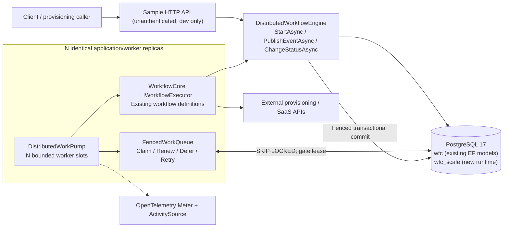
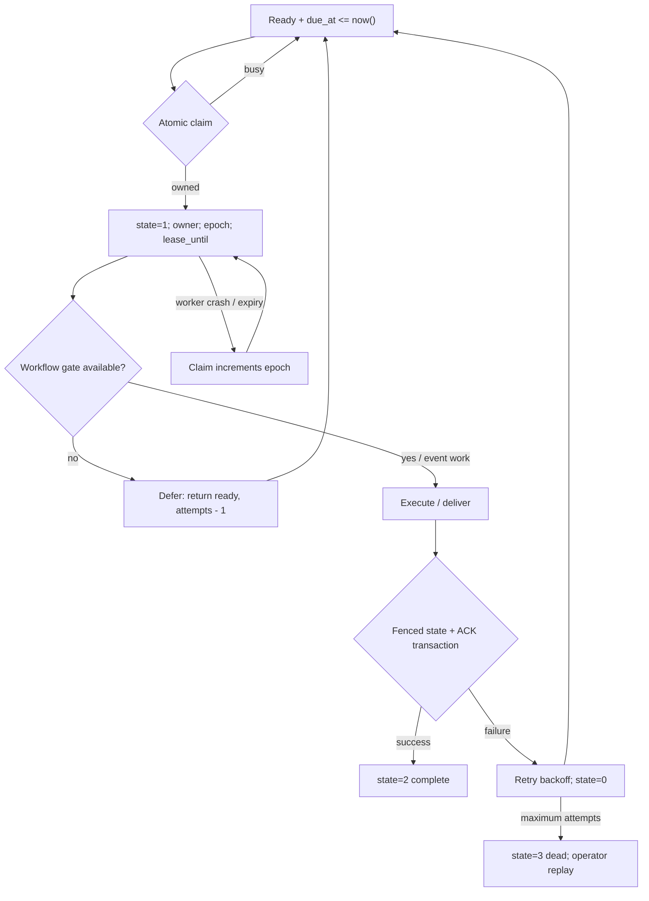

# Architecture: PostgreSQL-distributed Workflow Core runtime

## 1. Purpose and scope

Support several .NET 10 worker replicas executing durable, long-running
Workflow Core definitions using PostgreSQL as the single authoritative state
and dispatch store. Optimize for deterministic ownership, crash recovery and
simple deployment. The new design intentionally **does not implement** the
legacy `IQueueProvider` contract or wire the legacy `RunnablePoller` into
the distributed path.

The branch uses a **database-polling worker pool**, not a distinct scheduler,
partition controller, RabbitMQ service or Temporal-like task matcher. Desired
separate scaling planes are future options, not implemented features.

## 2. Context and containers

Notes:
- The API and workers may run in the same process (sample) or be hosted in
  separate independently scaled deployments using the same registered runtime.
- `DistributedWorkPump` is the **only** new worker loop. `AddDistributedWorkflowCore`
  switches off legacy workflows, events, index consumers, polling and lifecycle publisher.
- The legacy `IWorkflowHost` is retained only for definition registration; do not
  invoke its original lifecycle, event or workflow submission methods.
- There is currently **no separate index queue** for the new runtime.
- All worker replicas share one writable PostgreSQL primary; cross-region
  active/active execution is not supported.

## 3. Responsibilities

| Component | Code location | Responsibility |
|---|---|---|
| `DistributedWorkflowEngine` | `scaling/src/WorkflowCore.Scaling.PostgreSQL/DistributedWorkflowEngine.cs` | Create workflow/event intents, execute pointers, apply state transitions under fencing, deliver signals |
| `FencedWorkQueue` | `.../FencedWorkQueue.cs` | Atomic batch claim; queue and workflow leases; renew/defer/retry; dead-letter exhausted items |
| `DistributedWorkPump` | `.../DistributedWorkPump.cs` | Hosted bounded slot loops, polling, heartbeat, backoff, metrics/tracing |
| `WorkQueueAdministration` | `.../WorkQueueAdministration.cs` | Queue counters, oldest ready age, manual dead-letter requeue |
| `PostgresContext` | Existing `WorkflowCore.Persistence.PostgreSQL` | Original workflow pointers/subscriptions/errors schema |
| Existing `IWorkflowExecutor` | `src/WorkflowCore/Services/WorkflowExecutor.cs` | Step execution and progression with existing DSL |
| `wfc_scale` tables | `scaling/sql/002..004` | Work-item state, gates, durable events, delivery markers, idempotency keys |

## 4. Scaling behavior

Each replica starts `DistributedRuntimeOptions.Concurrency` asynchronous
slots. Each slot polls one of the `workflow` or `event` queues. The scheduling
loop gives a first attempt to events every fourth iteration; it is a heuristic,
**not a fair-queue or per-tenant quota guarantee**.

`ClaimAsync` selects eligible work items with `FOR UPDATE SKIP LOCKED` and
updates `owner`, `epoch`, `attempts` and `lease_until`. It uses the PostgreSQL
database clock. The queue can be shared by replicas without an external lock
manager. The same work item can be executed again after lease expiration.

Workflow items additionally acquire a `workflow_gate` row using
`AcquireWorkflowAsync`. The gate provides a single eligible writer and a
monotonically increasing `epoch`/ `revision` test for workflow state commits.
Event items claim the event queue, then acquire the gate of each affected
workflow when applying a subscription. Contention yields a deferral instead
of charging a failure retry.

**Throughput bottlenecks still exist:** a single PostgreSQL writer, per-step EF
hydration of execution pointers, event subscription scans, and no tenant-aware
admission control. No published capacity/latency claim is justified by the
current integration suite.

## 5. Failure and ownership model

The graph is conceptual. In the code, an expired item at maximum attempts is
marked dead by `DeadLetterExhaustedAsync`, which runs opportunistically from
one worker slot approximately every 100 idle iterations. This is **not** a
dedicated always-on sweeper.

An externally successful activity can still repeat after worker loss before
state commit. The system guarantees **at-least-once attempts**, never
exactly-once remote effects.

## 6. Boundaries and non-goals

- No transactional broker outbox, external broker, leader election, partition
  assignment or deterministic multi-region arbitration.
- No automatic migration of live legacy workflow instances.
- No guarantee of strongly ordered delivery for concurrent heterogeneous
  events and subscriptions; ordering code requires more stress testing.
- No cluster control-plane API, tenant quotas, automatic purging, retention
  sweeper or backpressure integrated with PostgreSQL load.
- No claim that one host can execute the old and new runtime safely against
  the same workflow tables.

For production blockers see [Production readiness](production-readiness.md).
