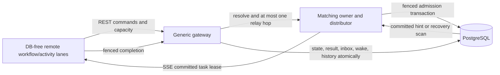
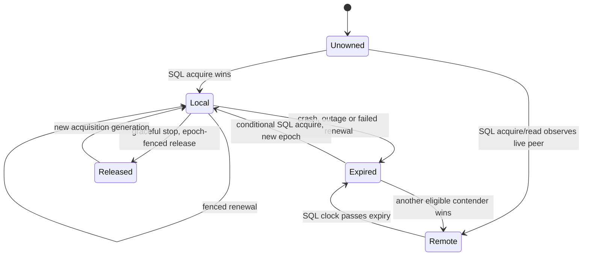

# Ownership recovery and scaling design

Status: reproduced SSE recovery defect and targeted implementation; experimental runtime. This document separates
required recovery work from evidence-gated matching and deployment proposals.

## Baseline and boundaries

The authorized prerequisite merge is `dcdab7bdf0c4c6b9566463d652c06da687316a64`:
master `eef381e118cbf69b06667af478d555bee4215573` plus committed feature history
through `fb3c79eaec2fe6392e898af1e58545fc8c9867cd`. No uncommitted source changes
were imported. The local implementation brief is retained. Historical untracked
documentation and measurements are snapshotted in
[evidence](cadence-inspired-evidence/) with SHA-256 manifest and source status.
Old images are not proof of correspondence with that source tree.

This work owns `HubMatchingOwnership`, routing endpoints and ownership tests and
telemetry. Terra owns resource eligibility/hot-key handoff, generic hint fanout,
admission diagnostics and business resource keys in the separate
`../sse-resource-handoff-implementation` checkout. Its design was reviewed read
only. Its validation document and implementation can advance independently;
neither is evidence that its branch has been integrated here. Avoid changing
`HubEventGatedClaimDispatcher`, admission SQL or key policy in this work.
Telemetry additions must be additive to accommodate Terra's metrics and views.

## Actual architecture and authority

| State | Authority and lifetime |
| --- | --- |
| Workflow partition, revision, snapshot, history, inbox, timers | Durable PostgreSQL; unchanged by owner turnover |
| Task readiness, execution owner/epoch/expiry, attempts | Durable PostgreSQL; independently fenced from matching ownership |
| Resource capacity, constraints, sequence/FIFO | Durable PostgreSQL; task and sorted resource locks enforce admission |
| Matching topology | Persisted per namespace; mismatch rejects, never silently remaps |
| Matching owner URL, ID, epoch, expiry | PostgreSQL lease row; SQL clock and conditional update decide authority |
| Local tracked ownership | Advisory renewal state; cannot authorize claims by itself |
| Preferred peer | Deterministic affinity hint; cannot prevent takeover of an expired row |
| Worker lane reservations, session/credit IDs, waiting demand | Ephemeral and bounded; disconnect cannot release uncertain execution leases |
| Readiness notifications | Transaction-committed hints; periodic durable scans recover missed delivery |

The task store locks candidates, checks due/attempt/status/capability/partition
predicates, locks resources in sorted order and checks capacity and FIFO before
committing a lease. The distributor checks captured owner epoch before and after
claim and emits only committed leases. Completion checks the task execution
lease and workflow revision and commits effects/history together. Owner loss
does not release resource permits held by live task execution leases. Arbitrary
legacy workflows are not assumed supported by the remote execution slice.

## Causal hypotheses and lab

The historical incident (expired shards 1/3, repeated 503, 41 unfinished
workflows) lacks continuous tracing. No root cause is assumed. Inspect and
experiment with: preferred peer unreachable versus HTTP rejection versus slow
headers; routing stale between resolve and relay; retry cancellation; owner
renew/acquire races; peer URL/DNS/configuration; DB outage; and old owner resume.
The prerequisite code has no owner routing cache: every resolution reads PostgreSQL.
The sharded background loop renews already tracked local leases, while requests
drive new acquisition. SSE preferred forwarding catches connection errors but
returns after HTTP rejection. Its header wait has no dedicated deadline. These
are candidates to reproduce, not yet the historical cause.

`scaling/observability/benchmark/owner_recovery_lab.py` creates only resources
named `cadence-owner-20261109-*`, network `cadence-owner-20261109`, retained volume
`cadence-owner-20261109-pg`, loopback ports 25200/25201/25210/25440. It fails rather
than resetting an existing lab. Four DB-free processors have independent 8-slot
workflow/activity lanes and four matching shards. Both Hubs use 8-second leases,
2-second renewal, event-gated matching and the existing broad release hints.
Remote workers have no database credentials. Fixed credentials are lab-only.
Other projects and terminals must remain untouched.

Trace each experiment with monotonic elapsed time, wall UTC and DB UTC; sample
owner ID/epoch/expiry at least each second, preserve both Hub and worker/LB logs,
correlate HTTP outcomes, session establishment/rejection and first durable task
claim and completion. Keep the failed process stopped for the observation
window; restart is recorded after the window. Separate detection, expiry,
acquisition, routing, reconnect, first dispatch and first completion. Validate
persisted business snapshots/history/attempts, not just successful health checks.
Build and identify baseline/modified images; use the same topology/configuration.
Eight seconds is a lease setting, not a recovery SLO.

## Correction gate

Only a reproduced path can justify a runtime correction. Preserve SQL authority
and exact owner epoch validation. Candidate correction boundaries are bounded
header routing, HTTP rejection fallback before response start and a coalesced
owner lifecycle independent of relay success where demonstrated. No route
failure permits stealing a live SQL lease. Any election must be bounded per
namespace/shard with jitter/backoff, and any routing mapping must expire and be
revalidated. Graceful stop retains fenced release. Database failures fail closed.
Metrics use bounded outcome/operation dimensions; IDs belong in diagnostic logs.

### Reproduced cause and selected correction

Fresh baseline hard kills left the dead owner's two shards expired through the
85-second windows. The diagnostic-only image (`d6f041f5`) showed
`TaskCanceledException` with inner `TimeoutException` from the configured
`SocketsHttpHandler.ConnectTimeout`. The SSE preferred-peer branch caught only
`HttpRequestException`; its outer handler translated this timeout into 503,
so every retry skipped acquisition. The long-poll path already catches timeout.
This is a demonstrated failure mechanism consistent with the older incident;
the older incident itself still lacks exception traces.

The correction handles a pre-header transport timeout independently of caller
cancellation. A rejected HTTP response leaves the downstream response untouched
and also permits fallback. Header resolution has a three-second bound, while
accepted SSE body streaming remains unbounded and cancellable by its client.
Once downstream headers start, failure aborts the stream; it never elects and
dispatches on the same partially delivered response. A live SQL owner is never
stolen because its transport failed. An expired/unowned preferred route tries
one relay, then one conditional SQL election. Fixed 64 election stripes
serialize acquisitions and reread the winning lease; a fixed 64-slot negative
preferred-route hint backs off for a jittered 2–4 seconds. It caches neither
authority nor a positive owner mapping. No timer changes or schema migration.

Renewal updates/removals also compare the captured local lease value, avoiding
an old renewal response erasing a newer local generation. This is defensive
concurrency hardening, not the measured timeout cause. Matching remains
request-driven: an idle namespace with no subscribers or requests needs no
elected owner. Graceful shutdown retains SQL epoch-fenced release; hard crashes
rely on expiry. A separate acquisition background service is not justified by
the demonstrated request-path failure.

New bounded metrics are ownership changes (`outcome=acquired|lost`), resolution
failures (`reason=peer_http|route`), route fallback count, worker stream reconnect
attempts and session-to-first-successful-flush duration with explicit latency
buckets. The last metric includes idle time and excludes sessions that never
dispatch; it is not a failover-duration or exact eligible-wait metric. Correlate
DB UTC and monotonic lab traces for recovery timelines. Optional
`WFC_HUB_OWNER_DIAGNOSTICS=true` logs route exceptions with namespace/shard/node;
no task payloads, tokens or resource keys are logged. Disable after investigation.

## Matching gate and Terra composition

Cadence's [flow](https://github.com/cadence-workflow/cadence/blob/master/docs/flow.md)
shows synchronous pairing with waiting pollers and persisted fallback. Here the
equivalent is committed readiness, compatible one-shot worker credit, durable
transactional admission, SSE delivery, then scan recovery. It never permits
volatile-only enqueue or bypass of resource/FIFO predicates. Historical means
and created-task waiting do not prove avoidable rediscovery. Terra's generic
hint capability routing overlaps this gate and must be evaluated first. No
second release channel, candidate cache or direct-task path is justified yet.
Future acceptance must cover lost/duplicate hints, rollback, stale heads,
expired execution leases and cross-shard multi-resource constraints.

The completed normal-path trials retain 32 active SSE sessions and show variable
throughput across repeated 200-workflow cohorts. Candidate-query means alone
do not attribute that variance to rediscovery; created-to-lease includes policy
blocking. With notifications disabled, the keyed cohort still completes through
durable scans. These findings close phase C without a complementary fast path.
Phase D is also closed for this delivery: sampled inter-Hub connections include
control traffic, and no sustained connection, relay, CPU or pool limit was
demonstrated. The following plan is a conditional migration decision.

## Queue and deployment gate: proposed migration, not implemented

Logical task queues could be separate from immutable workflow placement, scoped
by namespace, queue ID, lane, activity version and workflow-definition version.
Persist queue identity/version on new tasks without moving workflow partitions;
existing NULL queue rows retain legacy routing. Owners would lease queue slices,
while global resource rows and durable sequence continue cross-queue admission.
A versioned subscription can multiplex shard streams with the same lane-wide
credit bound. Resume requires fresh session/owner validation, never implicit
replay of consumed credits. Old workers keep their default routing and new
workers must explicitly advertise queue support. Duplicate/lost delivery keeps
normal task-lease recovery. Backlog cannot become invisible at a cutover.

Migration sequence: add nullable queue columns and index online; deploy readers
that understand both versions; register immutable routing metadata under an
optimistic revision; enable new writes for an opt-in new definition version;
drain old rows while serving both; retire legacy only after backlog and attempts
are empty. Rollback disables new writes and keeps dual readers until new-format
rows drain; a configuration toggle alone cannot undo persisted routing.
Never change matching shard count in a live namespace without a migration.

Triggers to revisit: repeated sustained measurements of connection/relay budget
exhaustion, empty-credit overhead, admission DB work per completion, queue wait
with compatible free capacity, CPU or pool saturation attributable to competing
roles. Record p50/p95/p99, session count, relay count, task identity/version skew
and backlog age before setting thresholds from an operational budget. First
separate gateway/routing, demand matching, state admission and timer roles inside
the current host. Independent deployment requires demonstrated contention and
the same failover/transaction tests. No broker, etcd, storage sharding or service
split is authorized merely by analogy.

Cadence [topology](https://cadenceworkflow.io/docs/concepts/topology/) separates
frontend, matching and history responsibilities; its
[persistence](https://github.com/cadence-workflow/cadence/blob/master/docs/persistence.md)
requires transactional durable state. Its optional
[Shard Manager integration](https://cadenceworkflow.io/docs/shard-manager/in-cadence/)
is off by default; the [architecture](https://cadenceworkflow.io/docs/shard-manager/architecture)
uses etcd for that subsystem. These references, verified 2026-11-09, inform role
boundaries, not a dependency for this PostgreSQL runtime.

## Delivery and rollback

Prerequisites remain isolated in the merge commit. Diagnostics, reproduced fix
and evidence should be separate changes. Roll out to an isolated lab first,
then a canary with unchanged topology and task contracts, monitor bounded
resolution/ownership/reconnect/progress metrics and DB cost. Roll back Hub
binaries after draining streams; retain tasks/leases/history and allow fenced
expiry/reconnect. No database reset or schema change is required for routing.
Terra must compose its changes on the same SSE prerequisite and rerun the
combined recovery/FIFO/session/credit suites before claiming joint validation.
