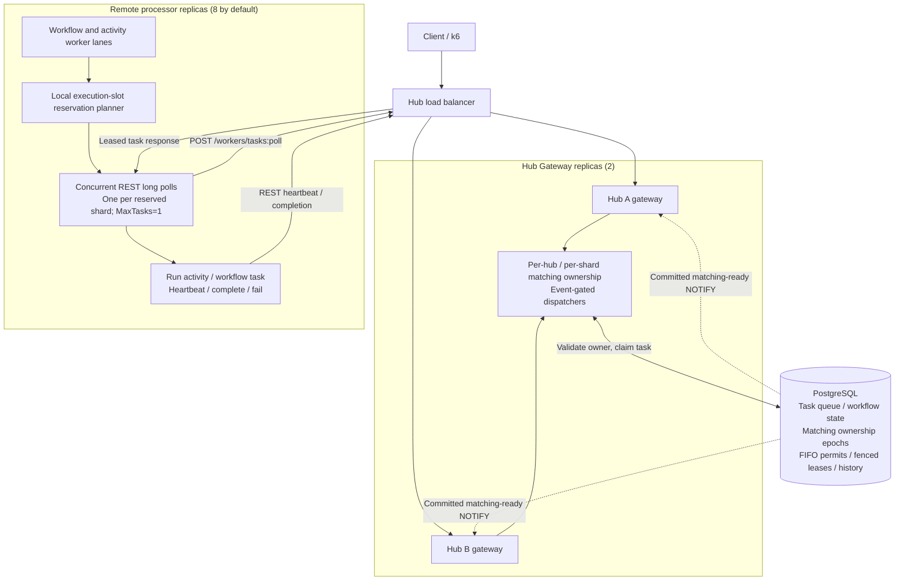
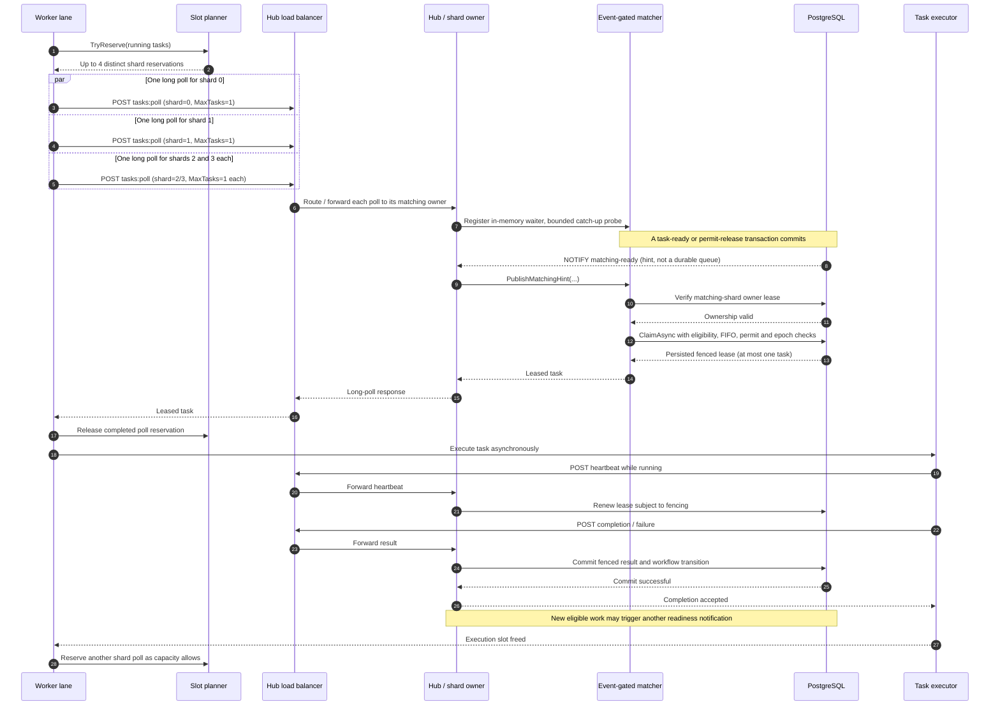
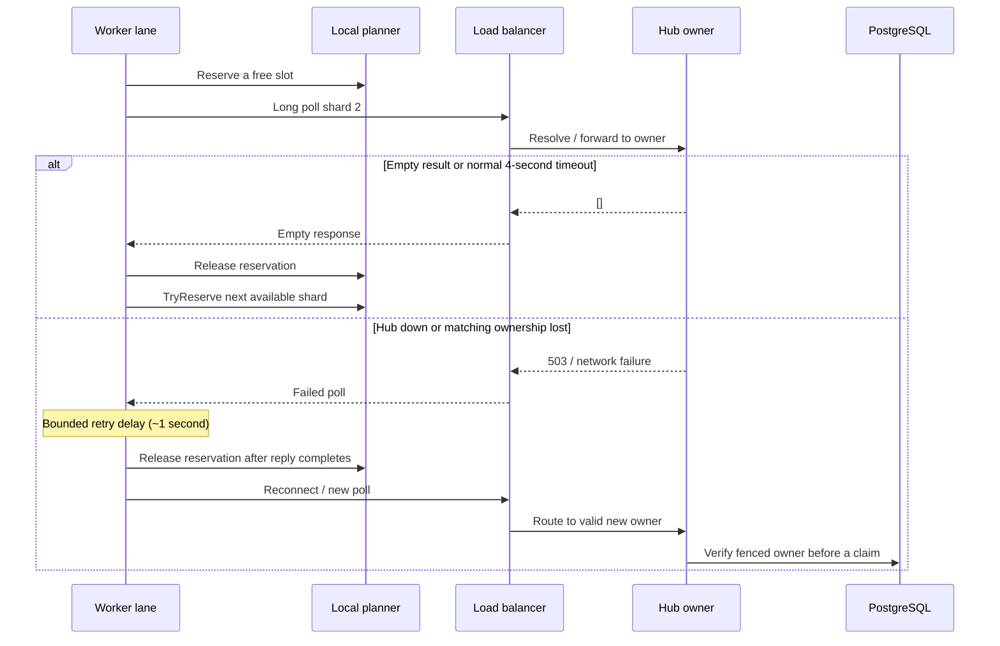

# Capacity-aware matching: architecture and sequence diagrams

**Scope:** [PR #28](https://github.com/thanhhaictld/workflow-core/pull/28), derived from PR #27 including PostgreSQL optimization migrations 020–022. These diagrams explain the **task delivery/matching path**, not a change to workflow definitions. **Fanout is experimental and default OFF**.

## 1. High-level topology



*The matching box is a logical responsibility within Hub replicas, **not another standalone service or a single global lock**. Each matching shard has its own PostgreSQL-fenced owner, potentially a different replica. The load-balanced Gateway forwards polls to the current matching owner.*

## 2. Successful task dispatch and completion



Other polls can remain outstanding while the returned lease executes. Completion is not a separate delivery ACK: the worker already uses the existing HTTP heartbeat and completion protocol.

## 3. The worker's capacity invariant

```text
execution slots = 8
max concurrent shard polls = min(4, 8, matching_shards)
each outstanding poll reserves one slot and uses MaxTasks=1

running_tasks + reserved_polls <= execution_slots
```

Example: if 6 tasks are executing, at most 2 shard polls may remain outstanding. The local planner tracks which shards have a reserved poll, ensuring one outstanding poll per shard **per worker lane**. This is not a global per-shard concurrency limit; multiple worker replicas may poll the same matching owner.

| Running tasks | Reserved polls | Unreserved free slots |
|---:|---:|---:|
| 0 | 4 | 4 |
| 3 | 4 | 1 |
| 6 | 2 | 0 |
| 8 | 0 | 0 |

## 4. Timeouts, retries and Hub ownership changes



The diagram simplifies errors; in code, transport errors are logged and bounded by a one-second delay. A task already leased in PostgreSQL **does not become available immediately when its HTTP connection fails**. Lease expiry/fencing and existing recovery control reassignment. A missed NOTIFY is recovered by matching catch-up probes and periodic PostgreSQL readiness reconciliation.

## 5. Configuration and limitations

```powershell
make obs-setup
# Edit scaling/observability/.env to set suitable secrets.
make obs-offboarding-fanout-up
make obs-offboarding-fanout-ps
make obs-offboarding-fanout-logs
make obs-offboarding-fanout-test
make obs-offboarding-fanout-down
```

The Make targets combine `compose.yaml`, `compose.matching-ha.yaml` and `compose.matching-shards.yaml`, set the matching/event-gated/fanout flags, and use `pwsh` as Make's recipe shell. Fanout is active only for **single-Hub worker lanes with >1 matching shard**. Multi-Hub worker lanes continue the adaptive REST/SSE fallback. There is **no gRPC push, durable worker-credit service, delivery ACK protocol or new task queue**.

**Tradeoffs:** More simultaneous HTTP waiters and individual one-task claims can increase PostgreSQL transactions per workflow and host CPU. The first CI A/B benchmark found promising unordered and keyed-FIFO throughput, but shared runner CPU approached saturation; see [investigation and measured results](capacity-aware-matching-experiment.md). Do not infer dedicated-host scaling or promote the flag from one run.

**Relevant source:** `scaling/src/WorkflowCore.RemoteExecution/HubRuntimeWorkers.cs`, `HubShardCapacityPlanner.cs`, `scaling/src/WorkflowCore.Hub.Gateway/HubEventGatedClaimDispatcher.cs`, `HubTaskMatcher.cs`, `HubGatewayEndpoints.cs`, `PostgresHubNotificationListener.cs`, `HubReadinessBroadcaster.cs`.
