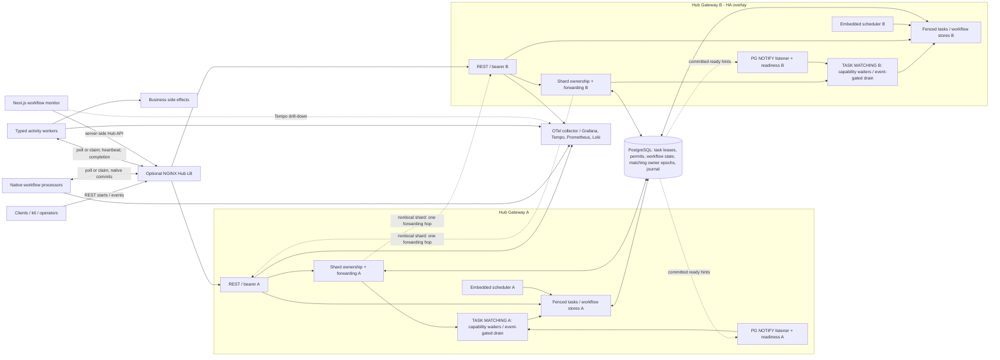
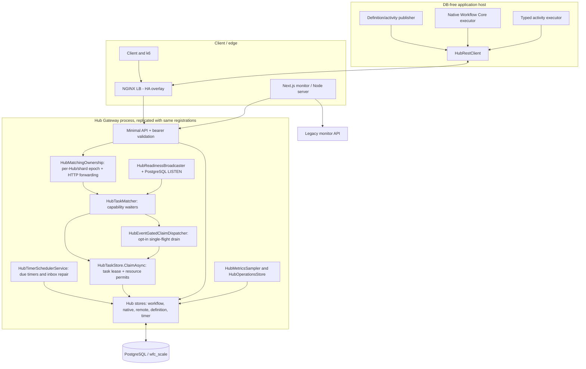
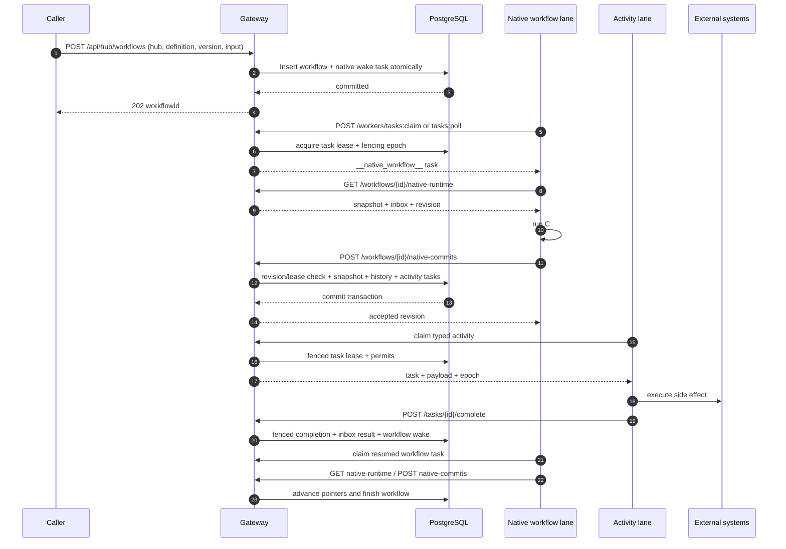
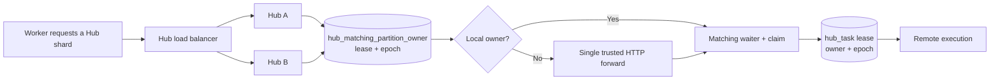
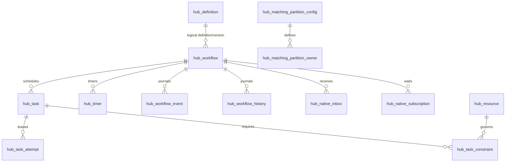
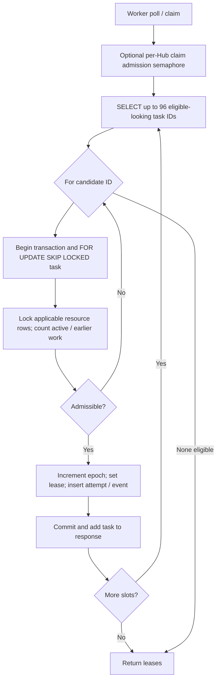
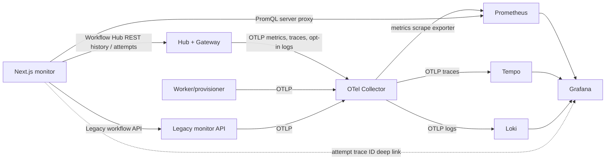

# Distributed Workflow Core — as-built system architecture

> **Source snapshot:** `thanhhaictld/workflow-core` at commit `e1feb9fbc0ce557a806c5f342c8561d5c1730a94` (head of [PR #23](https://github.com/thanhhaictld/workflow-core/pull/23), 2026-11-07). This document describes code present at that commit, **not** a target-state design. The PR stack is unmerged. The [older architecture](architecture.md) covers the separate direct-PostgreSQL scaling runtime.  
> **Verification methodology:** read the standalone hosts, service registrations, Hub Gateway endpoints, stores, worker/executor code, SQL migrations 002–020, Next.js routes and Compose/CI definitions. Interpret runtime behavior from these sources. A successful CI job is not equivalent to production readiness.

## 1. Architecture at a glance

The fork contains **two distinct distributed execution paths**, plus upstream Workflow Core:

| Path | Who evaluates workflow code? | Who can reach PostgreSQL? | Main purpose | Status in this snapshot |
|---|---|---|---|---|
| **Upstream Workflow Core** (`src/`) | Original Workflow Core host/executor | Provider-host-dependent | Existing upstream framework | Retained |
| **Direct PostgreSQL distributed runtime** (`scaling/src/WorkflowCore.Scaling.PostgreSQL`) | `DistributedWorkflowEngine` / work-pump workers | Worker/application hosts | Fenced direct-DB workflow execution and execution history | Implemented separately; coexists; **not** the Hub transport |
| **Hub-managed remote/native runtime** (`scaling/src/WorkflowCore.Hub*`, `WorkflowCore.RemoteExecution`) | Independent provisioner/processor hosts | **Hub Server only** for Hub-owned tables | REST-mediated workflow decisions, activities, timers, event delivery and monitoring | Main current path, evolving across unmerged PRs |

**Core rule:** Hub is the management, durable-state and admission boundary—not a host of application workflow definitions. A *workflow partition* chooses stable placement. It does **not** automatically serialize execution; only explicit policy resources do. A *matching shard* chooses an owner for worker poll routing and is different from both workflow placement and per-task fencing.

### C4-ish system context (task matching is explicit)



**How to read this:** matching lives *inside each Hub Gateway process*, not in a separately deployed matching service. On the matched path, the worker's HTTP long poll is routed to the current PostgreSQL-fenced matching-shard owner, where `HubTaskMatcher` tracks in-memory capability-specific demand. Committed readiness hints wake matching; `HubTaskStore.ClaimAsync` still makes the authoritative PostgreSQL task/permit/epoch decision. The ordinary `tasks:claim` path bypasses matching. The HA overlay runs both Hub replicas; base Compose runs only A.

The optional two-Hub load-balancer and sharded matching configuration are enabled through Compose overlays, not by the base Compose stack. The two DB nodes above represent **logical ownership/schema boundaries**; the supplied local observability Compose stack actually uses **one PostgreSQL container**.

## 2. Repository and deployment inventory

| Component | Source of truth | Deployed process / responsibility |
|---|---|---|
| Hub HTTP surface | [`HubGatewayEndpoints.cs`](../src/WorkflowCore.Hub.Gateway/HubGatewayEndpoints.cs) | REST gateway, bearer filter, workflow/task APIs, readiness/SSE, matching forwarding |
| Hub server | [`Hub.Server/Program.cs`](../src/WorkflowCore.Hub.Server/Program.cs) | Registers Gateway, Scheduler and OTel; **no business C# definitions** |
| State and admission | [`WorkflowCore.Hub`](../src/WorkflowCore.Hub/) | PostgreSQL tasks, workflow/snapshot, resource permits, fenced leases, events, timers, operations |
| Embedded timer scanner | [`HubSchedulingExtensions.cs`](../src/WorkflowCore.Hub.Scheduling/HubSchedulingExtensions.cs) | Background timer polling and inbox reconciliation; separable module but same Hub process currently |
| Hub REST transport | [`HubRestClient.cs`](../src/WorkflowCore.Hub.Client/HubRestClient.cs) | Authenticated REST for independent application hosts; no PostgreSQL dependency |
| Remote/native executor | [`WorkflowCore.RemoteExecution`](../src/WorkflowCore.RemoteExecution/) | Loads code-first definitions, runs Workflow Core decisions, activities and remote worker lanes |
| Native reference host | [`Provisioner.Host/Program.cs`](../sample/onboarding/WorkflowCore.Provisioner.Host/Program.cs) | Onboarding workflows, parallel branching, timers and typed activities; both workflow and activity lanes |
| Native-only load host | [`Offboarding.Processor/Program.cs`](../sample/offboarding/WorkflowCore.Offboarding.Processor/Program.cs) | DB-free offboarding decisions; optional ordered/unordered policy benchmarks |
| Legacy demo worker | [`Scaling.Worker/Program.cs`](../sample/onboarding/WorkflowCore.Scaling.Worker/Program.cs) | Separate sample with legacy/direct-runtime compatibility paths |
| Operations read model | [`HubOperationsStore.cs`](../src/WorkflowCore.Hub/HubOperationsStore.cs) | Backlog, blocked/ready work, queue/lease percentiles, partition and matching metrics |
| Next.js monitor | [`scaling/monitor`](../monitor/) | Unified Hub + legacy lists, native/lease waterfall, trace/history/details, operations |
| Legacy monitor API | [`monitor/api/Program.cs`](../monitor/api/Program.cs) | Existing direct-Postgres runtime and legacy workflow read/query endpoints |
| OTel instrumentation | [`HubTelemetry.cs`](../src/WorkflowCore.Hub/HubTelemetry.cs), [`HubOpenTelemetryExtensions.cs`](../src/WorkflowCore.Hub.Telemetry/HubOpenTelemetryExtensions.cs) | OTel tracing/metrics/logging, configurable OTLP export |
| Local stack | [`compose.yaml`](../observability/compose.yaml) + [HA](../observability/compose.matching-ha.yaml) + [shards](../observability/compose.matching-shards.yaml) | PostgreSQL, Hub(s), worker(s), monitor/API, Collector, Prometheus, Tempo, Loki, Grafana, k6 |

### Process-level design



**Important:** Source service names above are logical; the diagram's Hub box represents one replica, which can be duplicated for an HA experiment.

## 3. Domain model, identifiers and boundaries

- **Hub ID**: logical namespace for workflow definitions, activities, tasks and management. Currently also a bearer-protected gateway grouping, **not** a full scoped RBAC tenancy boundary.
- **Workflow definition**: key `(hub_id, definition_id, version)`. Published from application hosts into `hub_definition`; activity registration separately identifies `(hub_id, activity_type, version)` and policy/contract.
- **Workflow instance**: UUID in `hub_workflow`; contains immutable `partition_id`, execution mode, revision, status, inputs/results and optional native snapshot.
- **Workflow placement partition**: chosen from SHA-256 of workflow UUID modulo configured partition count by `HubPartitionRouter.ForWorkflow`; persists with the instance. Does not imply mutual exclusion.
- **Matching shard**: `partition_id % matching_partition_count` for claim routing. Owner records are separately fenced by epoch and renewed; sharding count is stored per Hub and immutable while live.
- **Task**: UUID and monotonic database `sequence`, with hub/partition/type/version, payload, due time, lease owner/epoch and optional workflow/step/pointer/dispatch key.
- **Resource permit**: `hub_resource` plus `hub_task_constraint` rows; optional capacity, FIFO or exclusive admission. A task lease holds actual capacity until completion/expiry.
- **Attempt**: task ID + epoch in `hub_task_attempt`; lease claim/finish timestamps and outcome, plus optional trace/span identifiers.
- **Workflow execution pointer**: Workflow Core native pointer identity, persisted in snapshot/history; enables branching, joining and event subscriptions.
- **Transport correlation**: optional W3C scheduling `traceparent` / `tracestate` on task, and attempts' `trace_id` / `span_id`. Correlation is complementary to durable execution history.

## 4. Workflow types and state ownership

### 4.1 Inline managed chain (compatibility)

`HubWorkflowStore` builds a pre-registered step chain from the in-memory `HubWorkflowRegistry`. The standalone Hub registers this registry **empty**; inline chains are retained for explicit integration/test registration. Sequential transitions are committed by `HubWorkflowStore.CompleteAsync` / `FailAsync` and release the next task.

### 4.2 Remote sequential processor

`HubRemoteWorkflowStore` persists a workflow record with `execution_mode = 'remote'`. A worker claims an internal `__workflow__` task, reads `GET /workflows/{id}/runtime`, evaluates a code-first step in its own process and POSTs one of `ScheduleActivity`, `ScheduleTimer`, or `CompleteWorkflow`. The Hub verifies the task lease and expected workflow revision within a transaction. Activity completion advances workflow state and schedules the next workflow task.

The sequential builder/compatibility path remains implemented but is **not** the primary native-fluent execution mode.

### 4.3 Native Workflow Core / fluent code (main path)

`HubNativeExecutor` invokes registered upstream `IWorkflow<T>` / Workflow Core definitions in the remote host. It uses `HubSnapshotCodec` for opaque serialized execution state, `HubActivityMiddleware` for routed typed activities, and the native life-cycle publisher for timestamped step/history events. The Hub never evaluates workflow expressions.

A native execution iteration receives an expiring `__native_workflow__` task lease, current snapshot and durable inbox. It returns a `HubNativeCommit` containing updated snapshot, pointer/subscription state, activity dispatches and history. `HubNativeWorkflowStore.CommitAsync` verifies the exact lease epoch/worker and workflow revision; atomically persists the snapshot, inbox acknowledgments, subscriptions, activity tasks, timers, event history and completion ACK. The worker can then terminate; durable state is independent of process lifetime.

### 4.4 Native workflow sequence



## 5. Durable scheduler, timers and events

- `WorkflowCore.Hub.Scheduling` is its own assembly, registered by `Hub.Server/Program.cs` in the Hub process. Defaults: `Enabled=true`, scan every `500 ms`, batch `100`, max `2` concurrent batches **per Hub instance**.
- `HubTimerStore.FireDueAsync` first performs bounded native inbox reconciliation, selects due `hub_timer` candidates and calls `FireOneAsync`.
- Firing locks **workflow first, then timer**, with `FOR UPDATE SKIP LOCKED`, verifies due/state/revision, marks timer fired or cancelled, and wakes native/remote execution in the **same database transaction**. Multiple Hub schedulers may run; database arbitration prevents double-committing a timer.
- Native `WaitFor` event state uses `hub_native_subscription`, `hub_native_event`, `hub_native_inbox` and idempotent keys; event publication matches durable subscribers under workflow locks and wakes affected instances. The periodic inbox sweep repairs missed/future-effective delivery and exhausted activity transport attempts.
- Delayed work is a durable DB wait, **not** a long-lived .NET task or OTel span. The scheduler does not execute application code.

```mermaid
sequenceDiagram
    autonumber
    participant Worker as Native / remote workflow worker
    participant Hub as Hub Gateway
    participant DB as PostgreSQL
    participant S as Embedded scheduler
    Worker->>Hub: native commit with WakeAt / ScheduleTimer
    Hub->>DB: insert timer + waiting state + revision
    Note over DB: workflow has no running worker during delay
    loop periodic scan
      S->>DB: find due timers; lock workflow then timer
    end
    S->>DB: fire timer + journal + wake workflow task (one tx)
    Worker->>Hub: claim wake task; read runtime
    Worker->>Hub: submit fenced resumed transition
```

## 6. Task matching, ownership, readiness and workers

The Hub has **two alternative worker acquisition paths**:

| Path | API | Trigger | Configuration/limitations |
|---|---|---|---|
| Adaptive direct claims | `POST /workers/tasks:claim` | Worker bounded polling, jitter/backoff after empties, optional SSE preemption | Default fallback and multi-Hub capability path |
| Demand-driven matching | `POST /workers/tasks:poll` | In-memory waiting demand, PostgreSQL committed hints + recovery probes; request forwarded to matching owner | Opt-in `WFC_HUB_MATCHING_ENABLED`, `WFC_HUB_LONG_POLL_ENABLED`; one Hub ID per poll |
| Event-gated matching variant | Same `tasks:poll` | Per-Hub/shard single-flight claim drain; coalesces readiness; empty drain waits for fresh signal | Additional opt-in `WFC_HUB_MATCHING_EVENT_GATED`; not default |

A worker lane declares supported `HubCapability` (hub, type, version) and a bounded concurrency count. The native workflow worker handles `__native_workflow__` and optional sequential compatibility `__workflow__`; the activity lane handles registered activity types. Worker claims return at most 16 tasks per request in the common loop.

**Current multi-Hub caveat:** `HubRuntimeWorker` uses matching polling only when its capabilities contain exactly one distinct Hub ID. Mixed workflow hosts fall back to adaptive claims. Sharded long polls rotate a matching partition, with approximately a **4-second server hold** per shard. This is not a global ready-queue dispatcher.

### Matching request and readiness sequence

```mermaid
sequenceDiagram
    autonumber
    participant Worker as Workflow/activity worker
    participant LB as Hub load balancer
    participant Gateway as Gateway / shard owner
    participant Matcher as HubTaskMatcher / event-gated dispatcher
    participant Ready as PostgreSQL LISTEN / readiness
    participant Store as HubTaskStore
    participant PG as PostgreSQL
    Worker->>LB: POST /api/hub/workers/tasks:poll (Hub, capabilities, shard)
    LB->>Gateway: forward HTTP to a Gateway replica
    Gateway->>PG: resolve matching shard owner + epoch
    Note over Gateway: If nonlocal, forward once to the owner Gateway
    Gateway->>Matcher: register compatible in-memory worker demand
    alt committed work-ready notification
        PG-->>Ready: NOTIFY after commit
        Ready-->>Matcher: capability/shard hint
    else bounded recovery probe
        Matcher->>PG: inspect durable ready work
    end
    Matcher->>Store: claim only on matching worker demand
    Store->>PG: SELECT candidates; lock task/permits; lease + epoch + attempt; COMMIT
    PG-->>Store: committed task leases
    Store-->>Matcher: task batch (or none)
    Matcher-->>Gateway: task batch
    Gateway-->>LB: HTTP response
    LB-->>Worker: leased tasks
    Note over Worker,PG: Worker runs separately; heartbeat and completion use ordinary REST and fenced DB updates.
```

**Matching correctness boundary:** in-memory waiters and notifications are performance optimizations, not durable task assignments. An empty matched claim can legally return no tasks; another notification/reconciliation probe drives future claims. The task lease is established only by the PostgreSQL transaction, not by matcher ownership.

### Matching HA versus task ownership



Matching ownership uses an **8-second PostgreSQL lease**, renewed about every **2 seconds**, with independent epoch fencing per `(hub_id, matching_partition)`, deterministic preferred peer, and at most one HTTP forwarding hop. This protects matching ownership, **not** the remote business task. The task still needs its separate lease/epoch (typically 45 seconds) and fenced commit.

The readiness channel uses PostgreSQL `LISTEN/NOTIFY` (advisory, after commit), an SSE endpoint for adaptive workers, and periodic recovery sweeps. Event gating suppresses the noisy 2-second sweep *for matching wakeups*, retaining a slower catch-up scan. PostgreSQL, not the in-memory channel, remains authoritative.

## 7. PostgreSQL physical data architecture

All Hub-owned tables are in `wfc_scale`. The separate direct PostgreSQL runtime also uses `wfc_scale` tables for its work queues/gates and upstream EF tables in `wfc`. Do not infer one unified state machine from the shared schema name.

### Core tables

| Table | Fields / identity | Purpose |
|---|---|---|
| `hub_workflow` | `id`, `hub_id`, `definition_id`, `definition_version`, `partition_id`, `execution_mode`, `revision`, `native_snapshot`, `native_status` | Workflow lifecycle and version/revision fencing |
| `hub_task` | `id`, `sequence`, `task_type`, `workflow_id`, `state`, `epoch`, `lease_until`, `due_at`, `dispatch_key`, `traceparent` | Durable ready, leased, complete and dead work |
| `hub_task_attempt` | PK `(task_id, epoch)`, `worker_id`, `claimed_at`, `finished_at`, `outcome`, `trace_id`, `span_id` | Durable per-lease timing and correlation |
| `hub_resource` | PK `resource_key`, `capacity`, `strict_fifo` | Admission policy resource configuration |
| `hub_task_constraint` | PK `(task_id, resource_key)` | Resource requirements per task |
| `hub_workflow_history` | workflow/step/task/event | Legacy inline and remote step history |
| `hub_workflow_event` | ordered ID, workflow, pointer/scope/attempt/event/payload | Native/remote workflow execution history |
| `hub_definition` | PK `(hub_id, definition_id, version)` | Published metadata, not executable C# |
| `hub_activity_registration` | PK `(hub_id, activity_type, version)` | Typed contract, explicit ordering, capacity, revision |
| `hub_timer` | `workflow_id`, `due_at`, `state`, `scheduled_revision` | Durable timers, exactly one accepted state transition under DB fences |
| `hub_native_inbox` | workflow/pointer/kind/source (unique) | Durable activity result and external-event inbox |
| `hub_native_subscription` / `hub_native_event` | workflow pointer; event name/key; request key | WaitFor subscriptions and retained signals |
| `hub_native_status_request` | workflow + request key | Status change idempotency |
| `hub_matching_owner` | Hub + owner/epoch/lease | Legacy one-owner matching mode |
| `hub_matching_partition_config` / `hub_matching_partition_owner` | Hub, shard, owner, epoch, lease | Stable shard-count metadata and sharded matching HA |



The last edge is a **logical application relationship**, not a claimed declared foreign-key relationship. The other diagram edges summarize the actual persisted data model; review SQL before assuming cascade-delete semantics.

### Migration groups

- `002–006`: direct-DB runtime, work queues, signals, request dedupe, history and definition versions.
- `007–009`: Hub queue/resources, managed workflow rows, lease-attempt journal.
- `010–013`: remote definitions, activity metadata, timers/events, native snapshot/inbox/subscriptions, policy revisions.
- `014–019`: committed readiness hints, explicit ordering and matching owner/shard state.
- `020`: W3C task trace context and per-attempt Tempo trace identifiers.

Compose's `migrate` service applies these additive SQL files in order; the legacy monitor API's EF migrations run separately. Migration scripts should be smoke-tested with `docker compose config` and a fresh PostgreSQL volume after any edit.

## 8. Admission and ordering guarantees

Policy modes found in code: `Legacy`, `Unordered`, `PartitionSerial`, `KeyedExclusive`, `KeyedFifo` and `KeyedBounded`.

- `Unordered` has no implicit Hub- or partition-serialization resource; it is **not** blocked simply because a task hashes to a partition.
- `PartitionSerial` creates a per-partition FIFO resource of capacity one.
- `KeyedExclusive` / `KeyedFifo` are capacity-one resources for a hashed business key; FIFO additionally blocks overtaking earlier unfinished queued tasks.
- `KeyedBounded` uses the configured key capacity without strict FIFO.
- `Legacy` retains implicit Hub/activity concurrency resource rules plus optional keyed resource. Operators can revise capacities through a revisioned API; existing resource leases remain durable.
- The claim transaction locks task rows with `FOR UPDATE SKIP LOCKED` and policy resource rows in canonical order, checks active/earlier tasks, increments the **task epoch**, writes the attempt and commits.
- The database `sequence` is admission order. It is **not** exactly-once external effect completion order: an expired worker can still perform an external side effect, so idempotency/reconciliation is required.

### Admission hot path (as implemented)



The current `HubTaskStore` still performs per-candidate transactional resource checks and may reselect candidates for each task in the requested batch. `_claimGate` allows roughly `maxPoolSize / 4` concurrent claim RPCs **per Hub process** when the admission flag is enabled. It reserves DB capacity for completion and scheduler work but can cause significant waits.

## 9. Failure model and delivery semantics

| Failure | Implemented behavior | Guarantee boundary |
|---|---|---|
| Remote worker crashes | Lease expires, work becomes reclaimable, attempt may end as `LeaseExpired` | **At-least-once** external execution, not exactly once |
| Stale completion/heartbeat | Worker ID, epoch, lease deadline and workflow revision checked; reject stale requests | No stale workflow-state commit; external side effects may still need repair |
| Duplicate client submission | Optional idempotency key for workflow/task start; payload/key conflicts rejected | Key scope and retention matter |
| HTTP completion transient error | Worker retries same frozen execution result rather than re-running body | Avoids unnecessary body replay while lease remains valid |
| Hub matcher owner crashes | Expired matching owner epoch taken over by another Hub; one-hop forwarding | HA for matching plane, **not** PostgreSQL HA |
| Hub scheduler crashes | Another scanner can pick due DB timers; periodic scan resumes | Durable timer state persists |
| Missed NOTIFY/SSE | Low-frequency recovery scan or adaptive polling rediscovers DB work | Wakeup notification is a hint, never source of truth |
| Native event arrives before/around waiting | Persisted event/subscription/inbox matching plus scheduler sweep | Idempotent keyed delivery; inspect race/retention limits |
| Deployment with unknown workflow version | Processor requires matching registered C# workflow version | Code/version pinning required across rollouts |
| PostgreSQL outage | Hub writes, claims, matching leases and timers unavailable | **Single shared primary in supplied Compose**; no automated DB HA proven |

**Lock domains must not be conflated:** task-row lease and epoch; workflow row/revision; explicit business resource permits; matching-owner leases; native event-lane advisory lock only when needed. They solve different problems.

## 10. API surface

All below are under `/api/hub` and protected by the current static bearer-token endpoint filter.

| Category | Routes (observed) |
|---|---|
| Registration | `GET/POST /definitions`, `POST /activity-registrations`, `GET /activity-registrations/{hub}/{activity}/{version}`, `PUT /activity-registrations/capacity`, `GET /policies` |
| Workflows | `POST /workflows`, `GET /workflows`, `GET /workflows/{id}`, `GET /workflows/{id}/history`, `GET /workflows/{id}/trace`, `GET /workflows/{id}/runtime`, `POST /workflows/{id}/transitions` |
| Native workflow | `GET /workflows/{id}/native-runtime`, `POST /workflows/{id}/native-commits`, `POST /workflows/{id}/status`, `POST /hubs/{hub}/events` |
| Tasks/workers | `POST /tasks`, `GET /tasks/{id}`, `POST /workers/tasks:claim`, `POST /workers/tasks:poll`, `POST /tasks/{id}/heartbeat`, `POST /tasks/{id}/complete`, `POST /tasks/{id}/fail`, `GET /workers/events` |
| Operations/HA | `GET /operations`, `GET /diagnostics`, `GET /workflow-overview`, `GET /hubs`, `GET /matching/owner/{hub}`, `GET /matching/partitions/{hub}`, `GET /runs`, `GET /runs/{runId}/summary` |
| Health (outside group) | `GET /health/live`, `GET /health/ready` |

The Next.js monitor uses server-side route handlers to call these APIs; Hub bearer credentials are **not** put in public browser variables.

## 11. Observability and unified workflow monitor



- **Durable business timeline:** `hub_workflow_event` / `hub_workflow_history` / `hub_task_attempt`, read by Hub APIs and rendered by `hub-workflow-trace.tsx` and `hub-trace-waterfall.tsx`. Timers/parallel branches are reconstructed from durable events and persisted attempts; older runs may lack precise timings.
- **Technical traces:** OTel `WorkflowCore.Hub` activities, worker execution/body/completion spans, gateway HTTP, PostgreSQL-related diagnostics. Tempo renders a bounded segment as a conventional trace waterfall.
- **Hybrid async correlation (PR #23):** task creation stores `traceparent` and `tracestate`. A first young attempt continues causal parent context; retry or old task starts a new trace with `ActivityLink`. Default age split is 120 seconds via `WFC_HUB_TRACE_SEGMENT_MAX_AGE_SECONDS`. Attempt trace/span IDs are written with fenced completion and shown as Grafana links. Tempo **does not automatically join linked traces** into one full-workflow waterfall.
- **Metrics:** workflow counts/durations; queue ready/leased/dead; claim admission wait, candidate-query and DB connection acquisition; resource-permit checks; matching claim-drain attempts; worker body and completion latency; native commit/row/event-lane lock wait; timer fire lag; PG notify failures and listener counts; process memory/GC/threadpool.
- **Low-cardinality rule:** never use individual workflow IDs, tenant IDs, task IDs or trace IDs as Prometheus labels. They can appear as restricted diagnostic span attributes if privacy requirements permit.
- **Local stack:** OTel collector routes metrics to Prometheus scrape exporter, traces to Tempo and opt-in logs to Loki; Grafana provisions all three data sources. k6 remote-writes load metrics to Prometheus.
- **Visibility caveat:** missing/sampled/expired telemetry is not equivalent to lost durable workflow history. Monitoring-side aggregation is a presentation layer, not the state authority.

## 12. Runtime configuration and local deployment

| Variable | Meaning / observed default |
|---|---|
| `WFC_PG` | Hub PostgreSQL connection string (required) |
| `WFC_HUB_DB_POOL` | Npgsql max pool per Hub, default `12` |
| `WFC_HUB_AUTH_TOKEN` | Required static bearer secret (minimum 24 characters) |
| `WFC_HUB_CLAIM_ADMISSION_ENABLED` | Admission gate; **base Compose defaults false**, performance CI explicitly true |
| `WFC_HUB_COMPLETION_FAST_PATH_ENABLED` | Single route classification before completion; default true |
| `WFC_HUB_BATCH_HISTORY_ENABLED` | Batch native history writes; default true |
| `WFC_HUB_NATIVE_EVENT_LANE_MODE` | `subscriptions` normally; `hub` forces broader event-lane lock for A/B |
| `WorkflowHub__Scheduler__Enabled` | Timer scanner enabled in Hub; default true |
| `WFC_HUB_MATCHING_ENABLED` | Opt-in PostgreSQL matching ownership |
| `WFC_HUB_MATCHING_PARTITIONS` | Matching shards, default 1 (4 in overlay), 1–64 |
| `WFC_HUB_MATCHING_EVENT_GATED` | Opt-in coalesced/single-flight matching dispatcher |
| `WFC_HUB_LONG_POLL_ENABLED` | Remote worker matched long poll; fallback adaptive path otherwise |
| `WFC_HUB_ADAPTIVE_CLAIMS` | Worker backoff following empty polls; default true |
| `WFC_HUB_TRACE_SEGMENT_MAX_AGE_SECONDS` | Old task → linked new trace; default 120 seconds |
| `OTEL_EXPORTER_OTLP_ENDPOINT` | Enables OTLP instrumentation/export |
| `WORKFLOW_HUB_URL`, `WORKFLOW_HUB_TOKEN` | Next.js server-side Hub access |
| `WORKFLOW_GRAFANA_PUBLIC_URL`, `WORKFLOW_GRAFANA_TEMPO_UID` | Browser-readable Grafana drill-down target |

**Stack variants:**

1. Base [Compose](../observability/compose.yaml): one PostgreSQL + Hub (with embedded scheduler) + provisioner + Next.js monitor + legacy API + Collector/Prometheus/Tempo/Loki/Grafana.
2. [HA overlay](../observability/compose.matching-ha.yaml): Hub A/Hub B and NGINX `hub-lb`; ownership forwarding and failover tests. All still share one PostgreSQL primary.
3. [Shards overlay](../observability/compose.matching-shards.yaml): typically four independently owned matching shards and opt-in event-gated matcher.
4. k6 is opt-in profile; workload profiles include onboarding (1,000-run), policy ordering and offboarding.

See [deployment.md](deployment.md), [workflow-hub-gateway.md](workflow-hub-gateway.md) and [observability README](../observability/README.md) for commands. These Compose manifests are **local verification infrastructure**, not a production-ready Helm/Kubernetes blueprint.

## 13. Measured performance and architectural scaling limit

**Evidence:** completed [November 7 three-way A/B run](https://github.com/thanhhaictld/workflow-core/actions/runs/42323417533), two Hubs/four matching shards, 100 workflows for each policy and each 8-/16-processor scenario, on a shared **four-vCPU** runner. Results show **workflow completions/sec**, not task completions/sec.

| Policy | Event-gated 8 processors | Event-gated 16 processors | Observed scaling |
|---|---:|---:|---:|
| Unordered | 9.59 wf/s | 8.70 wf/s | -9.3% |
| Partition FIFO | 10.57 wf/s | 10.74 wf/s | +1.6% |
| Keyed FIFO | 10.33 wf/s | 13.73 wf/s | +32.9% |

Event-gated aggregate OTel: 2,813 claim RPCs, 1,632 empty (58%); Hub claim admission p95 `0.669 s`; claim p95 `0.978 s`; worker body p95 `0.307 s`; completion HTTP p95 `0.333 s`. These are different span populations, **not additive stages for one transaction**.

**Current overhead mechanism supported by source:** admission gate + 96-row candidate discovery; per-candidate transactional locks and `hub_resource`/`hub_task_constraint` permit-count checks; repeated discovery for multi-task claim; partially speculative matching wakeups; nonmatching multi-Hub workflow lane. Intentional FIFO capacity adds genuine queue delay. Shared runner and DB resources confound conclusions about a single definitive saturation resource.

**Prior disconfirmed shortcut:** [PR #19's single candidate snapshot](https://github.com/thanhhaictld/workflow-core/pull/19#issuecomment-6685720528) regressed all measured workloads; do not portray it as an approved optimization. Earlier event-gated matching was also workload-sensitive, so opt-in flags should remain opt-in until workload-specific SLO acceptance.

**Recommended next experiments (not implemented):**

- Separate the uncontended **unordered** claim path and benchmark atomic batched `FOR UPDATE SKIP LOCKED` with transaction/fencing semantics unchanged.
- Reduce blocked/inefficient FIFO candidate selection via durable eligibility/permit-head strategy and capability/key-aware wakes; prove fairness before changing behavior.
- Isolate admission-gate wait vs first query, per-resource lock wait and native snapshot commit, with matched 8/16/32-worker tests on dedicated DB/Hubs.
- Add per-Hub poll lanes for multi-Hub native workflow processors without exceeding total worker capacity.
- Compare WAL, connection saturation, pg_stat_activity waits, DB CPU and worker CPU before declaring a dominant physical resource bottleneck.

## 14. Security, resilience and production-readiness gaps

**As built:** The Hub uses a constant-time compared, shared static bearer token across `/api/hub`. Matching peers are restricted to configured trusted URLs; local Compose worker-to-Hub HTTP is optionally permitted. The Hub holds DB credentials and processors are REST-only. Snapshot decoding uses a restricted type binder for registered assemblies.

**Not established by this snapshot:** per-tenant/per-Hub authorization and RBAC; OIDC/mTLS rollout; comprehensive operator audit; secret rotation; multi-region active-active workflow ownership; database HA/failover; enforced tenant fairness; retention/archival and replay tooling; external side-effect exactly-once; full multi-replica fault/race validation. The legacy production-readiness document explicitly marks important blockers; some telemetry/diagnostics have improved since that document, but those improvements do not establish production certification.

A “region” is **not** a first-class, cross-region authority in the current Hub implementation. Hub placement partition is a hash key in one shared PostgreSQL domain; adding regions requires independent design of residency, regional ownership, routing, failover, ordering and replication.

### Important operational hazards

- Two Hub replicas mean two independently configured connection pools, scheduler loops, readiness listener sessions and potentially concurrent database work. Size the **aggregate** PostgreSQL connection budget.
- Persistent state changes on one database must be coordinated with all live worker workflow-code versions; a stored snapshot is not an executable definition.
- Never equate matching lease owner with task execution owner or an unbounded workflow lock.
- Do not expose Hub bearer or workflow payloads to the browser or OTel metrics.
- Validate migrations in the actual Compose environment. The supplied `compose.yaml` migration block currently uses different `$PG_USER` and `$$PG_USER` escaping for 019/020; inspect `docker compose config` output during deployment instead of assuming both commands expand identically.

## 15. Verification, source index and confidence

**Test suites** under [`scaling/tests/WorkflowCore.Scaling.PostgreSQL.Tests`](../tests/WorkflowCore.Scaling.PostgreSQL.Tests/) include: task policy/lease fencing, native execution/transport, timer scheduling, event-lane lock behavior, matching owner epochs/shards, retry/failover, explicit ordering, registration, operation read models, and W3C hybrid-trace correlation. CI under [`.github/workflows`](../../.github/workflows/) runs distributed PostgreSQL tests, build, bootstrapping, k6 partition/order checks, multi-Hub failover, performance A/B and observability smoke.

**Concrete evidence:** [PR #23's last recorded head CI](https://github.com/thanhhaictld/workflow-core/actions/runs/42323417547) and [OTel smoke](https://github.com/thanhhaictld/workflow-core/actions/runs/42323417523) completed successfully on the sampled commit. Do not infer long-duration soak, formal security review or dedicated-DB scaling validation from those tests.

| Evidence status | Meaning |
|---|---|
| **Observed in source** | Directly instantiated, queried, committed or exposed at the snapshot SHA |
| **Benchmarked in CI** | Observed in a specific CI resource topology/run; not an SLO guarantee |
| **Proposed / gap** | Architecture improvement or requirement without demonstrated implementation |
| **Legacy / separate** | Implemented in older `DistributedWorkflowEngine` path, not necessarily in Hub path |

### High-value code references

- Startup: [Hub Server](../src/WorkflowCore.Hub.Server/Program.cs), [Hub registration/API](../src/WorkflowCore.Hub.Gateway/HubGatewayEndpoints.cs).
- Matching: [HubMatchingOwnership](../src/WorkflowCore.Hub.Gateway/HubMatchingOwnership.cs), [HubTaskMatcher](../src/WorkflowCore.Hub.Gateway/HubTaskMatcher.cs), [event-gated dispatcher](../src/WorkflowCore.Hub.Gateway/HubEventGatedClaimDispatcher.cs), [LISTEN bridge](../src/WorkflowCore.Hub.Gateway/PostgresHubNotificationListener.cs).
- Durable state: [HubTaskStore](../src/WorkflowCore.Hub/HubTaskStore.cs), [HubNativeWorkflowStore](../src/WorkflowCore.Hub/HubNativeWorkflowStore.cs), [HubRemoteWorkflowStore](../src/WorkflowCore.Hub/HubRemoteWorkflowStore.cs), [HubDefinitionStore](../src/WorkflowCore.Hub/HubDefinitionStore.cs).
- Execution: [HubRuntimeWorkers](../src/WorkflowCore.RemoteExecution/HubRuntimeWorkers.cs), [HubNativeExecutor](../src/WorkflowCore.RemoteExecution/HubNativeExecutor.cs), [HubWorkflowRegistration](../src/WorkflowCore.RemoteExecution/HubWorkflowRegistration.cs), [HubSnapshotCodec](../src/WorkflowCore.RemoteExecution/HubSnapshotCodec.cs).
- Timers/notifications: [HubTimerStore](../src/WorkflowCore.Hub/HubTimerStore.cs), [HubSchedulingExtensions](../src/WorkflowCore.Hub.Scheduling/HubSchedulingExtensions.cs), [HubReadinessBroadcaster](../src/WorkflowCore.Hub.Gateway/HubReadinessBroadcaster.cs).
- Concurrency: [HubPolicies](../src/WorkflowCore.Hub/HubPolicies.cs), [explicit ordering design](explicit-partition-ordering.md), [migrations](../sql/).
- Diagnostics: [HubTelemetry](../src/WorkflowCore.Hub/HubTelemetry.cs), [HubOperationsStore](../src/WorkflowCore.Hub/HubOperationsStore.cs), [Hybrid OTel tracing](hybrid-otel-tracing.md), [monitor waterfall](../monitor/src/components/hub-trace-waterfall.tsx).
- Separate older path: [`DistributedWorkflowEngine.cs`](../src/WorkflowCore.Scaling.PostgreSQL/DistributedWorkflowEngine.cs), [`DistributedWorkPump.cs`](../src/WorkflowCore.Scaling.PostgreSQL/DistributedWorkPump.cs), [legacy architecture](architecture.md).

---

**Architecture conclusion:** Current code is a **PostgreSQL-authoritative, REST-mediated, at-least-once distributed workflow engine** with native code-first execution in DB-free workers, optional explicit activity FIFO policies, sharded HA **matching ownership**, embedded durable scheduler, and a dual-pane durable monitor + OTel/Tempo diagnostics. It is **not** yet an independently partition-owned, multi-region, linearly scaling or production-certified control plane.