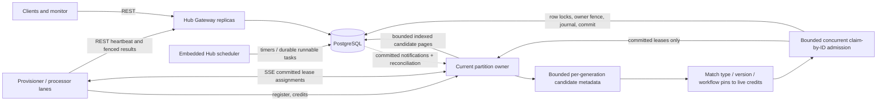

# Distributed Hub architecture — primary execution path

> **Architecture decision:** The Hub-native runtime uses **partition-owned,
> in-memory candidate matching and fenced SSE task delivery** as its primary
> distributed execution model. PostgreSQL is the authoritative task/lease,
> workflow-history and result store.
>
> This is the selected architecture for the `make ups-16`
> development/benchmark presets. It remains under correctness and failover
> validation; enabling a development preset is not a production readiness claim.
> This document supersedes the alternative transport proposals listed in
> [historical matching investigations](README.md#historical-investigations).

## Architecture at a glance



The Gateway hosts generic REST management and coordination, **not business
workflow handlers**. The embedded scheduler is a distinct internal module; it
persists timers and makes work runnable. A Provisioner or processor process
registers C# workflow definitions and typed activity handlers, executes
workflow/activity lanes and commits results through Hub REST. It does not require
database credentials.

### Clear ownership boundary

| Component | Authoritative for | Not authoritative for |
| --- | --- | --- |
| PostgreSQL | Task state, owner/lease epoch, attempts, workflow revisions, history | Worker connections |
| Matching owner `(hub, partition, owner epoch)` | Live demand, advisory candidates, bounded reservations, SSE sessions | Durable task existence or permission to execute |
| Worker lane | Local execution semaphore, side-effect idempotency, heartbeat progress | Task scheduling or overriding a stale lease |
| Scheduler | Making persisted timers and workflow work eligible | Worker matching or delivery |

Every matching owner is itself elected and fenced in PostgreSQL. Partition
assignment uses `task.partition_id % matchingPartitionCount`; candidate
discovery requires a matching count that divides 64. A partition routes tasks
to an owner. Multiple workers can hold leases in the same partition. Activity
registration declares identity, version, partition count and its optional
contract. Worker credits indicate available execution slots. The PostgreSQL claim
gate bounds concurrent admission SQL. Hub quotas and strict ordering are retired.

## End-to-end assignment

1. **Task becomes ready:** the workflow engine or timer scheduler commits the
   durable task. Migration 040 removes the per-row task-ID notification path;
   the statement-level trigger emits a coalesced hub/bucket readiness signal.
   Signals are advisory and may be duplicated, reordered, or lost. The indexed
   candidate reader reconciles startup, ownership takeover, missed signals,
   due tasks and expired leases.
2. **Discover once, share across workers:** the current owner reads paginated,
   index-backed task identity, routing and deadlines, with cached workflow pins. It holds bounded candidate buffers and cursors per
   owner generation. No task is leased just for appearing in memory.
3. **Match to available demand:** each connected worker SSE session advertises
   sequenced free-slot credits. The matcher pairs a compatible buffered
   candidate with **one** credit. Capability and workflow-definition version
   checks are repeated in PostgreSQL. Sequence is a preference across currently
   buffered, compatible candidates. Earlier waiting credits get the first match.
4. **Claim authoritatively:** a bounded, concurrent admission worker locks and
   validates matching ownership and task eligibility in PostgreSQL. A batch of
   one or more selected task IDs is claimed atomically. The transaction writes
   the new task lease epoch, attempts and workflow history before committing.
5. **Push committed leases in bounded batches:** the partition owner reserves
   up to **four worker credits per acquisition turn**, matches eligible
   candidates, then sends an individual `task.assigned` SSE event for every
   committed lease in that batch. **One-shot candidate credits are retired
   after confirmed admission**; SSE session delivery IDs continue to account
   for leased worker slots until worker progress/release. An uncertain COMMIT
   remains quarantined instead. Completion/failure acknowledgements also retire
   any matching credits still retained for a resolved lease.
6. **Execute and complete:** the worker checks its local semaphore, deduplicates
   `(taskId, epoch)`, executes handlers and uses REST to heartbeat and
   submit the fenced result or native workflow commit. Completion can make
   dependent work ready and notify the owner.

The candidate reader runs independently of bounded admission workers and the
uncertainty reaper. The admission path and discovery each have bounded concurrency. `WFC_HUB_CANDIDATE_ADMISSION_CONCURRENCY`
controls the maximum number of local admission groups (default 2). The
existing PostgreSQL claim gate still applies and should not be configured
higher than the available connection budget.

The established candidate matcher remains enabled in the normal presets via
`WFC_HUB_MATCHING_CANDIDATES_ENABLED=true`. Its indexed discovery query pages
bounded task identity and routing fields; the registry accounts for page
memory. The reader batches uncached workflow-pin lookups.
### Coarse readiness signals and recovery

Migration 036 installs statement-level transition-table triggers that emit
distinct hub/bucket signals only when tasks become ready. Migration 040 removes
the row-level exact task-ID trigger and its producer function while retaining
the bucket signal functions and the explicit outbox compatibility setting.
Existing databases apply 040 after 039; earlier migration files remain
unchanged. The removed `WFC_HUB_CANDIDATE_TASK_ID_HINTS_ENABLED` setting has no
runtime equivalent. Old exact-ID payloads from a mixed-version producer are
accepted as coarse partition rescans until that producer is upgraded.

The listener coalesces up to 128 notifications per 25 ms in a 512-message
channel. Overflow and malformed payloads request bounded recovery. Local
Gateway durable mutations publish conservative rescans after commit. The
two-second ready-hub reconciliation and ten-second indexed sweep recover lost
signals, future tasks becoming due and leases expiring without a task-row
update. Candidate entries remain advisory; PostgreSQL checks current task
state, owner fencing and workflow pins during admission. A bounded
workflow-definition LRU serves indexed discovery; missing pins remain
advisory. See [candidate metadata enrichment](hub-candidate-metadata-enrichment.md).

The 030 notification outbox remains transactionally populated and dispatches
signals while deleting rows in the same transaction. It is not a replayable
task feed, so bootstrap/takeover and indexed recovery remain required.

## SSE sessions and capacity

- When the per-partition candidate credit limit is reached, the owner
  records `workflow_hub_candidate_capacity_fallbacks_total` and may use
  the **owner-fenced SQL claim fallback**. This is pressure relief, not a
  second recommended architecture. Capacity remains bounded by the same
  session reservation; do not count fallback attempts as candidate hits.
- Wake-driven candidate discovery coalesces notifications and scans up to 16
  bounded turns per activation. Concurrent PostgreSQL claim admission and
  the ambiguity reaper run independently.
- The primary routes are `POST /api/hub/workers/push-sessions`,
  `GET /api/hub/workers/push-sessions/{id}/events`,
  `PUT /api/hub/workers/push-sessions/{id}/capacity` and
  `POST /api/hub/workers/push-sessions/{id}/revoke`.
- Sessions are ephemeral and bound to one matching owner generation and one
  matching partition. The worker authenticates to the owner URL returned by
  registration, validated against configured trusted origins.
- Capacity updates have monotonically increasing sequence numbers and carry
  active/released delivery IDs. A capacity refresh never recreates credit for
  an outstanding assignment; the worker's local semaphore is the last guard.
- Push sessions are the native worker delivery path. A lane keeps one active
  session and rotates across matching partitions and registered Hub namespaces.
  It revokes the current session and drains running tasks before reusing its
  capacity. Running tasks continue with REST heartbeats.
- Set `WFC_HUB_PUSH_ENABLED=true` on Hub replicas and native workers. A worker
  with capabilities requires it, and an unavailable registration is retried.
  Set matching and trusted owner URLs on the Hub as shown below.
- SSE carries **committed lease assignments**, not an authoritative queue.
  Notifications, candidate buffers, capacity credits and SSE frames are
  disposable on owner takeover; committed leases are not.

## Failover and delivery uncertainty

| Failure point | Recovery and safety |
| --- | --- |
| Owner lost before claim | New owner re-reads durable candidates and receives fresh worker credits |
| Owner lost after commit, before SSE send | Lease survives; no replay is assumed; expiry and fenced reclaim recover task |
| SSE stream disconnect | Worker drains local running tasks and immediately tries old-session revocation (204/404), or verifies changed/expired owner epoch; only then reuses credits |
| Neither revocation nor ownership proof available | Continue waiting with bounded network probes; never infer safe credit reuse from a timeout |
| Commit result ambiguous | Keep the candidate reservation/credit quarantined until its exact epoch is no longer live |
| Worker stops or misses heartbeat | Lease expires; a new worker may claim with a later epoch; stale heartbeat/result is rejected |
| Notification dropped | Cursor-based bounded reconciliation restores discovery |
| Database unavailable | No in-memory-only task admission or result commit is permitted |

A failed SSE send can still consume an attempt without execution, because
the current implementation increments `attempts` when PostgreSQL grants the
lease. Receipt-versus-execution attempt accounting is **not yet separated**.
The runtime provides at-least-once execution, not exactly-once external side
effects. Activity handlers must use the stable dispatch key or equivalent
downstream idempotency.

## Standard development deployment

The supported main development preset layers the base stack, HA owner routing
and matching shards together:

```bash
make obs-setup
make ups-16
```

The standard preset configures two Hub replicas, four matching partitions,
the existing in-memory candidate matcher, PostgreSQL claim admission and
worker SSE push. The
important environment settings are:

| Setting | Main preset |
| --- | --- |
| `WFC_HUB_MATCHING_ENABLED` | `true` on Hub replicas |
| `WFC_HUB_MATCHING_CANDIDATES_ENABLED` | `true` (existing in-memory candidate matcher) |
| `WFC_HUB_PUSH_ENABLED` | `true` on Hub replicas and workers |
| `WFC_HUB_MATCHING_PARTITIONS` | `4`, consistent on Hub and worker |
| `WFC_HUB_CANDIDATE_ADMISSION_CONCURRENCY` | `2` (per Hub) |
| `WFC_HUB_CLAIM_ADMISSION_LIMIT` | `3`, DB-pool protection |
| `WFC_HUB_MATCHING_ADVERTISE_URL`, `WFC_HUB_MATCHING_PEERS` | Direct reachable and trusted owner URLs |
| `WFC_HUB_PUSH_TRUSTED_OWNERS` | Exact permitted worker-to-owner origins |
| `WFC_HUB_OUTBOX_ENABLED` | `true` (dispatcher; database outbox writes remain separately configured) |

For a two-Hub stack, verify both instances have the same partition count,
migration 029 is installed, direct owner URLs resolve from processors, and
the load balancer does not buffer SSE. `WFC_HUB_AUTH_TOKEN` and database
secrets remain necessary for local setup; production authentication and
tenant isolation require separate security review.

### Monitoring

The authenticated `GET /api/hub/workers/transport-diagnostics` reports
`candidateEnabled`, `candidateCredits`, `candidateReservations`,
`candidateUncertain`, `candidateBuffered`, `candidateAdmissionsActive`,
connected push sessions and claim/delivery counters. An idle SSE session may
reserve **up to four pending candidate credits per acquisition turn**. A
waiting credit is not a committed lease; confirmed grants should promptly
retire matching credits, while outstanding SSE deliveries remain charged to
their worker session. Failover tests verify bounded credits after completion.

Track workflow/task backlog, schedule-to-start p95/p99, actual lease
expiries, attempt exhaustion, owner epoch changes, admission wait, active PostgreSQL connections and activity completion p95/p99. Avoid
treating reduced HTTP calls alone as throughput proof.

Candidate matcher attribution is available through
`workflow_hub_candidate_match_lock_duration_seconds`,
`workflow_hub_candidate_match_entries_checked`,
`workflow_hub_candidate_match_compatibility_checks` and
`workflow_hub_candidate_match_unmatched_credits`. These describe work in
indexed task-type/version queues, including workflow-pin, reservation and
admission-deferral checks. Both ordinary and backpressured credit allocation
use the same indexed search. Demand-to-admission latency and batch fill are recorded separately
from PostgreSQL claim duration. The repeatable in-memory 400/4,000
lane profile is `HubCandidateMatcherProfileTests`; its timings are diagnostic,
not unit-test thresholds. SQL discovery and admission remain competing costs;
see the [15 November PostgreSQL review](postgresql-4k-review-2026-11-15.md).

One local Release profile run (16 credits against one indexed workflow task
type/version queue; no PostgreSQL) recorded:

| Candidate entries | Workflow pins | Matching time | Reservations |
| ---: | --- | ---: | ---: |
| 400 | compatible | 0.09 ms | 16 |
| 400 | mismatched | 7.89 ms | 0 |
| 4,000 | compatible | 4.68 ms | 16 |
| 4,000 | mismatched | 87.05 ms | 0 |

This is a single synthetic sample, sensitive to JIT and cache state. It
confirms that mismatched workflow-pin work can grow with entries in a shared
type/version queue; it is not a production workload comparison or evidence of
an end-to-end throughput gain. Repeat with warmup and multiple samples when
using it to compare matcher changes.

The golden preset baseline has candidate backpressure, concurrent admission,
and cross-worker batching enabled, admission concurrency 2 per Hub, and batch
cap 32. Vary cross-worker batching separately from admission concurrency when
profiling. The fact that one partition admits at a time and its owner row is
locked through commit leaves a testable admission-ceiling hypothesis, not a
proven bottleneck. Four admission groups are not four executing tasks: each
group can contain multiple leases, and task execution continues after commit.
Any experiment with concurrent admission for one partition must be opt-in and
retain owner fencing, SQL claim gating, renewal/takeover safety, cancellation and uncertain-commit quarantine. No such concurrency
change is enabled by this instrumentation.

For a controlled follow-up, use an isolated PostgreSQL 17 database and compare
the unchanged golden preset against `WFC_HUB_CANDIDATE_ADMISSION_CONCURRENCY=1`
and `=2` with the same fixed workflow/task mix, pool 12, claim gate 3, batch cap
32 and cross-worker batching enabled. Repeat with cross-worker batching
disabled as a separate factor, with warmup and multiple measured runs. Capture
completed tasks/s, queue and admission p95/p99, claim-gate wait, matcher lock
and scan histograms, SQL statement calls/time/buffer hits, lease uncertainty,
attempt and history conservation. Compare SQL discovery
and admission costs because the 15 November review found them to be competing
cost explanations. If these runs still indicate per-partition owner-row
serialization, prototype a concurrent-per-partition owner-fenced variant only
in a separate opt-in branch. Include owner renewal during admission, takeover
at expiry, lock order, cancellation and ambiguous commit tests before any
performance comparison; `FOR SHARE` is only a candidate lock-mode experiment
if those cases prove it safe. No isolated per-partition variant has been
measured or qualified here, so the admission ceiling remains unresolved.

### Delivery-attempt accounting follow-up

PostgreSQL currently increments `attempts` and persists attempt history when it
grants a lease, before SSE delivery. A failed send or missing receipt is an
unknown outcome: the worker may have received and started the task. Do not
refund the attempt or treat a missing acknowledgement as proof of non-execution.
The follow-up protocol should add separate bounded delivery and execution
observability while retaining the lease and stale-worker fencing:

1. Persist an append-only delivery record tied to `(task_id, lease_epoch)` with
   `Pending`, `Sent`, `Received`, `Started`, `RejectedBeforeStart`,
   `LeaseExpired` or `Unknown` transitions. Keep task attempt/history rows as
   the execution lease-grant record for backwards compatibility.
2. Add idempotent, epoch-fenced `received` and `started` receipts. `received`
   is diagnostic only; `started` records worker intent but cannot prove that
   external side effects did or did not happen. Completion remains the durable
   execution outcome.
3. Bound resend to the same live `(task_id, epoch)` and delivery ID while its
   lease remains valid. Never create a new epoch just because a send or receipt
   timed out. After lease expiry, the existing authoritative reaper/takeover
   decides whether the task is retryable; keep a separate bounded delivery
   churn limit for operator visibility rather than consuming execution retry
   budget silently.
4. On ambiguous send, disconnect, cancellation or lost acknowledgement, mark
   delivery outcome `Unknown`, quarantine the matching credit until durable
   lease retirement is confirmed, and expose both delivery uncertainty and
   execution attempts. A fenced explicit `RejectedBeforeStart` may be recorded
   but must not bypass the authoritative lease/owner checks.

This needs an additive migration and failure-injection tests for lost SSE,
lost receipts, duplicate receipts, same-epoch resend, expiry, takeover,
attempt/history conservation and stale completion. It is a protocol design
follow-up, not a counter-only adjustment.

### Task index cleanup

Migration `031_hub_retire_compatibility_claim_indexes.sql` drops these five
non-unique compatibility claim indexes with `DROP INDEX CONCURRENTLY IF EXISTS`:

- `ix_hub_task_claim_hub_sequence`
- `ix_hub_task_claim_capability_sequence`
- `ix_hub_task_claim_capability_bucket_sequence`
- `ix_hub_task_ready_capability_sequence`
- `ix_hub_task_ready_capability_bucket_sequence`

Compose, `scripts/dev.ps1 db-schema` and current CI setup skip their original
index-only migrations (023 and 025–027), then apply 031 after 030 with
autocommit, never inside a transaction block, followed by additive migration
032 for task-ID hints. Repeated application of 032 is safe.
Task data, unique indexes, the three candidate discovery indexes, the global
claim-sequence index, readiness/expiry, and reconciliation indexes
are retained. Migration 028 remains in the repository for databases where it
was previously installed; active setup does not apply or reverse it.

Compatibility SQL claims and the capacity fallback remain available, but their
performance without these indexes requires workload validation. To restore the
previous index set for a compatibility rollback, explicitly reapply migrations
023 and 025–027 after normal setup; their index builds can block writes. Use
equivalent `CREATE INDEX CONCURRENTLY` statements outside a transaction for an
online restore. Subsequent normal schema setup applies 031 and removes them again.

Migration `039_hub_retire_task_operations_index.sql` removes the broad
`ix_hub_task_operations` index on existing databases. Run it with autocommit.
Migration 011 still creates the monitor sample table and the workflow operations
index. If a deployment needs the former task index for selective monitor reads,
restore it explicitly outside a transaction after normal schema setup.

```sql
CREATE INDEX CONCURRENTLY IF NOT EXISTS ix_hub_task_operations
    ON wfc_scale.hub_task (hub_id, partition_id, task_type, state, due_at);
```

### Verification

```bash
dotnet build scaling/WorkflowCore.Scaling.slnx -c Release
pwsh -NoProfile -File ./scripts/dev.ps1 test
# Requires the local PostgreSQL container and Release binaries:
make obs-matcher-failover
```

The failover suite runs **before-claim**, **after-claim/pre-send**, and
**during-execution** owner failures against isolated test databases. It asserts
owner takeover, candidate mode active on both Hubs, reconnected SSE sessions,
bounded reconnect latency, eventual completion, partition routing, side-effect
observations, stale heartbeat rejection and matching-credit conservation.
Tests and local benchmark outcomes must be recorded before production rollout.

The [14 November SSE benchmark](hub-push-benchmark-2026-11-14.md) did
**not** enable the candidate-matching feature flag: its 4,000-lane result
is evidence about the SSE transport, not a combined candidate+push p95 claim.
The feature should be benchmarked against the existing baseline at 8, 16,
128, 1,000 and 4,000 logical lanes, and with multiple Hub replicas.

## Other code paths and historical work

The direct REST claim and readiness APIs serve the sequential compatibility
processors. The upstream engine and direct-PostgreSQL `DistributedWorkPump` are separate
projects and are not part of this Hub-native architecture. Do not run legacy
background consumers against the same workflow state.

For implementation details see [native workflow contracts](hub-native-fluent-runtime.md),
[task store](../src/WorkflowCore.Hub/HubTaskStore.cs),
[matcher](../src/WorkflowCore.Hub.Gateway/HubCandidateAcquisition.cs),
[push sessions](../src/WorkflowCore.Hub.Gateway/HubPushSessions.cs),
[worker lanes](../src/WorkflowCore.RemoteExecution/HubRuntimeWorkers.cs)
and the [documentation index](README.md).
