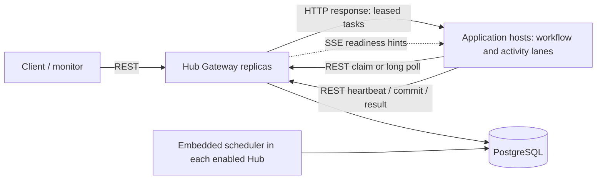

# Current distributed runtime

Reviewed against the working tree on 8 November 2026. This guide describes
implemented behavior, including opt-in paths; it does not establish which flags
are enabled in a running deployment. The runtime remains experimental.

## Choose the runtime

| Runtime | Entry point | Execution and persistence |
| --- | --- | --- |
| Hub native runtime | `AddHubWorkflowRuntime`, `HubWorkflowClient` | DB-free application hosts execute C# definitions; Hub persists snapshots, inboxes, tasks, leases and timers through REST |
| Direct PostgreSQL runtime | `AddDistributedWorkflowCore`, `DistributedWorkflowEngine` | Application workers use `DistributedWorkPump` and access PostgreSQL directly |
| Upstream Workflow Core | Original `src/` and `test/` | Original host, queue and provider APIs; the root README examples below the fork documentation section describe this runtime |

The Hub also retains inline and sequential remote compatibility paths for
existing data. Do not infer native capabilities from the sequential adapter,
which supports an Activity/Delay slice. Never mix legacy background consumers
with either distributed runtime for the same workflow state.

## Hub components and execution



- **Hub Server** composes the generic Gateway, durable stores, telemetry and
  embedded scheduler. It does not load business workflow definitions.
- **Application hosts** register definitions and typed activities, then execute
  independently bounded workflow and activity lanes. The onboarding
  `WorkflowCore.Provisioner.Host` combines both roles. The separate offboarding
  processor is another application host, not a Hub component.
- **Workflow tasks** load the durable native snapshot and inbox, run the native
  executor, and submit a fenced commit. Ordinary steps execute in that lane;
  registered activity types are routed to separate durable activity tasks.
- **Activity tasks** execute application handlers and return results. Results
  enter the durable inbox and wake workflow progression.
- **Scheduler** scans durable timers and reconciles runnable native work. A wait
  releases processor capacity; a future task resumes the run. The scheduler is
  an in-process library, not a separately deployed service today.

Native support includes branches, loops, parallel joins, delays, events, retries,
cancellation and compensation. Upstream's unimplemented `SubWorkflowStepBody`
is rejected. See the [native contracts](hub-native-fluent-runtime.md) for limits,
mapping rules and compatibility requirements.

## How a task reaches a processor

1. Startup publishes activity policies and workflow metadata. Workflow claims
   advertise supported definition IDs and versions; activity claims advertise
   task types and versions within Hub namespaces.
2. A worker with free slots requests at most its available capacity, capped at
   16 tasks per request in the native worker loop.
3. Hub checks capabilities, due time, workflow status, attempt limits and
   applicable resource capacity/FIFO constraints. PostgreSQL row locks protect
   admission. Eligible tasks become leased to the requesting worker ID with an
   incremented epoch and attempt count.
4. The **HTTP claim or poll response carries the leased tasks**. SSE carries
   `tasks.available` readiness hints, not task payloads or ownership.
5. The processor heartbeats and submits a result or workflow commit. Worker ID,
   epoch, lease validity and, for workflow commits, revision fence mutations.
   Expired tasks can be reclaimed; exhausted attempts require recovery handling.

Task execution is at least once. Stable dispatch identities support downstream
idempotency; neither the transport nor fencing makes external effects exactly
once. A workflow is not permanently attached to a processor.

### Transport selection

| Path | Selection | Behavior |
| --- | --- | --- |
| Adaptive claim + SSE | Default native worker path | `POST /api/hub/workers/tasks:claim`; SSE shortens empty-queue backoff; periodic claims recover missed hints |
| Matching long poll | `WFC_HUB_LONG_POLL_ENABLED=true` and a lane advertises exactly one Hub namespace | `POST /api/hub/workers/tasks:poll`; server holds the request for work; requires matching-enabled Hub configuration |
| Multi-Hub lane | Even when long polling is enabled | Uses the adaptive claim/SSE path until multi-Hub matching fan-out is implemented |

Long polls wait up to 20 seconds in single-partition mode and 4 seconds in
sharded mode. One outstanding poll per lane rotates across matching partitions.
There is no SSE task-push or processor delivery-acknowledgement protocol today.

PostgreSQL transaction-committed NOTIFY hints wake Hub replicas; LISTEN reconnect
and periodic reconciliation recover missed hints. These hints are not a durable
queue. Legacy readiness sweeps run every 2 seconds; the opt-in event-gated
matching path also uses a throttled 10-second capability/partition recovery scan.

## How Hub replicas scale

All replicas share a writable PostgreSQL database. REST requests can be load
balanced; regular claims coordinate through database locks and task leases.
Each enabled embedded scheduler can scan timers safely using transactional row
locking. Database contention and the combined connection pools remain limits;
adding replicas does not imply linear throughput.

Long-poll matching has a separate ownership layer:

| Configuration | Ownership and routing |
| --- | --- |
| Matching disabled | Regular claims remain available; the poll endpoint returns 404 |
| Matching enabled, one partition | One matching owner per logical Hub namespace; other replicas forward polls to the owner |
| Matching enabled, multiple partitions | One owner per `(hub, matching partition)`; preferred owners spread partitions across configured peers, with lease-based takeover |

Matching ownership uses PostgreSQL-fenced leases lasting 8 seconds, renewed every
2 seconds. It routes pending worker demand; **task leases remain separate**.
Matching shard membership is `task.partition_id % matchingPartitionCount`.
Claim queries use the expression index from migration 026 by default when the
matching count divides 64: `partition_id % 64 = ANY(matchingBuckets)` selects
exactly the same shard. Apply migration 026 before deploying this query path.
Set `WFC_HUB_MATCHING_INDEXED_BUCKET_CLAIMS=false` to retain the legacy modulo
filter for comparison. Counts not dividing 64 use the direct modulo filter;
single-shard and unsharded claims omit partition filtering. This does not change
persisted partition IDs or resource ordering.
Matching partitions do not redefine business resource or FIFO ordering scopes.
The partition count is persisted per namespace and must agree across Hubs and
processors; it is not a live resharding control.

| Setting | Purpose |
| --- | --- |
| `WFC_HUB_MATCHING_ENABLED` | Enable Hub long-poll matching (off unless configured) |
| `WFC_HUB_MATCHING_NODE_ID` | Unique Hub matching node identity |
| `WFC_HUB_MATCHING_ADVERTISE_URL`, `WFC_HUB_MATCHING_PEERS` | Reachable owner URL and configured trusted peer URLs |
| `WFC_HUB_MATCHING_PARTITIONS` | Same count on Hubs and workers, 1–64; default 1 |
| `WFC_HUB_LONG_POLL_ENABLED` | Worker transport opt-in; default off in code |
| `WORKFLOW_WORKERS`, `ACTIVITY_WORKERS` | Onboarding host lane concurrency; defaults 8 and 16 |
| `WFC_HUB_WORKER_MAX_INFLIGHT_PER_LANE` | Optional cap applied independently to each native lane |
| `WFC_HUB_DB_POOL` | Per-Hub connection pool setting; Compose default 12 |

The [base Compose stack](../observability/compose.yaml) runs one Hub. Add the
[HA overlay](../observability/compose.matching-ha.yaml) for two Hubs and Nginx;
it enables worker long polling by default. Add the
[sharding overlay](../observability/compose.matching-shards.yaml) after HA for
four matching partitions by default. Peer configuration is explicit; automatic
membership discovery and autoscaling are not implemented by these overlays.

Event-gated matching, demand-aware claim admission, unconstrained batch claims
and FIFO-head prefiltering are configurable experiments. Consult their
[focused reports](README.md#matching-and-performance) before enabling them;
implemented flags are not proof of a throughput improvement.

## Setup, migrations and verification

Use .NET SDK 10, Node.js 22+ for the monitor, and PowerShell 7. Start with the
[local observability runbook](../observability/README.md) or
[monitor/development setup](../monitor/README.md). Run commands from the root:

```powershell
pwsh -NoProfile -File ./scripts/dev.ps1 help
dotnet build scaling/WorkflowCore.Scaling.slnx -c Release
pwsh -NoProfile -File ./scripts/dev.ps1 test
```

The current Compose migrator and `scripts/dev.ps1` apply ordered SQL migrations
002 through 023. Preserve existing data and apply additive migrations in order;
do not reset volumes to upgrade. The direct PostgreSQL runtime additionally uses
the upstream EF schema. Compose initializes that schema through the separate
monitor API migration service.

The PostgreSQL integration suite needs `WFC_TEST_PG` and a configured schema;
some tests return without exercising the database when it is unset. The dev
script test command configures the local schema and environment. Relevant suites
include `HubNative*Tests`, `HubRemoteSchedulerTests`, `HubMatchingOwnershipTests`,
`HubMatchingPartitionTests` and `HubPostgresNotificationTests`. Existing test
coverage is not a claim that those checks passed on this working tree.

Production identity, scoped authorization, tenant isolation, recovery operations
and broader failure/load validation remain outstanding. The sample bearer token,
monitor and simulated business handlers are development facilities.

## Implementation evidence

- [Host composition](../src/WorkflowCore.Hub.Server/Program.cs)
- [Native registration/options](../src/WorkflowCore.RemoteExecution/HubWorkflowRegistration.cs)
  and [worker lanes/transport](../src/WorkflowCore.RemoteExecution/HubRuntimeWorkers.cs)
- [Task admission and leases](../src/WorkflowCore.Hub/HubTaskStore.cs)
  and [HTTP endpoints](../src/WorkflowCore.Hub.Gateway/HubGatewayEndpoints.cs)
- [Matching ownership](../src/WorkflowCore.Hub.Gateway/HubMatchingOwnership.cs),
  [matcher](../src/WorkflowCore.Hub.Gateway/HubTaskMatcher.cs),
  [readiness reconciliation](../src/WorkflowCore.Hub.Gateway/HubReadinessBroadcaster.cs)
- [Scheduler](../src/WorkflowCore.Hub.Scheduling/HubSchedulingExtensions.cs)
  and [timer transactions](../src/WorkflowCore.Hub/HubTimerStore.cs)
- [Integration tests](../tests/WorkflowCore.Scaling.PostgreSQL.Tests/)

Use the [documentation index](README.md) for detailed contracts, operations and
historical reports. Source and tests take precedence over historical plans.
