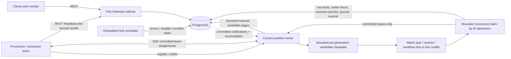

# Distributed Hub architecture — primary execution path

> **Architecture decision:** The Hub-native runtime uses **partition-owned,
> in-memory candidate matching and fenced SSE task delivery** as its primary
> distributed execution model. PostgreSQL is the authoritative task/lease,
> concurrency-policy, FIFO, workflow-history and result store.
>
> This is the selected architecture for the `make obs-up` and `make ups-16`
> development/benchmark presets. It remains under correctness and failover
> validation; enabling a development preset is not a production readiness claim.
> This document supersedes the alternative transport proposals listed in
> [historical matching investigations](README.md#historical-investigations).

## Architecture at a glance



The Gateway hosts generic REST management and coordination, **not business
workflow handlers**. The embedded scheduler is a distinct internal module; it
persists timers and makes work runnable. A Provisioner or processor process
registers C# workflow definitions and typed activity handlers, executes
workflow/activity lanes and commits results through Hub REST. It does not require
database credentials.

### Clear ownership boundary

| Component | Authoritative for | Not authoritative for |
| --- | --- | --- |
| PostgreSQL | Task state, owner/lease epoch, attempts, FIFO/resource permits, workflow revisions, history | Worker connections |
| Matching owner `(hub, partition, owner epoch)` | Live demand, advisory candidates, bounded reservations, SSE sessions | Durable task existence or permission to execute |
| Worker lane | Local execution semaphore, side-effect idempotency, heartbeat progress | Task scheduling or overriding a stale lease |
| Scheduler | Making persisted timers and workflow work eligible | Worker matching or delivery |

Every matching owner is itself elected and fenced in PostgreSQL. Partition
assignment uses `task.partition_id % matchingPartitionCount`; candidate
discovery requires a matching count that divides 64. FIFO/resource scopes can
span these matching partitions and are *always* rechecked transactionally.

## End-to-end assignment

1. **Task becomes ready:** the workflow engine or timer scheduler commits the
   durable task. PostgreSQL notifications are latency hints, not durable
   messages; the candidate reader periodically reconciles missed hints.
2. **Discover once, share across workers:** the current owner reads paginated,
   index-backed metadata (ID, epoch, type/version, partition, due time and
   advisory resource keys). It holds bounded candidate buffers and cursors per
   owner generation. No task is leased just for appearing in memory.
3. **Match to available demand:** each connected worker SSE session advertises
   sequenced free-slot credits. The matcher pairs a compatible buffered
   candidate with **one** credit. Capability and workflow-definition version
   checks in memory are an optimization, not authorization.
4. **Claim authoritatively:** a bounded, concurrent admission worker locks and
   validates matching ownership and task eligibility in PostgreSQL; constrained
   tasks acquire their canonical resource permits and enforce strict FIFO. An
   unconstrained batch may be claimed atomically by ID. The transaction writes
   the new task lease epoch, attempts and workflow history before committing.
5. **Push the committed lease:** the partition owner sends `task.assigned`
   with the leased-task payload, epoch, worker/session/delivery IDs over SSE.
   **One-shot candidate-matching credits are retired on a confirmed claim**;
   the SSE session then owns the outstanding delivery accounting until worker
   progress/release. An uncertain commit remains quarantined instead.
6. **Execute and complete:** the worker checks its local semaphore, deduplicates
   `(taskId, epoch)`, executes handlers and uses REST to heartbeat and
   submit the fenced result or native workflow commit. Completion can make
   dependent work ready and notify the owner.

The candidate reader runs independently of bounded admission workers and the
uncertainty reaper. This prevents a slow resource lock from blocking discovery
or lease-retirement bookkeeping. `WFC_HUB_MATCHING_ADMISSION_CONCURRENCY`
controls the maximum number of local admission groups (default 3). The
existing PostgreSQL claim gate still applies and should not be configured
higher than the available connection budget.

## SSE sessions and capacity

- The primary routes are `POST /api/hub/workers/push-sessions`,
  `GET /api/hub/workers/push-sessions/{id}/events`,
  `PUT /api/hub/workers/push-sessions/{id}/capacity` and
  `POST /api/hub/workers/push-sessions/{id}/revoke`.
- Sessions are ephemeral and bound to one matching owner generation and one
  matching partition. The worker authenticates to the owner URL returned by
  registration, validated against configured trusted origins.
- Capacity updates have monotonically increasing sequence numbers and carry
  active/released delivery IDs. A capacity refresh never recreates credit for
  an outstanding assignment; the worker's local semaphore is the last guard.
- A lane rotates its partition membership with a zero-credit revocation
  barrier, rather than duplicating capacity across owners. Tasks already
  running continue with REST heartbeats.
- SSE carries **committed lease assignments**, not an authoritative queue.
  Notifications, candidate buffers, capacity credits and SSE frames are
  disposable on owner takeover; committed leases are not.

## Failover and delivery uncertainty

| Failure point | Recovery and safety |
| --- | --- |
| Owner lost before claim | New owner re-reads durable candidates and receives fresh worker credits |
| Owner lost after commit, before SSE send | Lease survives; no replay is assumed; expiry and fenced reclaim recover task |
| SSE stream disconnect | Worker drains local running tasks and immediately tries old-session revocation (204/404), or verifies changed/expired owner epoch; only then reuses credits |
| Neither revocation nor ownership proof available | Continue waiting with bounded network probes; never infer safe credit reuse from a timeout |
| Commit result ambiguous | Keep the candidate reservation/credit quarantined until its exact epoch is no longer live |
| Worker stops or misses heartbeat | Lease expires; a new worker may claim with a later epoch; stale heartbeat/result is rejected |
| Notification dropped | Cursor-based bounded reconciliation restores discovery |
| Database unavailable | No in-memory-only task admission or result commit is permitted |

A failed SSE send can still consume an attempt without execution, because
the current implementation increments `attempts` when PostgreSQL grants the
lease. Receipt-versus-execution attempt accounting is **not yet separated**.
The runtime provides at-least-once execution, not exactly-once external side
effects. Activity handlers must use the stable dispatch key or equivalent
downstream idempotency.

## Standard development deployment

The supported main development preset layers the base stack, HA owner routing
and matching shards together:

```bash
make obs-setup
make obs-up
# For 16 processor containers:
make ups-16
```

The standard preset configures two Hub replicas, four matching partitions,
candidate discovery, PostgreSQL claim admission and worker SSE push. The
important environment settings are:

| Setting | Main preset |
| --- | --- |
| `WFC_HUB_MATCHING_ENABLED` | `true` on Hub replicas |
| `WFC_HUB_MATCHING_CANDIDATES_ENABLED` | `true` on Hub replicas |
| `WFC_HUB_PUSH_ENABLED` | `true` on Hub replicas and workers |
| `WFC_HUB_MATCHING_PARTITIONS` | `4`, consistent on Hub and worker |
| `WFC_HUB_MATCHING_ADMISSION_CONCURRENCY` | `3` (per Hub) |
| `WFC_HUB_CLAIM_ADMISSION_LIMIT` | `3`, DB-pool protection |
| `WFC_HUB_MATCHING_ADVERTISE_URL`, `WFC_HUB_MATCHING_PEERS` | Direct reachable and trusted owner URLs |
| `WFC_HUB_PUSH_TRUSTED_OWNERS` | Exact permitted worker-to-owner origins |
| `WFC_HUB_LONG_POLL_ENABLED`, `WFC_HUB_TASK_SSE_PUSH`, `WFC_HUB_MATCHING_EVENT_GATED` | `false` in the primary preset; not competing push implementations |

For a two-Hub stack, verify both instances have the same partition count,
migration 029 is installed, direct owner URLs resolve from processors, and
the load balancer does not buffer SSE. `WFC_HUB_AUTH_TOKEN` and database
secrets remain necessary for local setup; production authentication and
tenant isolation require separate security review.

### Monitoring

The authenticated `GET /api/hub/workers/transport-diagnostics` reports
`candidateEnabled`, `candidateCredits`, `candidateReservations`,
`candidateUncertain`, `candidateBuffered`, `candidateAdmissionsActive`,
connected push sessions and claim/delivery counters. An idle SSE session may
hold **one pending candidate credit** while waiting for work; this is not a
leaked committed lease.

Track workflow/task backlog, schedule-to-start p95/p99, actual lease
expiries, attempt exhaustion, owner epoch changes, admission wait, resource
locks, active PostgreSQL connections and activity completion p95/p99. Avoid
treating reduced HTTP calls alone as throughput proof.

### Verification

```bash
dotnet build scaling/WorkflowCore.Scaling.slnx -c Release
pwsh -NoProfile -File ./scripts/dev.ps1 test
# Requires the local PostgreSQL container and Release binaries:
make obs-matcher-failover
```

The failover suite runs **before-claim**, **after-claim/pre-send**, and
**during-execution** owner failures against isolated test databases. It asserts
owner takeover, candidate mode active on both Hubs, reconnected SSE sessions,
bounded reconnect latency, eventual completion, FIFO non-overlap, side-effect
observations, stale heartbeat rejection and matching-credit conservation.
Tests and local benchmark outcomes must be recorded before production rollout.

The [14 November SSE benchmark](hub-push-benchmark-2026-11-14.md) did
**not** enable the candidate-matching feature flag: its 4,000-lane result
is evidence about the SSE transport, not a combined candidate+push p95 claim.
The feature should be benchmarked against the existing baseline at 8, 16,
128, 1,000 and 4,000 logical lanes, and with multiple Hub replicas.

## Other code paths and historical work

Adaptive HTTP claims and long polling remain in source for compatibility,
emergency rollback and mixed-capability lanes; they are **not competing
target architectures**. Multi-Hub-capability lanes still use the supported
adaptive fallback until per-Hub session fan-out is implemented. The original
upstream engine and direct-PostgreSQL `DistributedWorkPump` are separate
projects and are not part of this Hub-native architecture. Do not run legacy
background consumers against the same workflow state.

For implementation details see [native workflow contracts](hub-native-fluent-runtime.md),
[task store](../src/WorkflowCore.Hub/HubTaskStore.cs),
[matcher](../src/WorkflowCore.Hub.Gateway/HubCandidateAcquisition.cs),
[push sessions](../src/WorkflowCore.Hub.Gateway/HubPushSessions.cs),
[worker lanes](../src/WorkflowCore.RemoteExecution/HubRuntimeWorkers.cs)
and the [documentation index](README.md).
