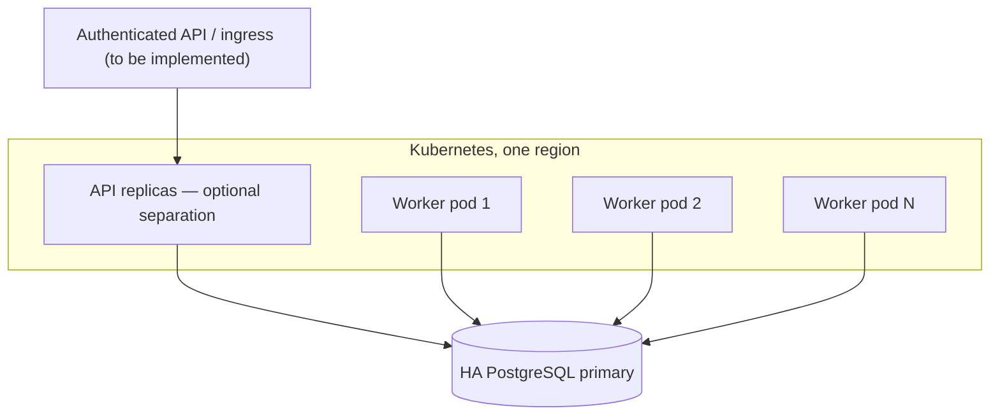

# Deployment, migration, and rollback

**Status:** reference procedure; not a production-approved runbook.
The distributed runtime is incompatible with the old Workflow Core
dispatch/control-plane path for the **same workflow rows**.

## 1. Prerequisites

- .NET 10 build/runtime; PostgreSQL 17 is the CI test target.
- One writable PostgreSQL primary reachable from all replicas.
- The original Workflow Core PostgreSQL/EF schema (`wfc`) installed first.
- The three `wfc_scale` SQL migrations applied in ascending order.
- Identical workflow definitions, step assemblies, serializer types and
  deployment version across worker replicas.
- Secrets provisioned through a secret manager, not source files.
- An authorization layer if exposing any API outside the isolated test lab.
- Sufficient connection pool capacity for `Concurrency × replicas`, transaction
  times and heartbeat traffic; validate with load tests.

## 2. Database install

The upstream EF migration chain belongs to
`src/providers/WorkflowCore.Persistence.PostgreSQL/Migrations/`. Execute it
using your established EF migration runner or a one-off .NET migration job.
The new DI registration explicitly sets `canCreateDB=false,
canMigrateDB=false` and **does not** run it automatically.

After the original EF tables exist:

```bash
export PGHOST=localhost PGPORT=5432 PGDATABASE=workflow PGUSER=workflow
# PGPASSWORD must be supplied securely by your runtime
psql -v ON_ERROR_STOP=1 -f scaling/sql/002_distributed_runtime.sql
psql -v ON_ERROR_STOP=1 -f scaling/sql/003_signal_delivery.sql
psql -v ON_ERROR_STOP=1 -f scaling/sql/004_request_dedupe.sql
```

Verify:

```sql
SELECT to_regclass('wfc."Workflow"') AS existing_workflow,
       to_regclass('wfc_scale.work_item') AS work_items,
       to_regclass('wfc_scale.workflow_gate') AS workflow_gates,
       to_regclass('wfc_scale.signal_event') AS signal_events,
       to_regclass('wfc_scale.signal_delivery') AS deliveries,
       to_regclass('wfc_scale.request_dedupe') AS request_keys;
```

All should be non-null. Maintain backups and change control before rerunning
schema scripts or applying breaking migrations.

## 3. Local test instance

```bash
export WFC_PG='Host=localhost;Port=5432;Database=workflow;Username=workflow;Password=REPLACE'
export WORKERS=4
dotnet run --project src/samples/WorkflowCore.Scaling.Api/WorkflowCore.Scaling.Api.csproj --urls http://localhost:5180
```

This endpoint is unauthenticated. Bind only to loopback for local development;
the example binding above is not a production network exposure recommendation.
In a second terminal:

```bash
curl -s http://localhost:5180/health/ready
curl -s -X POST http://localhost:5180/api/workflows \
  -H 'Content-Type: application/json' \
  -H 'Idempotency-Key: smoke-2026-10-31-a' \
  --data '{"tenantId":"tenant-smoke"}'
```

Use the returned `workflowId` to call `GET /api/workflows/{id}`.
Completion is asynchronous; 202 means accepted, not finished.

## 4. Kubernetes logical topology (proposal, not shipped manifests)



The current sample combines API and worker in one process. Running a
worker-only deployment requires a host that registers workflow definitions
and the distributed pump without exposing the sample HTTP endpoints. That
host is **not included** as an independent project yet.

Suggested first-stage controls (configure in your platform deployment):
- rolling deployment with graceful termination time exceeding expected
  cooperative step cancellation / lease handling;
- CPU/memory limits and anti-affinity across hosts/zones;
- readiness checks for DB connectivity plus migration/schema readiness;
- separate DB credentials for migration jobs and runtime;
- small initial replica count, then scale only with DB metrics/backlog age;
- private network and TLS to PostgreSQL.

## 5. Migration from legacy runtime

No live-instance migration exists. Because backward compatibility was
explicitly deprioritized, **do not** place both old and new dispatchers on
the same live `wfc` workflow table.

Safe options:
1. **Greenfield:** install isolated schemas/database and start only the new
   engine. Verify step registration and event replay.
2. **Drain and cut over:** stop new submissions to old engine, wait for legacy
   workflows to finish or terminate via an approved process, stop all legacy
   consumers, snapshot/back up the database, then launch the new runtime in
   a new database or isolated schema.
3. **Recreate workloads:** for long-running old workflows, rebuild them as
   new instances after explicitly reconciling completed external operations
   and issuing fresh idempotency keys.

Do not directly import old waiting/sleeping pointers without a dedicated,
tested migration/repair tool.

## 6. Rollout and rollback

- Run PostgreSQL integration and load/chaos tests on the exact image digest.
- Canary only new workflow definitions/traffic, never share instances with
  legacy hosts.
- Observe oldest ready-work age, dead letters, claim/ACK rates, gate expiry
  and EF transaction durations.
- Stop new ingress before rollback; stop all new worker pods and confirm no
  live gate owners remain or leases have expired.
- Restore application build/configuration and **a consistent DB snapshot** if
  a schema/data rollback is required. Replaying old consumers against new
  ledger-managed instances is not a supported rollback.
- Validate external provisioning outcomes before reissuing commands.

For region failover, fencing of the old primary and a verified consistent
new primary are prerequisites. Active/active regional execution is not
implemented, and asynchronous replication can lose acknowledged writes.
