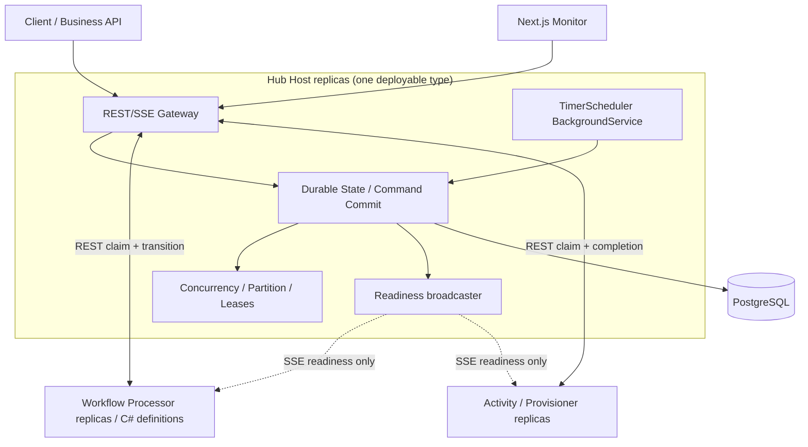

# Architecture decision and implementation plan — Hub-owned embedded scheduler

Status: **IMPLEMENTATION IN PROGRESS** (see [implementation runbook](hub-remote-scheduler-implementation.md)); full native IWorkflow<T> adapter and production hardening remain outstanding.
Base branch: `refactor/scaling-project-layout`
Scope: replace the current Hub-owned demo activity chain with an infrastructure-only REST/SSE Hub, an independent code-first Workflow Processor host, an Activity/Provisioner host, and a durable scheduler **in the Hub process**.
Primary decision: schedule execution is a separate .NET module, but initially **not** a separate deployment.

## 1. Decision

- `WorkflowCore.Hub.Gateway` owns HTTP REST, authorization boundary, SSE notifications and validation; it does not know onboarding, backup or billing definitions.
- `WorkflowCore.Hub` owns durable state, concurrency permits, partitions, leases, revisions, command commit and execution journal.
- **New:** `WorkflowCore.Hub.Scheduling` owns timer scanning, expiry arbitration and durable workflow-task wakeup. Register its `BackgroundService` in `WorkflowCore.Hub.Host`.
- **New:** `WorkflowCore.Hub.Client` owns retry-safe typed REST calls, SSE resubscription, idempotency, correlation and HTTP transport.
- **New:** `WorkflowCore.RemoteExecution` integrates the existing Workflow Core fluent definitions with an externalizable workflow-task state machine.
- Workflow Processor hosts load the C# definitions, claim workflow tasks, calculate next actions, and submit state transitions over REST. They do not keep a DB connection or remain running while a workflow waits.
- Provisioner hosts claim and execute typed activities over REST, then send fenced results. They do not decide workflow progression or manage workflow timers.
- PostgreSQL is authoritative for timers, task state, wakeups, history, policy permits and revisions. SSE is only a wakeup hint.
- Retain the existing combined Workflow runs monitor and distributed-trace-style waterfall; do not replace it with a completion-only timeline.

**Future extraction:** `WorkflowCore.Hub.Scheduler.Host` can host the *same scheduling module* with scheduling disabled on Gateway hosts. Changing deployment must require **no public REST or workflow definition contract change**.

## 2. Codebase starting point (verified)

Current branch projects:

| Project/path | Current fact | Target action |
| --- | --- | --- |
| `scaling/src/WorkflowCore.Hub.Gateway` | `AddHubGateway` registers onboarding, backup and billing policies and the onboarding activity chain | Remove all business registrations; keep generic REST/SSE and DI |
| `scaling/src/WorkflowCore.Hub` | `HubWorkflowStore` runs a sequential Hub-managed chain; `HubTaskStore` provides durable activity claims/leases | Extract command/state transaction service; add timer and workflow-task contracts |
| `scaling/sample/onboarding/WorkflowCore.Hub.Host` | Hosts API and background broadcaster; no timer scheduler | Register `AddHubScheduling()` alongside `AddHubGateway()` |
| `scaling/sample/onboarding/WorkflowCore.Scaling.Worker` | Supports remote activity handlers | Evolve into / add an independent sample Provisioner host |
| `scaling/sql/007_hub_gateway.sql`, `008_hub_workflows.sql`, `009_hub_task_attempts.sql` | Task, sequential workflow and task-attempt journal exist | Add forward-only migrations for timers and resumable workflow tasks; preserve existing data |
| `monitor` | One unified list, legacy and Hub details, Hub attempt waterfall | Add timer/wait rows and workflow-processor task attempts to the same read model |

No scheduler implementation, remote `IWorkflow<T>` processor, or generic external workflow transition command currently exists. Do not describe them as already implemented.

## 3. Deployment and boundaries



**Important:** The scheduler invokes `IHubTimerStore` / `IWorkflowTaskCommitter` directly, not REST against itself. Workflow Processor and Provisioner *must* use the Hub REST API and receive no `WFC_PG`.

The current path `scaling/sample/onboarding/WorkflowCore.Hub.Host` is the existing sample-host project path. Keep it for the first refactor to avoid another unrelated folder move. The host binary/configuration must nevertheless remain business-agnostic. A later housekeeping change may move the generic host under `scaling/hosts/`.

## 4. Project layout

```text
scaling/
  src/
    WorkflowCore.Hub/                  # persistence, task leases, revisions
    WorkflowCore.Hub.Contracts/        # DTOs and typed commands (new)
    WorkflowCore.Hub.Gateway/          # generic REST, SSE, authorization hooks
    WorkflowCore.Hub.Scheduling/       # timer engine and BackgroundService (new)
    WorkflowCore.Hub.Client/           # remote REST/SSE client (new)
    WorkflowCore.Hub.Telemetry/        # OTEL metrics/traces/logs
    WorkflowCore.RemoteExecution/      # Workflow Core workflow-task adapter (new)
    WorkflowCore.Scaling.PostgreSQL/   # existing experimental legacy runtime
  sample/
    onboarding/
      WorkflowCore.Hub.Host/           # infrastructure-only composition root
      WorkflowCore.Processor.Host/     # onboarding workflow definitions (new)
      WorkflowCore.Provisioner.Host/   # onboarding business handlers (new)
      WorkflowCore.Scaling.Api/        # existing legacy monitoring/demo API
      WorkflowCore.Scaling.Samples/    # legacy sample definitions
      WorkflowCore.Hub.LoadTest/       # stress/functional harness
  tests/
    WorkflowCore.Scaling.PostgreSQL.Tests/
    WorkflowCore.Hub.Scheduling.Tests/ # timer and crash/failover integration (new)
```

Do not modify upstream `src/WorkflowCore` or its fluent API unless the remote adapter proves an unavoidable gap. Prefer an additive execution adapter rather than changing `IWorkflow<T>`, `StepBody` and `IWorkflowBuilder`.

## 5. Runtime responsibilities and contracts

| Component | Owns | Explicitly does not own |
| --- | --- | --- |
| Gateway | REST/SSE protocol, authentication/authorization hooks, request validation | Workflow definitions, step execution, timer polling |
| Durable Hub store | Workflow revision, transitions, leases, event journal, partition/permit consistency | C# business code |
| Scheduling module | Scanning due timers, expiry vs event arbitration, wakeup task creation | HTTP transport, user activities |
| Workflow Processor | Versioned C# definitions, state-machine replay/decision, command generation | PostgreSQL and long-running sleeps |
| Provisioner | Executing idempotent activities, heartbeat/fenced results | Workflow state-machine or timers |

**External REST additions (proposed):**

- `POST /api/hub/definitions` — publish immutable workflow definition ID/version and declarative metadata, with an idempotent registration key.
- `POST /api/hub/workflows` — create workflow instance pinned to its definition/version.
- `GET /api/hub/workers/events?kind=workflow|activity` — SSE readiness; lost SSE must not lose tasks.
- `POST /api/hub/workflow-tasks:claim` — lease workflow task with revision + serialized state/signal/timer event.
- `POST /api/hub/workflows/{id}/transitions` — submit atomically fenced transition with expected revision, epoch and commands.
- Retain/refine `POST /api/hub/workers/tasks:claim` and task completion/heartbeat/failure for activity workers.
- `POST /api/hub/workflows/{id}/events` — send an external signal, with deduplication and event-vs-timeout arbitration.
- `GET /api/hub/workflows/{id}/history` and `/trace` — read complete durable lifecycle for the waterfall.
- Per-hub authorization policies and worker capabilities are future security controls; never trust worker-provided hub names without verifying identity.

**Transition command envelope** (illustrative; version the wire format):

```json
{
  "protocolVersion": 1,
  "workflowId": "uuid",
  "taskId": "uuid",
  "leaseEpoch": 3,
  "expectedRevision": 7,
  "definition": { "id": "tenant-onboarding", "version": 1 },
  "state": { "pointer": "await-approval" },
  "commands": [
    { "type": "ScheduleTimer", "timerKey": "approval-timeout",
      "generation": 2, "dueAt": "2026-11-05T09:00:00Z" }
  ],
  "idempotencyKey": "workflow-task-uuid:epoch:commit"
}
```

The Hub commits the state update, deduplication key, history records and *all* commands in one PostgreSQL transaction. Reject mismatched revision/lease with conflict; replaying an already accepted identical commit returns the original acknowledgement. External activity side effects remain at-least-once and require an idempotency key/fencing token downstream.

Concurrency policy declarations must become serializable descriptions of resource scope, capacity, strict FIFO and key-expression/version. The existing in-memory `Func<JsonElement,string?>` callback must not cross REST; change to a declarative canonical key selector or centrally registered, versioned policy metadata. Hub enforces permits, not workers.

## 6. Durable timer design

**Proposed migration:** `scaling/sql/010_hub_timers.sql` (additive; the existing last migration is 009).

```sql
CREATE TABLE wfc_scale.hub_timer (
    id uuid PRIMARY KEY,
    workflow_id uuid NOT NULL REFERENCES wfc_scale.hub_workflow(id),
    hub_id text NOT NULL,
    partition_id integer NOT NULL,
    timer_key text NOT NULL,
    generation bigint NOT NULL CHECK (generation > 0),
    due_at timestamptz NOT NULL,
    state smallint NOT NULL DEFAULT 0, -- 0 Pending, 1 Fired, 2 Cancelled
    scheduled_revision bigint NOT NULL,
    created_at timestamptz NOT NULL DEFAULT now(),
    fired_at timestamptz,
    cancelled_at timestamptz,
    UNIQUE (workflow_id, timer_key, generation)
);

CREATE INDEX ix_hub_timer_due
  ON wfc_scale.hub_timer (due_at, partition_id, id)
  WHERE state = 0;
```

This is a schema *design*, not an executable migration: add referential checks, state invariants and indexes appropriate to actual query plans before implementation. A timer generation makes looping/re-arming the same logical timer key safe.

**The scheduler cycle:**

1. Wake according to configured poll cadence; claim at most `BatchSize` due timers with indexed lookup and `FOR UPDATE SKIP LOCKED` in a transaction.
2. For each timer, serialize against the workflow's state/revision using a consistently ordered lock (workflow before timer, or a deliberately enforced alternative). Confirm the timer generation is still expected and the workflow is waiting for it.
3. Atomically mark the timer Fired, append `TimerFired` and `WorkflowTaskScheduled` journal entries, and enqueue one resumable workflow task with a unique wakeup key.
4. Commit, then publish an SSE hint. The existing periodic claim sweep ensures recovery when the hint is lost.
5. Handle stale/cancelled timers as no-ops; never resume a workflow twice for the same logical generation.

**Critical race:** event delivery and timeout firing contend on the same workflow revision/lock. Whichever commits first wins. The loser observes the changed wait state, cancels/ignores its timer/event, and does not enqueue a second resume. Test this at the exact deadline boundary with multiple Hub replicas.

Avoid long transactions: do not perform HTTP calls or execute user code while timer rows are locked. Reconciliation must cover crashes between transaction commit and SSE publication.

`FOR UPDATE SKIP LOCKED` avoids waiting on locked timer rows and works for queue-style consumers; it does not guarantee global fairness or eliminate every lock conflict. Measure skipped rows and lag.

## 7. Registration in Hub Host and extraction seam

**Initially one service, two independent hosted loops:**

```csharp
// scaling/sample/onboarding/WorkflowCore.Hub.Host/Program.cs
builder.Services.AddHubGateway(connectionString);
builder.Services.AddHubScheduling(
    builder.Configuration.GetSection("WorkflowHub:Scheduler"));

var app = builder.Build();
app.MapHubGateway();
app.Run();
```

`AddHubScheduling` is **proposed**, not currently implemented. Registration should bind/validate strongly typed options, expose `ITimerScheduler`/`IHubTimerStore`, and register `TimerSchedulerService : BackgroundService` only when `Enabled=true`. Keep database/transaction logic in `WorkflowCore.Hub` and scheduler algorithms in `WorkflowCore.Hub.Scheduling`.

```json
{
  "WorkflowHub": {
    "Scheduler": {
      "Enabled": true,
      "PollIntervalMs": 500,
      "BatchSize": 100,
      "MaxConcurrentBatches": 2,
      "SqlCommandTimeoutSeconds": 5,
      "StartupJitterMs": 250
    }
  }
}
```

These are lab starting values, **not measured production limits**. With the existing 12-connection Hub pool, cap scheduler DB usage and measure HTTP wait times; if the timer scanner starves under load, first optimize query/batching, then consider a separate scheduler-specific pool with a small cap.

**Multi-replica behavior:** Running a scheduler loop on every Hub replica is acceptable initially. Let `SKIP LOCKED` + transactional generation/revision checks coordinate. No Redis or broker is required for timer correctness. Avoid adding a global leader election for the first version; introduce partition-scoped ownership/leases only when measured contention or high timer volume warrants it.

**Later dedicated deployment:**

```text
Gateway deployment:
  WorkflowHub__Scheduler__Enabled=false

Scheduler deployment:
  WorkflowHub__Scheduler__Enabled=true
  (runs WorkflowCore.Hub.Scheduler.Host with same scheduling module)
```

The dedicated host has direct PostgreSQL access by design—it is an infrastructure component, unlike Workflow Processor and Provisioner. It can run without public REST listeners, but should expose internal health/telemetry if operationally required. Reuse the same schema, `IHubTimerStore` and background service without forking scheduler code.

**Switch-over sequence:** deploy a healthy dedicated scheduler first; verify it can scan and progress a canary timer; then disable embedded scheduler on Gateway replicas. Temporary overlap is safe due to DB arbitration; **no scheduler running** is not safe for timer SLOs. Roll back by re-enabling embedded scheduling once the dedicated instance is stopped or unhealthy. Avoid any schema or REST breaking change during extraction.

## 8. Timer use cases and execution trace

| Workflow action | Hub durable record | Scheduler behavior |
| --- | --- | --- |
| `Delay(5 minutes)` | Pending timer + waiting state | Enqueue workflow task after deadline |
| `WaitForEvent("Approved")` with timeout | Subscription + timer + revision | Event and timeout compete atomically |
| Activity timeout/retry | Activity deadline/lease + retry policy | Requeue/fail activity, then resume workflow as needed |
| Delayed start | Schedule + workflow identity | Create workflow task at due time |

Do not confuse **activity lease expiry** with **business timeout**; the former fences a worker claim, while the latter is a workflow/business deadline. Keep both durable and observable.

**Preserve the workflow waterfall**, with durable spans/segments generated from journal events:

```text
TenantOnboarding workflow (elapsed 15m 30s)
├─ WorkflowTask #1              25ms
├─ ValidateTenant               20ms
├─ ProvisionTenant              460ms
├─ WaitForApproval              15m 00s
│  ├─ TimerScheduled            at 10:00
│  └─ TimerFired                at 10:15
├─ WorkflowTask #2              18ms
└─ SendWelcome                  30ms
```

Persist `TimerScheduled`, `TimerCancelled`, `TimerFired`, `WorkflowTaskClaimed`, `WorkflowTaskCommitted` and activity attempt events with IDs, timestamps, revision, parent task/step and correlation context. Never keep a 30-day OpenTelemetry span open for a workflow wait; instead reconstruct a durable waterfall and link individual short-lived OTel spans by trace/span IDs and workflow ID (trace attributes, **not Prometheus labels**).

Extend the **existing unified Next.js Workflow runs** detail/trace view rather than creating a separate monitor. Preserve hub filter, waterfall scale/zoom, retries and attempts.

## 9. Operational controls and observability

**Hub health:** `/health/live` means process alive. `/health/ready` checks database connectivity and required scheduling ability without blocking readiness on a momentary lag. Advertise scheduler readiness and mode independently, and alert if all scheduler instances stop. When `Enabled=false` a Gateway can still be ready because a dedicated scheduler can be healthy.

**Scheduler metrics (low-cardinality labels only):**

- `workflow_hub_timer_pending` and `workflow_hub_timer_due` gauges
- `workflow_hub_timer_fired_total` and `workflow_hub_timer_cancelled_total` counters
- `workflow_hub_timer_fire_lag_seconds` histogram (actual wakeup commit minus due_at, nonnegative)
- `workflow_hub_timer_batch_duration_seconds` histogram
- `workflow_hub_scheduler_db_errors_total` counter
- `workflow_hub_scheduler_enabled` and `workflow_hub_scheduler_active_instances` gauges
- Existing queue backlog, workflow completion throughput, PostgreSQL connections and worker inflight metrics remain visible.

Avoid timer ID, workflow ID, tenant ID, and input payload as metric labels. Put IDs into trace spans/log attributes only where safe.

Suggested first validation SLO: p95 timer fire lag < 2 seconds in a **local 1,000-waiting-workflow test** under concurrent workflow/HTTP load. This is an initial target to validate, not a promise.

## 10. Delivery phases and acceptance criteria

| Phase | Work | Exit criteria |
| --- | --- | --- |
| P0 — boundary cleanup | Move demo workflow/policy registrations from Gateway to onboarding Processor/Provisioner; generic Hub Host DI | Hub builds and starts with zero business registrations; existing E2E smoke tests preserved |
| P1 — contract and transactional engine | Versioned workflow-task commands, revision and epoch fencing, idempotent commit, immutable definition metadata and policy serialization | Duplicate or stale transition cannot mutate state; state+events+tasks atomic |
| P2 — embedded scheduler MVP | Add Scheduling project, migration 010, BackgroundService, `Enabled` option, due timer scan and cancel/fire | Survives Hub restart; two Hub replicas do not logically fire a timer twice |
| P3 — external processor / provisioner | Add REST/SSE client and remote execution adapter; distinct C# Workflow Processor and Provisioner hosts | Both hosts use zero DB credentials; real code-first workflow delays and resumes |
| P4 — history and observability | Journal timer lifecycle and workflow-task attempts; preserve waterfall; OTEL/Grafana timer panels | Waiting time visible, no invented timings; history persists across restarts |
| P5 — resilience/performance | k6 and .NET harness: 1,000 concurrent workflows/timers, multi-replica chaos, event-timeout races, DB contention | p95 timer lag and throughput measured; no lost/duplicate logical wakeups; bounded DB sessions |
| P6 — optional extraction | Thin dedicated scheduler host, separate Compose/K8s deployment switch; no changes to API/contract | Gateway-only + scheduler-only deployment passes the **same** test suite |

Recommended implementation order: P0 → P1 → P2 → P3 → P4 → P5. P6 is **deferred** until measurable operational need.

## 11. Tests that must ship

- Unit: polling options validation, due calculation, cancellation/rearming generations, retry idempotency and serialization of commands.
- PostgreSQL integration: state/commands/timer atomic commit, `SKIP LOCKED` multi-scanner, event-vs-timeout race, duplicate HTTP commit replay, crash after commit before SSE, stale epoch, lost notification, migration forwards/repeated startup.
- Cross-process E2E: Hub Host + Processor Host + Provisioner Host, a real C# workflow that schedules timer, sleeps (no held thread), resumes and completes, with persisted waterfall.
- Chaos: kill Hub halfway through scanning and while waiting, restart processor/provisioner, disable/enable scheduler, two active schedulers, DB connection exhaustion.
- Stress: 1,000 concurrently waiting timers, mixed HTTP start traffic, compare 1/2 Hub replicas, 12 connection pool, timer lag p50/p95/p99, CPU, queue depth, retries.
- Deployment parity: run exactly the same E2E suite in embedded mode and dedicated scheduler host mode. Gateway and scheduler deployment topology must not change workflow definition or HTTP command schemas.

## 12. Constraints, risks and non-goals

1. The **current** Hub executes a simple sequential activity chain internally; merely adding `BackgroundService` does **not** complete the desired Processor/Provisioner rearchitecture. The workflow-task command adapter is a mandatory first-class workstream.
2. Multiple Hub scheduler loops can create redundant DB scans and share CPU/DB connections with API traffic; measure lag and fairness before adding leader/partition ownership.
3. Never use in-memory timers or `Task.Delay` for durable workflow waits. The scheduler loop itself can use a short `PeriodicTimer` to decide when to scan; the durable deadline remains in PostgreSQL.
4. SSE may disappear or be duplicated; it is notification only. Workflow-task claims and transition commits require durable, retry-safe APIs.
5. At-least-once workers can continue side effects after a lease expires; require downstream idempotency/fencing for correctness.
6. Keep old workflow data and unified monitor links. Add migrations; do not silently rewrite `hub_workflow_history` or drop existing persisted runs.
7. A dedicated scheduler is not needed in the initial deployment. Separate binaries/pods and leader election are not prerequisites for the first release.

## 13. Definition of done

The architecture is complete when:

- Generic Hub Host contains **no onboarding/billing/backup business definitions**.
- The embedded scheduling module runs from Hub Host DI, or can be disabled via configuration.
- Real C# workflows execute on independent processors; provisioners run activities; neither has workflow-state database credentials.
- All timers, signals, activity transitions and emitted workflow tasks are transactionally durable and revision/lease fenced.
- Multiple Hub replicas can scan the same due-timer set safely; a process crash does not strand timers.
- The existing Next.js unified monitor shows timer waits and both workflow/activity attempts in a distributed-trace-style waterfall.
- The end-to-end test and 1,000-timer stress test pass with reproducible Grafana/Prometheus metrics.
- An optional Scheduler Host using the same module can be enabled later without altering the external REST/definition contract.

### References

- Existing [Hub architecture and measured performance](workflow-hub-gateway.md)
- Existing [1000 workflow benchmark](workflow-hub-1000-performance.md)
- Microsoft: https://learn.microsoft.com/en-gb/aspnet/core/fundamentals/host/hosted-services?view=aspnetcore-10.0
- PostgreSQL 17: https://www.postgresql.org/docs/17/sql-select.html
