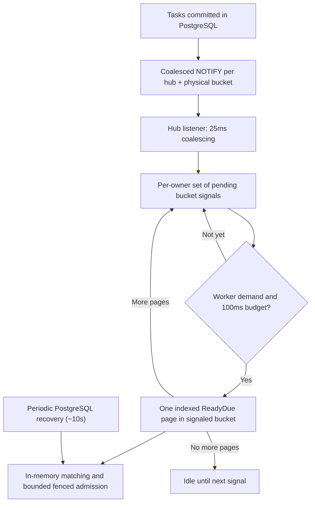

# Lightweight PostgreSQL readiness signals (MVP)

**Implemented on** `feat/hub-parallel-shard-admission-mvp` / PR #40.
**Schema migrations**: `scaling/sql/036_hub_lightweight_shard_signals.sql` (after 035) and `scaling/sql/040_hub_remove_exact_task_id_hints.sql` (after 039).

## Before and after

| Layer | Before | After (default mode) |
| --- | --- | --- |
| Producer trigger | Per-task/row JSON + NOTIFY | AFTER-STATEMENT transition-table query selecting distinct (hub, bucket) |
| Signal | Task type, version, actual partition; optional exact task ID | `{"hub":"...","partition":0..63,"kind":"signal"}` |
| SQL delivery | NOTIFY for each event (deduped within one transaction only) | One matching signal per bucket per SQL statement; PostgreSQL further collapses identical transaction-local payloads |
| Worker matcher | Bucket hints mark entire shard dirty and can drive a complete recovery sweep | Throttled, targeted `ReadyDue` keyset page for the hinted bucket; no full sweep reset |
| Subscriber | Coalesces up to 128 notifications per 25 ms; 512-message buffer | Preserved. Hint IDs are not required |
| Capacity throttle | No targeted query-rate bound | At most one targeted query per matching shard every **100 ms**, with round-robin bucket fairness |
| Recovery | Indexed full scans ~10 s; legacy broad sweep ~2 s | Indexed full scans retained at ~10 s; duplicated Hub-wide safety reconciliation reduced to ~30 s |
| Outbox | `make ups-16` starts an outbox dispatcher, even if session GUC is off | Default benchmark disables the dispatcher. Explicit `wfc.hub_notification_outbox=on` remains supported |

### Producer signal semantics

The default PostgreSQL statement trigger emits signals **only for tasks becoming ready**, not for lease heartbeats, task completion, or ordinary task claiming. Both INSERT and a state/due-date UPDATE can signal.

Multiple rows in one statement for the same `(hub, partition_id % 64)` generate **one matching notification**. PostgreSQL also deduplicates identical `(channel,payload)` notifications within a transaction. The legacy `wfc_hub_task_ready` channel still receives hub-wide signals for older listeners; those also dedupe transaction-locally. Separate transactions are **not** coalesced in PostgreSQL, so the Hub coalesces them separately.

Workflow and task mutation endpoints still wake legacy matchers and readiness SSE subscribers. With PostgreSQL notifications enabled, their unpartitioned wakeups leave candidate discovery to the committed database signal and periodic recovery. Setting `WFC_HUB_PG_NOTIFY_ENABLED=false` retains local hub-wide candidate wakeups.

Migration 040 removes the old per-row exact-ID trigger. Existing row data is preserved, and the statement-level bucket signals remain. Explicit legacy outbox sessions remain supported as a compatibility/test path. **Never enable an outbox dispatcher without configuring the producer to write to that outbox.** The removal is tracked in the [retirement decision](decision-retire-exact-task-id-hints.md).

### Targeted discovery



Every bucket retains its keyset cursor until exhausted. A newer notification invalidates that bucket's cursor so newly eligible earlier-deadline tasks cannot be skipped. A hot bucket cannot starve other pending buckets because selection rotates in bucket order. Worker-credit backpressure remains respected. The existing full recovery sweep and owner-fencing/lease-commit semantics are untouched, including for dropped/invalid notifications and owner takeover.

The 100 ms throttle is **per matching shard**, not per PostgreSQL table or entire deployment. It is a conservative initial value; compare p95 schedule-to-start and CPU per 1,000 leases before tuning. The 10-second recovery delay is a *safety bound* after lost hints, not a task delivery SLA.

## Deploy and validate

Existing installations must apply migration 036 after 035; this branch wires both into Compose, `scripts/dev.ps1`, and distributed CI. It alters the trigger protocol for this MVP and is not intended as a mixed-version rolling upgrade.

```bash
git switch feat/hub-parallel-shard-admission-mvp
make ups-16
make obs-test-4k
```

On an existing database, verify the migration applied (two statement triggers and one gated row trigger) before benchmarking:

```sql
SELECT tgname, pg_get_triggerdef(oid)
FROM pg_trigger
WHERE tgrelid = 'wfc_scale.hub_task'::regclass
  AND tgname LIKE 'trg_hub_work_ready%'
ORDER BY tgname;
```

Track `workflow_hub_candidate_signal_bucket_queries`, `workflow_hub_candidate_signal_hints_coalesced`, `workflow_hub_candidate_discovery_rows`, `workflow_hub_pg_notify_received`, `workflow_hub_candidate_admission_seconds`, actual activity **schedule-to-start p95/p99**, PostgreSQL CPU, and `pg_stat_statements` calls/buffer usage. Use the same backlog, traffic shape, PostgreSQL configuration, two-Hub topology, and worker concurrency in the before/after comparison.

**Risk:** Transition tables have a cost for very large UPDATE statements; any claimed CPU improvement requires A/B measurements. Under a sustained stream of new tasks in the same bucket, cursor invalidation can cause rereads; periodic full recovery is retained, and additional cursor logic may be appropriate if this dominates. Observability and failover tests must pass before merging.

## Related code

- `scaling/src/WorkflowCore.Hub.Gateway/PostgresHubNotificationListener.cs`
- `scaling/src/WorkflowCore.Hub.Gateway/HubReadinessBroadcaster.cs`
- `scaling/src/WorkflowCore.Hub.Gateway/HubCandidateAcquisition.cs`
- `scaling/src/WorkflowCore.Hub/HubPartitionCandidateRegistry.cs`
