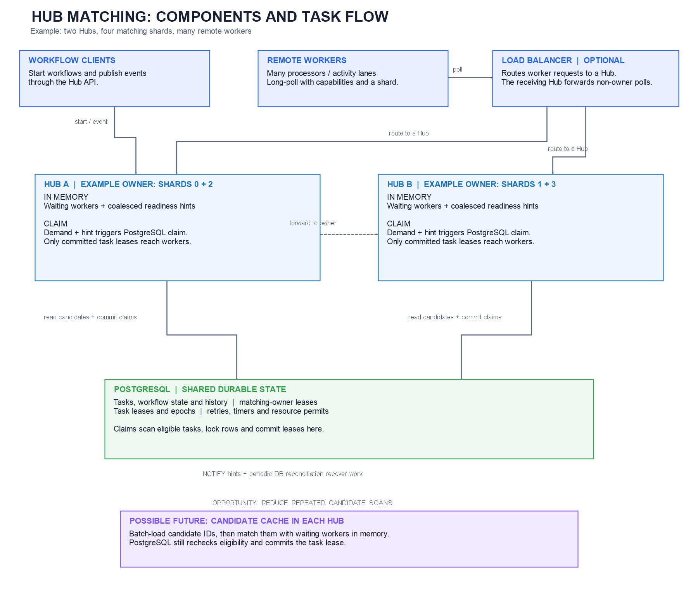
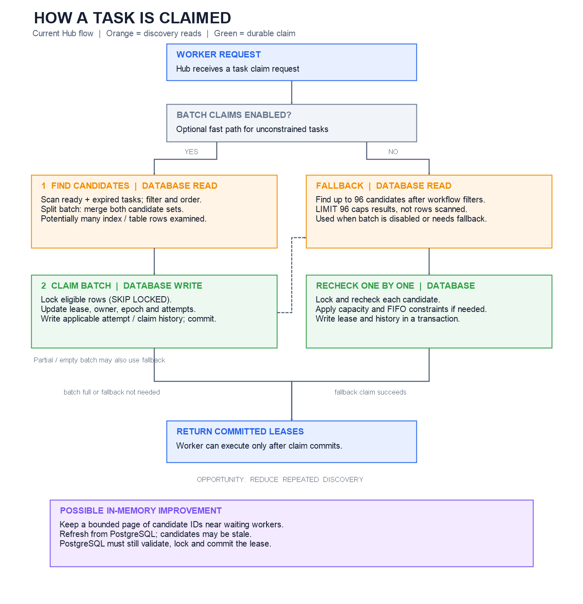

# Hub matching and claim flow

This guide describes the **current experimental Hub runtime** and then shows a
**proposed, not implemented** in-memory candidate cache. Diagrams use plain text.
The main path is sharded, event-gated long polling; direct claims, ordinary SSE
readiness, and the opt-in SSE task distributor are alternatives described below.
Configuration and deployment determine which path is active.

Legend: `[MEM]` Hub process memory; `[DB]` PostgreSQL; `[NET]` REST/SSE or
PostgreSQL notification; `[I/O]` database work, which may hit memory or disk.

## Components and partition ownership



[Open the editable Excalidraw diagram](images/hub-matching-architecture.excalidraw).
The shard assignments shown are examples. A task's matching shard is its
partition ID modulo the configured matching shard count; database leases govern
ownership and can move after failover. The diagram illustrates the opt-in
sharded, event-gated matching path; other delivery modes are described below.

## Current flow: from creation to execution

```text
 Workflow API / workflow commit / timer scheduler
                      |
                      v
 [DB 1] Transaction writes durable workflow state and hub_task
        (and relevant effects/history); transaction commits.
                      |
           +----------+----------------------------+
           |                                       |
           v                                       v
 [NET] PostgreSQL committed notification    [DB 2] Periodic recovery scan
       carries readiness information             finds hubs / matching hints
       (not a durable task delivery)              for outstanding work.
           |                                       |
           +-------------------+-------------------+
                               v
 [MEM] Hub readiness broadcaster / matcher
       Retains and coalesces hints for hub, matching shard, and capability.
       Hints may also come from local publication, permit release or catch-up.
                               ^
                               |
 Remote worker                 | demand + compatible hint
 (workflow or activity lane)   |
       |                       |
       | [NET] POST /workers/tasks:poll, with hub, capabilities,
       |       version pins, batch limit and matching shard
       v
 Hub gateway: resolve the shard owner; if necessary forward to owner.
 Ownership leases and epochs are stored in PostgreSQL. A worker lane rotates
 shards across polls; this is not cross-shard task or poll forwarding.
       |
       v
 [MEM] Owner parks the worker request in a bounded waiter queue.
       Event-gated dispatcher coalesces demand and readiness; it can perform
       a throttled catch-up probe when a worker arrives without a fresh hint.
       |
       v
 [DB 3] Verify owner before claim; apply optional claim admission gate.
       The normal gateway check is separate from the claim transaction.
       |
       v
 [DB 4] Discover eligible tasks and atomically claim them; see next diagram.
       |
       +-- no lease --> retain/retry hints as appropriate, or poll times out
       |
       v
 [NET] Return committed task lease(s) to the worker.
       |
       v
 Worker executes via REST/SSE only, then submits completion / native commit.
       |
       v
 [DB 5] Fenced transaction checks task lease and commits outcome, workflow
        state, attempts/history and any next tasks. New work can signal again.
```

Notifications are wakeup hints, not the source of truth. The safety sweep runs
on each Hub roughly every two seconds; event-gated matching's typed recovery
scan is additionally throttled to roughly ten seconds. A listener reconnect
also requests reconciliation. Timers, lost notifications, retry and lease
expiry can all require rediscovery. Sweeps also do other maintenance, including
dead-letter/reconciliation work. See [HubReadinessBroadcaster.cs](../src/WorkflowCore.Hub.Gateway/HubReadinessBroadcaster.cs),
[PostgresHubNotificationListener.cs](../src/WorkflowCore.Hub.Gateway/PostgresHubNotificationListener.cs),
and [HubEventGatedClaimDispatcher.cs](../src/WorkflowCore.Hub.Gateway/HubEventGatedClaimDispatcher.cs).

## Current claim: where scans and writes occur



[Open the editable Excalidraw diagram](images/hub-claim-flow.excalidraw).

```text
                        HubTaskStore.ClaimAsync
                                  |
             +--------------------+----------------------+
             |                                           |
   unconstrained batching enabled?                       no
             |                                           |
            yes                                          |
             v                                           |
 [DB, I/O] Begin batch transaction                       |
     |                                                   |
     | split candidates enabled?                         |
     |   yes: find ordered READY and EXPIRED candidates  |
     |        in separate bounded locking branches;      |
     |        merge by sequence and select batch.        |
     |   no:  original combined candidate query.         |
     |   opt-in ordered-capability variant: per-type     |
     |        ready scans, under restricted conditions.   |
     |                                                   |
     | Eligibility includes hub, shard, capability,      |
     | due/expiry, attempts, absence of constraints,     |
     | workflow status and version pins.                 |
     v                                                   |
 [DB, I/O] Lock eligible rows with SKIP LOCKED; update   |
     owner, lease, epoch and attempts; write applicable  |
     attempt and workflow-claim history; COMMIT.         |
     |                                                   |
     +-------------------+-------------------------------+
                         v
          Partial/empty batch, or batch disabled?
                         |
          +--------------+--------------------------+
          |                                         |
          v                                         v
 [DB, I/O] Fallback candidate query         No fallback needed /
   ordered by sequence, LIMIT 96;           permitted for this request
   workflow and optional FIFO-head
   filtering occurs before that limit.
          |
          v
 [DB, I/O] For candidates, transactions recheck and lock task rows;
   enforce resource capacity / FIFO where applicable; write lease,
   epoch, attempts and history; COMMIT. Stop once a task is claimed.
   Repeat for additional batch slots as allowed by the caller rules.
          |
          v
 Return committed leases; never treat an unlocked candidate as a lease.
```

`LIMIT 96` limits returned candidates, not rows or index entries examined.
The caller does not page beyond that window if every candidate fails later
admission. Batch branches may lock more candidates than the final merged batch;
unselected locks last until transaction end. A successful partial batch can
retain a readiness hint; an empty result consumes that hint, with later
recovery/probing still available. `SKIP LOCKED` permits progress around locked
rows and does not promise global FIFO under concurrency.

The owner check in the normal matcher is **not** transactionally tied to task
admission. An experimental task-store argument can lock and validate a captured
matching owner generation in the batch transaction, but the gateway does not
currently pass it. Task lease fencing remains separate. See
[HubTaskStore.cs](../src/WorkflowCore.Hub/HubTaskStore.cs),
[HubTaskMatcher.cs](../src/WorkflowCore.Hub.Gateway/HubTaskMatcher.cs), and
[HubMatchingPartitionLeaseStore.cs](../src/WorkflowCore.Hub/HubMatchingPartitionLeaseStore.cs).

## Other paths and recovery

```text
 Direct REST claim  ---> HubTaskStore.ClaimAsync ---> same database claim paths
   (no matching-owner routing requirement)

 Ordinary SSE       ---> readiness hint ---> worker issues a claim
   (hint only; it does not itself grant a task lease)

 Opt-in task SSE    ---> distributor uses worker credits and matching/claim
   (pushes committed leases; session/credit and delivery rules still apply)

 Owner crash / loss ---> owner lease expires or is released ---> another Hub
                        acquires shard ---> waiter reconnect + recovery scan.
 Worker / delivery failure after commit ---> task lease eventually expires
                        ---> eligible for retry, subject to attempts/policy.
```

Completion and execution are at least once under uncertain delivery; activity
side effects need idempotency or reconciliation. Workflow and task leases are
not equivalent to a matching-owner lease. See
[sse-task-distributor.md](sse-task-distributor.md) and
[hub-matching-multi-partition.md](hub-matching-multi-partition.md).

## Proposed experiment: cache candidate IDs in Hub memory

```text
                 PROPOSAL ONLY -- NOT IMPLEMENTED

 [DB] Durable tasks / retries / due work / expired leases
   |
   | bounded, coalesced refill + periodic reconciliation
   | [I/O remains: read batches instead of discovering on every claim]
   v
 [MEM] Owner-local bounded candidate cache
       key: hub + matching shard + owner generation + capability/version
       values: candidate IDs and enough metadata for selection
   ^                       |
   | notification hint     | compatible waiting worker + cached candidates
   | (not a task ID)       v
   |                 [MEM] choose bounded candidate IDs
   |                       |
   |                       v
   |                 [DB, I/O] conditional transactional claim by ID:
   |                   validate ownership protocol and recheck task state,
   |                   eligibility, absence of constraints and workflow pins;
   |                   lock, update lease/epoch/attempt and durable history.
   |                       |
   |              +--------+--------+
   |              |                 |
   |          committed          stale / blocked
   |              |                 |
   |              v                 v
   |        [NET] deliver       discard / refresh / bounded fallback
   |
   +-- on lost hint, due time, retry, expiry, takeover or eviction:
       reconcile from PostgreSQL; do not rely on a permanent forward cursor.
```

The cache could reduce repeated **candidate discovery** and index/heap reads;
it does not eliminate durable task creation, row locking, lease updates,
history writes, completion, ownership checks or recovery. Refill, stale entries
and extra lock contention can outweigh the savings. Start with unconstrained
work and retain a bounded service path for constrained/FIFO tasks. Exact
oldest-eligible ordering is difficult with an incomplete cache; a fresh head
check costs I/O, while relaxed ordering requires an explicit contract change.

Ownership takeover needs a tested transaction protocol: cache generation is
not sufficient to fence a paused old owner. Keep candidates as hints until the
claim commits; never treat loss of an in-memory reservation as proof a lease
failed. Bound memory and refill concurrency, account for worker credits, and
test starvation, stale results, lost/coalesced notifications, delayed tasks,
lease expiry, uncertain commits and owner failover. The detailed design and
validation checklist are in [matching-candidate-cache-proposal.md](matching-candidate-cache-proposal.md).

## Measure the proposed change

Compare equivalent workloads with cache off/on and, separately, batch split
off/on. Capture claim and refill calls, rows examined and returned, buffer hits
and reads, database CPU, throughput, latency, oldest eligible age, cache misses
and stale entries, and task attempts. Check complete workflow history and
takeover behavior, not just speed. Compare database counter **deltas**: total
statement execution time can overlap across concurrent calls and is not CPU
time. Index/heap fetch rates are not the same as physical disk I/O.
