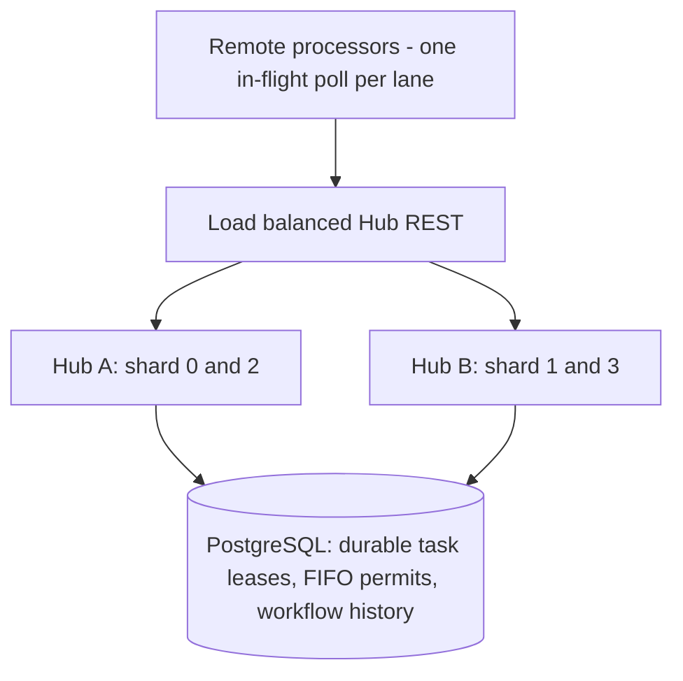

# Multiple matching partitions with explicit ownership and recovery

## Scope

This increment continues PR #20 on branch `feat/matching-partition-owners-recovery`.
It makes **matching dispatch partitions** (not FIFO ordering partitions)
independently owned by different live Hub gateway replicas.

The original PR #18 adaptive worker claiming and the PR #20 one-owner-per-Hub
mode are retained as opt-in rollbacks. Neither PostgreSQL workflow state nor
execution journal is moved into Hub memory. The existing REST auth and
gateway/worker separation remain.

### Routing and ownership



- `WFC_HUB_MATCHING_PARTITIONS=4` opts in to four matching partitions
  per **Hub namespace** (valid range 1..64). Set identically on all Hub
  replicas and remote processors.
- A task belongs to matching shard `task.partition_id % 4` in this version.
  The existing workflow and activity partition assignment stays unchanged.
- Each `(hub_id, matching_partition)` gets an independent PostgreSQL lease
  with `owner_id`, `owner_url`, `epoch` and `lease_until`.
- Config count is persisted once in
  `hub_matching_partition_config`: conflicting replica counts fail closed
  instead of silently remapping live task queues.
- Each shard prefers a different Hub based on the deterministic sorted
  private-peer URL list, but **the database lease is authoritative**.
  A peer can take over an expired shard when the preferred host fails.
- A nonowner forwards a worker poll at most once to the currently elected
  owner; peers must be explicitly allowlisted and auto redirects are blocked.
- Worker waits are in-memory and disposable. Durability is provided by
  task leases and replay after timeout, not by the pending HTTP request.
- An owner's 8-second lease renews every 2 seconds. Graceful shutdown
  releases owned shard leases; a hard crash requires expiry and new epoch.
- Task claims check shard eligibility in **both** candidate selection and
  locked row revalidation, and preserve task epoch fencing, permit admission
  and execution history. A keyed FIFO policy still serializes across shards.

### Notifications and recovery

Migration 019 adds `partition_id` to transaction-committed typed readiness
notifications. A new ready task wakes a compatible waiter in only its shard.
A resource-permit release wakes compatible waiters **across all shards**
because the next eligible task may have a different partition. The legacy
hub-wide SSE PostgreSQL channel is retained. Reconciliation scans and
lease expiry recover when a notification is lost.

A worker chooses one matching partition at a time and rotates to the next
after a successful or timed-out poll. Sharded polls hold up to 4 seconds
(before rotation), versus the 20-second legacy long-poll hold. This avoids
the unsafe alternative of simultaneously claiming on several matching
partitions with one worker slot. It also means light-load discovery may
take up to a few rotations; Temporal-style cross-partition task/poller
forwarding is **not** implemented yet.

### Lab: two Hub replicas and four partitions

```bash
docker compose \
  -f scaling/observability/compose.yaml \
  -f scaling/observability/compose.matching-ha.yaml \
  -f scaling/observability/compose.matching-shards.yaml \
  --env-file scaling/observability/.env.example \
  up -d --build hub hub-2 hub-lb

# Use a bearer token from the local .env; keep it out of shell history/logs.
curl -H "Authorization: Bearer <token>" \
  http://127.0.0.1:5110/api/hub/matching/partitions/policy-benchmark
```

The response lists each current owner and epoch. The multi-shard HA workflow
kills one elected Hub using SIGKILL during 150 real FIFO workflows and checks:
the surviving Hub acquires orphaned shards, owner epochs advance, workflows
complete, and cross-shard activity leases do not violate FIFO. It restarts
the failed Hub and verifies 100 keyed FIFO workflows.

The matched two-Hub A/B workflow compares PR #20 long polling with
`WFC_HUB_LONG_POLL_ENABLED=true` versus PR #18-style adaptive worker
claiming on the exact same two-Hub/four-shard resources. Compare workflow
p95/p99, schedule-to-start queue latency, DB candidate queries, empty
claims, completion p95/p99, and throughput.

### Explicit limitations

- This is a **four-shard matching dispatcher**, not four independent task
  persistence databases. Claims still use PostgreSQL on the same primary;
  CPU/connection pressure may continue to dominate.
- Matching ownership is a routing/failover mechanism, **not a replacement**
  for durable task fencing or transactionally enforced FIFO/permits.
- Crashing the matching owner after committing a task lease but before
  delivering the HTTP response can cause a delayed recovery and repeated
  at-least-once activity attempt. Keep activity side effects idempotent.
- PostgreSQL and the lab load balancer remain single points of failure.
  Two Hub gateway replicas alone do **not** establish full-system HA.
- Preferred-owner affinity is sticky. A recovered Hub does not immediately
  steal shards from a healthy survivor; explicit controlled rebalance is
  future work. Hard failures may keep queues temporarily slowed by lease
  expiry and waiter reconnection.
- Adjusting the partition count requires a coordinated migration/drain:
  current configuration **intentionally rejects** count changes for an
  existing Hub namespace.
- Old multi-Hub-capability worker lanes retain adaptive claiming rather than
  fan out across independent owner sets.
- Do not enable by default based only on a green test; require repeated
  comparable p95/p99 and a passing crash-recovery E2E benchmark.
