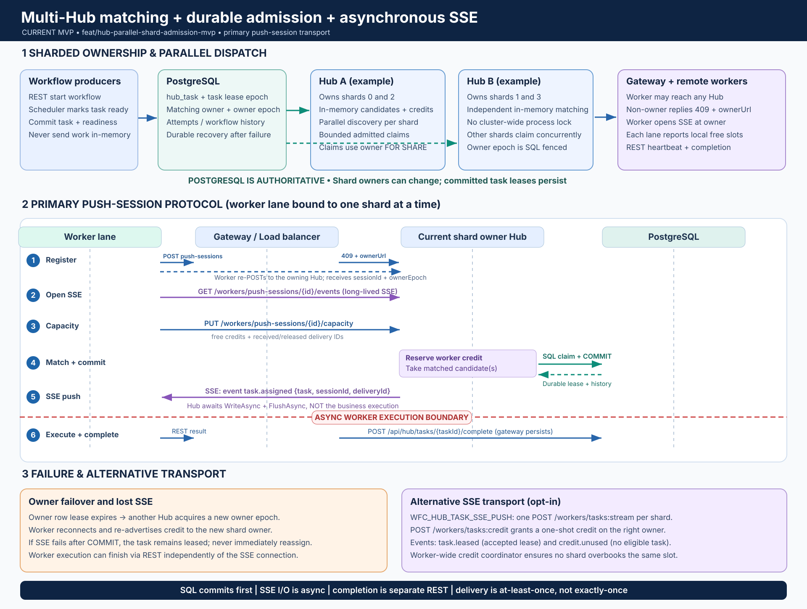
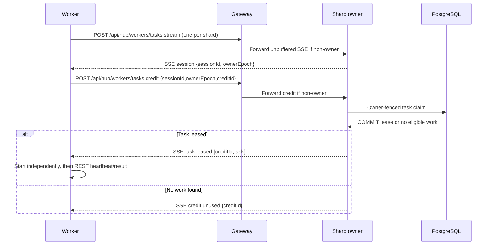
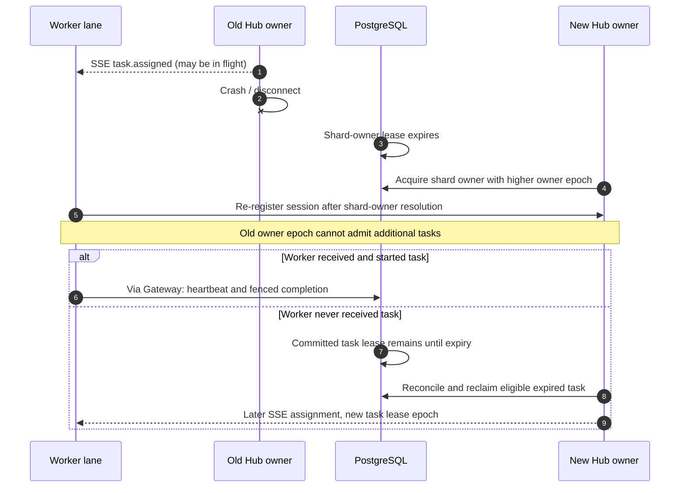

# Multi-Hub matching, durable admission, and asynchronous SSE delivery (MVP)

> **Current implementation:** `feat/hub-parallel-shard-admission-mvp` (PR [#40](https://github.com/thanhhaictld/workflow-core/pull/40)). This document describes the **implemented** runtime, not the historical aspirational design in [hub-push-matching-design.md](hub-push-matching-design.md). The primary and alternative SSE paths must not be conflated.



[Open the vector diagram](diagrams/hub-multi-hub-sse-admission.svg) · [Current MVP admission design](hub-parallel-shard-admission-mvp.md)

## Deployment and ownership model

Multiple Hub Gateway processes share PostgreSQL as the durable authority for ready tasks, matching-partition owners, task leases, attempts, and workflow history. Each `(hubId, matchingPartition)` has one fenced owner at a time; different matching shards may belong to different Hub processes. The *illustrative* split in the image (Hub A owns 0/2; Hub B owns 1/3) is not a fixed assignment. Worker lanes have no PostgreSQL credentials and use REST/SSE. A worker can initially contact any Gateway, but the primary push-session path returns **409 + ownerUrl/ownerEpoch** from a non-owner; the worker validates and reconnects directly to the shard owner.

No cluster-wide admission mutex is needed for independent tasks. Each owner maintains per-shard in-memory candidate selection and worker demand; multiple discovery turns across distinct shards, and bounded admission operations within a shard, may overlap. Within an admission transaction PostgreSQL validates the owner generation using `FOR SHARE`, validates task eligibility under task-row locking, and commits its lease/attempt/history before delivery. A takeover/renewal updates the owner row and conflicts with these shared locks. The fast batch path is **only for authoritatively classified unconstrained tasks** (`admission=1`, no persisted constraint row). This MVP does not restore permit-aware scheduling for constrained tasks.

## Primary push-session path: `WFC_HUB_PUSH_ENABLED`

The worker-side runtime chooses this mode when `PushEnabled` is on and the worker lane covers a single Hub. In this mode the worker's lane uses **one active shard at a time** and rotates shards; it does not open persistent sessions to every shard simultaneously.

```mermaid
sequenceDiagram
    autonumber
    participant W as Worker lane
    participant G as Gateway / LB
    participant A as Hub A (shard owner)
    participant P as PostgreSQL
    W->>G: POST /api/hub/workers/push-sessions
    G->>P: Resolve matching-partition owner
    alt Gateway not owner
        G-->>W: 409 {ownerUrl, ownerEpoch}
        W->>A: POST /api/hub/workers/push-sessions
    else Gateway is owner
        G-->>W: 200 session registration
    end
    A-->>W: sessionId, ownerEpoch
    W->>A: GET /api/hub/workers/push-sessions/{id}/events (SSE)
    W->>A: PUT /api/hub/workers/push-sessions/{id}/capacity {sequence, freeCredits, seenDeliveryIds, releasedDeliveryIds}
    P-->>A: Ready-task notification (advisory)
    A->>A: Reserve credit, match eligible task
    A->>P: Transaction: fence owner + lock task IDs + lease / history
    P-->>A: COMMIT: authoritative leased task(s)
    A-->>W: SSE task.assigned {sessionId, deliveryId, workerId, task}
    Note over A,W: Await SSE WriteAsync + FlushAsync; do NOT wait for task execution
    par Worker executes activity
        W->>W: Deduplicate task epoch and acquire local slot
        W->>G: REST task heartbeat(s)
        W->>G: POST /api/hub/tasks/{taskId}/complete
        G->>P: Persist completion / history
    and Hub continues matching
        A->>A: Admit and send further tasks as credits permit
    end
    W->>A: PUT /push-sessions/{id}/capacity (released delivery + new free slots)
```

The last capacity operation uses the same **`/api/hub/workers/` prefix** as the first; the sequence truncates that path only to keep the illustration readable.

**Synchronous vs asynchronous:** Admission waits for PostgreSQL to **commit** before any lease is delivered. The Hub then uses asynchronous `WriteAsync`/`FlushAsync` on the SSE response. Within one session, frame writes are awaited and serialized, but different sessions, matching shards, and admitted tasks progress independently. **The Hub does not await the business activity.** The worker executes in its own bounded slot and separately posts heartbeats and a fenced completion. **There is no `POST /workers/push-sessions/{id}/complete` endpoint.**

The Hub's push loop reserves up to **four credits per claim attempt** when available; admission itself can batch more across matching demands. `credit`/session/delivery state lives in memory, while the task lease and history live in PostgreSQL. After a failed send, the committed lease is not released speculatively because the worker may have received the frame.

## Alternative per-shard SSE transport

`WFC_HUB_TASK_SSE_PUSH` selects a **different** experimental protocol when the primary `PushEnabled` branch does not already win:



Unlike the primary push-session path, this protocol maintains a stream per matching shard; the worker's shared credit coordinator distributes **one-shot** credits across streams without double booking any local execution slot. Gateway stream forwarding flushes each received chunk. A dropped stream causes reconnect, not an immediate task reassignment.

## Owner failover and delivery uncertainty



**Do not equate an SSE write completing with execution acknowledgment.** Network delivery is uncertain. Deduplicate `(taskId, taskEpoch)` in the worker, keep externally visible side effects idempotent, and rely on durable lease expiry/recovery if delivery was lost. The **shard owner epoch** fences matching/admission; the **task lease epoch** fences execution/heartbeat/completion. These are separate.

## Limits, instrumentation, and source pointers

- Discovery turns: `WFC_HUB_CANDIDATE_DISCOVERY_PARALLELISM` default **4**, one active discovery turn per shard.
- Concurrent admissions: `WFC_HUB_CANDIDATE_ADMISSION_CONCURRENCY` default **2** per Hub; `WFC_HUB_CANDIDATE_ADMISSION_PER_PARTITION` default **2** per shard; claim batch max **32**.
- An SSE message does **not** make external effects exactly-once. Admission lease is durable, worker credit/session is not; task completion uses separate REST.
- Instrument owner fence wait, renewal duration, admission latency, actual activity schedule-to-start p95/p99, available credits, ambiguous sends, and lease-expiry retries. Workflow completion p95 from the 1,000-workflow CI test is **not** activity schedule-to-start.
- Primary path: [HubPushSessions.cs](../src/WorkflowCore.Hub.Gateway/HubPushSessions.cs) · [HubGatewayEndpoints.cs](../src/WorkflowCore.Hub.Gateway/HubGatewayEndpoints.cs).
- Worker and alternate SSE path: [HubRuntimeWorkers.cs](../src/WorkflowCore.RemoteExecution/HubRuntimeWorkers.cs) · [HubSseTaskStreamingEndpoints.cs](../src/WorkflowCore.Hub.Gateway/HubSseTaskStreamingEndpoints.cs) · [HubSseTaskDistributor.cs](../src/WorkflowCore.Hub.Gateway/HubSseTaskDistributor.cs).
- Shard and admission: [HubMatchingOwnership.cs](../src/WorkflowCore.Hub.Gateway/HubMatchingOwnership.cs) · [HubCandidateAcquisition.cs](../src/WorkflowCore.Hub.Gateway/HubCandidateAcquisition.cs) · [HubMatchingPartitionLeaseStore.cs](../src/WorkflowCore.Hub/HubMatchingPartitionLeaseStore.cs).
