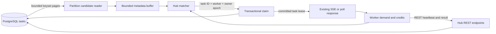

> **Historical implementation plan:** The current default Hub design is
> [candidate matching with fenced SSE push](current-runtime.md). The status
> and milestone checklist below describe earlier implementation checkpoints;
> use the canonical guide and source/tests for current behavior.

# Partition candidate readers and Hub matching: implementation plan

Status: **implementation started; candidate matching is not available**. The
legacy single-task admission transaction has been extracted for reuse. The
internal single-task by-ID primitive has structured outcomes and PostgreSQL
admission and reader tests; checkpoint evidence is in
`artifacts/candidate-matching/checkpoint-01.md`. An internal generation-scoped
candidate registry and scheduler is under test but is not connected to any
transport or enabled by configuration. Transport integration, rollout gates and
full candidate-mode acceptance remain outstanding; existing acquisition modes
remain in use.

Reviewed against revision `14999363` on 14 November 2026. This plan extends the
[push design](hub-push-matching-design.md) and the existing matching transports.
It changes task discovery and worker selection inside the Hub; PostgreSQL remains
the authority for execution admission and durable state.

## 1. Decision and intended result

One matching owner reads pages of potentially runnable task metadata for its
partition. All compatible worker demand on that owner shares those pages. The
Hub pairs a candidate with reserved worker capacity, then claims that specific
task in a short PostgreSQL transaction. A committed lease is delivered using
the existing transport.



Remote workers call Hub REST endpoints; only Hub infrastructure accesses
PostgreSQL. Workers never connect to the database.

The broad candidate-selection query moves from repeated worker claims to shared
partition discovery. Cached candidates stay unleased until a real worker slot
has been reserved. No workflow execution logic moves into the matcher.

## 2. Current behavior and code boundaries

| Source | Current behavior | Planned change |
| --- | --- | --- |
| [HubTaskStore.cs](../src/WorkflowCore.Hub/HubTaskStore.cs) | `ClaimAsync` discovers candidates, then locks and validates selected IDs; an independent batch path handles unconstrained tasks | Separate paginated discovery from reusable admission; add claim-by-ID and atomic batch-by-ID entry points |
| [HubTaskMatcher.cs](../src/WorkflowCore.Hub.Gateway/HubTaskMatcher.cs) | Holds long-poll demand and invokes SQL claims | Delegate opted-in partition demand to the shared candidate matcher |
| [HubEventGatedClaimDispatcher.cs](../src/WorkflowCore.Hub.Gateway/HubEventGatedClaimDispatcher.cs) | Coalesces capability hints and serializes claim drains | Retain as rollback; avoid a second independent discovery loop for enabled partitions |
| [HubPushSessions.cs](../src/WorkflowCore.Hub.Gateway/HubPushSessions.cs) | Owns credits and its own event-gated dispatcher, which still invokes broad `ClaimAsync` | Keep session accounting; replace its private acquisition dispatcher with the shared matching service |
| [HubSseTaskDistributor.cs](../src/WorkflowCore.Hub.Gateway/HubSseTaskDistributor.cs) | Older SSE task transport delegates acquisition through `HubTaskMatcher` | Reuse matching through that delegation; preserve credit dispositions and delivery contracts |
| [HubMatchingOwnership.cs](../src/WorkflowCore.Hub.Gateway/HubMatchingOwnership.cs) | Acquires and renews partition-owner generations | Publish lifecycle changes to start/stop generation-specific readers and matchers |
| [PostgresHubNotificationListener.cs](../src/WorkflowCore.Hub.Gateway/PostgresHubNotificationListener.cs) | Coalesces committed advisory notifications | Wake discovery/reconsideration rather than start a SQL query for each worker or notification |
| [HubReadinessBroadcaster.cs](../src/WorkflowCore.Hub.Gateway/HubReadinessBroadcaster.cs) | Periodically recovers readiness hints | Coordinate recovery with candidate readers and retain only required legacy sweeps |

Do not introduce an additional authoritative task queue or a durable row for
every worker credit. Existing direct adaptive pull remains available unchanged.

## 3. Invariants

1. There is one discovery coordinator per `(hub, matching partition, owner epoch)`.
   Different transports share its candidates, reservations and acquisition budget.
2. A buffered ID is advisory. Reading, buffering, reserving and evicting it never
   increments attempts, changes its task epoch, or acquires a task lease.
3. SQL validates owner generation, task eligibility, advertised capability,
   workflow definition pins, workflow state, retry budget, FIFO and resource
   capacity before committing a lease.
4. One worker credit has at most one outstanding local task reservation. One
   candidate ID has at most one outstanding local claim reservation per owner.
5. Claims preserve task epochs, attempt closure, history, workflow revisions,
   idempotent completion and existing failure semantics.
6. FIFO/resource scopes can span matching partitions. Memory is an advisory
   prefilter for these rules; canonical resource locks remain in PostgreSQL.
7. Losing owner generation cancels discovery and new reservations. In-progress
   transactions remain database-fenced. Committed task leases survive owner loss.
8. All candidate buffers, demand queues, deferred maps, channels, readers and
   SQL concurrency have explicit limits. No long transaction stays open between pages.
9. A database error or ambiguous commit is never converted to an empty backlog.
10. Existing partition routing and persisted partition counts remain unchanged.

## 4. Discovery API and candidate representation

Introduce internal contracts, with names finalized during implementation:

```csharp
HubTaskCandidate
    // ID, sequence, hub, task partition, task type/version,
    // workflow ID and definition identity/version when applicable,
    // observed task epoch, discovery state/deadline, resource keys.

HubCandidatePageRequest
    // Captured owner generation and routing configuration,
    // stream/bucket, cursor, cycle upper sequence, cycle database time,
    // page row limit and metadata byte limit.

HubCandidatePage
    // Candidates, next cursor, end-of-cycle indicator.
```

Add `ReadCandidatePageAsync` to a focused candidate store using the existing
bounded Hub data source. It returns lightweight metadata, not payloads or
execution-pointer snapshots. Return payloads only after a successful claim.

Read workflow identity/status in a set-oriented page query where needed for
capability and version matching. Obtain resource keys for the page in a bounded
set-oriented operation, not one database request per task. Page the task relation
before expanding resource-key joins so `LIMIT` counts tasks rather than joined rows.
Do not load all resource capacities or count every resource's active tasks during
discovery; authoritative resource admission remains in the claim transaction.

Keep ready tasks and expired leases in separate discovery streams. Exclude
completed/dead tasks and exhausted retries. Use a fixed database-time cutoff
within a sweep for `due_at` and lease-expiry eligibility. Do not read live leases
as ready work or reclaim them because their owner session disappeared.

## 5. Pagination and PostgreSQL access paths

Use `sequence > @afterSequence AND sequence <= @cycleUpperSequence`, ordered by
`sequence`, with `LIMIT @pageSize` for sequence-ordered streams. `sequence` is
already unique in migration 007. No increasing `OFFSET` is used. A deadline-ordered
expired stream may instead use the unique tuple `(lease_until, sequence)` with a
matching tuple cursor. Document each stream's exact ordering and cursor together.

At sweep start, capture a finite visible upper sequence and database-time cutoff.
New inserts beyond that upper sequence belong to a later sweep. A finite horizon
allows a sweep to finish even while new work keeps arriving. A sequence is not a
commit watermark: a transaction with a lower sequence may commit after the reader
passes it. Every completed sweep therefore wraps, and notifications accelerate
reconsideration without being required for eventual recovery.

The reader advances its cursor only through metadata it has actually processed.
If a byte budget interrupts a page, resume after the last processed row. Repeated
or changing rows across pages are deduplicated; pages are short Read Committed
reads, not a long repeatable-read snapshot that would hold back vacuum.

### Index and routing strategy

- Preserve `task.partition_id % matchingPartitionCount` routing.
- For counts dividing 64, reuse the existing 64-bucket decomposition. Read
  bucket streams with equality predicates and merge their sequence-ordered heads
  in the partition coordinator. Maintain a cursor per stream, rather than
  assuming a multi-bucket `ANY` predicate supplies global sequence order for free.
- Add forward-only migration `029_hub_partition_candidate_indexes.sql` after
  confirming the next migration number at implementation time. Existing indexes
  lead with capability and do not automatically suit a partition-wide reader.
- The ready-stream index should lead with hub, stable bucket and sequence, with
  a partial predicate for state 0 and remaining attempts. Keep included metadata
  narrow; exclude payloads and large resource-key arrays.
- The expired-stream access path should isolate state 1 and support deadline
  range/cursor access. A deadline-first index avoids repeatedly examining all
  live leases while looking for expired ones.
- Never place `now()` in a partial-index predicate. Time eligibility is checked
  by the query against the sweep cutoff.
- A sequence-ordered ready index can still examine many future-due tasks. Validate
  that case explicitly; where it dominates, add a separate due-time discovery
  stream/index while retaining sequence-based matching and SQL FIFO admission.
  Do not declare a page cheap merely because it returns few rows.
- All existing partition counts remain valid. Initially enable the optimized
  reader for counts dividing 64; other counts use the unchanged legacy path with
  an explicit mode diagnostic. Do not silently remap or reject their live queues.

Verify prepared query plans with the actual parameterization. Capture
`EXPLAIN (ANALYZE, BUFFERS)` for safe discovery reads against populated data,
including sparse due work, many live leases and skewed buckets. Validate that
partial-index predicates and expressions are recognizable to PostgreSQL.
Never run a mutating claim under `EXPLAIN ANALYZE` against live tasks.

## 6. Shared reader, bounded memory and starvation prevention

Implement a `HubPartitionCandidateMatcher` registry keyed by owner generation.
Each coordinator owns its cursors, candidate lookup by ID, capability queues,
worker demand, resource deferrals and one serialized matching drain. A single
process-wide bounded scheduler services coordinators fairly; do not create an
unbounded collection of independent timers or database tasks.

Candidate states are `Buffered`, `ReservedForClaim`, `Deferred` and
`UncertainClaim`. Successful claims leave the discovery buffer and transfer to
existing delivery/session accounting. A newer observed epoch supersedes older
cached metadata only after any local reservation has been resolved.

Suggested initial engineering limits, configurable and validated together:

| Setting | Initial value | Meaning |
| --- | ---: | --- |
| Page size | 256 tasks | Maximum tasks returned by one discovery page |
| Partition candidate limit | 2,048 | Buffered plus deferred metadata entries |
| Process candidate limit | 32,768 | Sum across owned partitions |
| Process metadata budget | 64 MiB | Additional byte cap, including resource keys |
| Partition low/high water | 512 / 1,536 | Refill hysteresis below the hard limit |
| Discovery concurrency | 1 per Hub | Separate bounded budget so discovery cannot consume the pool |
| Pages per scheduling turn | 2 | Yield to other owned partitions between turns |
| Recovery sweep start cadence | 10 seconds | Start/resume recovery work; not a promise of full traversal in 10 seconds |

These are resource bounds, not measured capacity claims. Derive tighter
partition budgets when the global limits are reached. Continue to use existing
claim admission limits; leave database connections available for completion,
heartbeat, scheduling and ownership renewal.

**A full buffer must not stop traversal forever.** Before advancing through a
page, match it against outstanding demand. Defer incompatible or resource-blocked
entries, and evict unreserved deferred/unused metadata when necessary to give
later pages a chance. Eviction affects only memory; subsequent sweeps rediscover
the durable task. Reserved and uncertain entries are never evicted as a way to
reuse their credit. Bound deferred-resource indexes and negative-cache lifetime
as strictly as candidate storage.

Schedule continuation turns for a sweep until its finite horizon is reached,
even if earlier candidates remain pending. Quotas prevent a busy capability or
bucket from monopolizing all storage and discovery turns. Preserve FIFO through
the SQL resource checks; skipping a blocked candidate in memory does not authorize
a later task in the same strict FIFO scope.

Do not restart the forward cursor on every notification. Coalesce a dirty marker
and request a bounded head catch-up pass, while retaining a forward pass that
must progress. This avoids both a permanently skipped old task and a hot queue
that repeatedly restarts at its first page.

Claims prefer the oldest compatible buffered candidate. Existing strict FIFO
and business partition-ordering rules remain mandatory in SQL. Global oldest
selection across unloaded pages is not established by an in-memory buffer;
document and test scheduling fairness without claiming stronger ordering.

## 7. Claim-by-ID and admission reuse

First extract the current locked admission logic into a shared implementation
used by both legacy discovery claims and new candidate claims. Keep it inside
`WorkflowCore.Hub`; the gateway does not become a second lease authority.

The internal claim request carries the candidate ID, observed epoch, worker ID,
registered capabilities and workflow pins, matching topology, owner ID/epoch,
and lease duration. In the same transaction:

1. Lock and validate the matching-owner row and topology before task/resource
   admission. Recheck its lease deadline before commit.
2. Lock the task by primary key, with current eligibility predicates. Validate
   hub, partition, capability/version and definition pins explicitly; the old
   discovery filter is no longer present to perform these checks first.
3. Validate state, due/expiry deadline, observed epoch, attempt budget and
   current workflow status. Fetch the full task payload at this point.
4. Lock resource rows in the existing canonical order. Re-read current capacities
   and FIFO settings under lock; check active permits and earlier unfinished tasks.
5. Update owner, task epoch, attempts and lease expiry. Close an expired attempt,
   append the same attempt/history records and preserve all native dispatch keys.
6. Revalidate owner expiry, commit, and return the existing leased-task contract.

Initially preserve the current journal/validation implementation and transaction
boundaries rather than rewriting all operations into a large new SQL statement.
The immediate saving is removal of per-claim broad discovery, not removal of
lease or history writes. Consolidate statements only when their locking and
failure behavior is demonstrably equivalent.

Use explicit outcomes such as `Leased`, `Unavailable`, `ResourceBlocked`,
`AdmissionDeferred`, `OwnerLost`, and `CommitOutcomeUnknown`. `Unavailable`
may include a locked, changed, deleted or otherwise ineligible task: do not add
extra diagnostic reads to every failed claim merely to distinguish these cases.
Return a blocked resource key when it is already known from admission so the
matcher can defer related candidates without trying each one immediately.

On a definite pre-commit rejection, release the local reservation and worker
credit. On admission pressure, yield without a busy retry loop. On owner loss,
stop the coordinator. A connection failure around commit is uncertain: retain
the candidate/credit quarantine and reconcile against durable task state and
existing session recovery rules. Do not blindly retry the claim or tell the
worker that the credit was unused.

### Preserve safe batching

Provide an atomic batch-by-ID path for unconstrained tasks addressed to one
worker, bounded by its reserved credits and the existing maximum batch size.
Validate capability/pins and task state for every ID; commit leases and all
journal records together. Return explicit successful IDs so rejected candidates
and unused credits can be resolved correctly.

Keep constrained claims single-task initially. Do not build a batch response by
performing several independent commits and then returning their combined result:
cancellation could hide leases already committed. Do not combine different
workers into a new multi-worker transaction in this implementation. Existing
SQL batching remains available when candidate mode is off.

## 8. Matching and wakeups

Filter by hub, matching partition, task type/version and workflow definition
pins in memory. Select waiting workers fairly. Reserve the task ID and real
worker credit together before invoking SQL, and maintain one partition drain
with existing process-wide admission backpressure.

Resource metadata supports advisory deferral. After a resource rejection,
temporarily defer other candidates requiring that resource. Bound the cooldown
and wake them on permit-release/policy-change hints; SQL still makes the final
decision. A task's change of compatibility or workflow status must be recoverable
even if no specialized hint exists.

Reuse the current notification channels and payloads initially. Notifications
mark partitions/capabilities dirty; they do not cause one metadata query per
notification, and they do not authorize a claim. No per-task NOTIFY protocol or
durable delivery outbox is required for this change.

After reconnecting LISTEN, establish the subscription before requesting catch-up.
Retain periodic due/expired scans because time can make a row eligible without
an UPDATE or notification. Global/keyed permit release may unblock another
partition, so preserve the existing cross-partition wakeup behavior.

Do not add a per-completion `COUNT(*)` or resource snapshot query for the matcher.
Reuse committed results and coalesced readiness hints. Remove redundant candidate
recovery scans only for fully covered enabled partitions, while preserving
legacy SSE wakeups and dead-task/native-workflow reconciliation.

## 9. Ownership, transports and existing issues

Introduce one internal demand/acquisition interface shared by `HubTaskMatcher`
and `HubPushSessions`. Polling and both SSE transports must not create separate
candidate caches, independent reservations or discovery queries for the same
partition generation.

Enable candidate acquisition independently of transport selection. Old clients
using matching long polls can benefit without a new worker protocol. Direct
adaptive pull remains the compatibility path and can race with cached IDs;
the claim transaction must reject stale candidates safely.

Reader lifecycle follows the captured ownership epoch. On takeover, discard the
old owner's metadata and demand; reconstruct from PostgreSQL and fresh worker
credits. Never reconstruct an undelivered assignment merely from a former
candidate cache. After a committed but failed delivery, preserve lease expiry,
attempt accounting and stale-result fencing.

Before enabling the newer push-session transport in the same deployment, resolve
the issues identified in review with regression tests:

- Validate and use the owner URL returned by successful registration, including
  registrations that initially reach the owner through a load balancer.
- Resolve/release delivery accounting for expired assignments without executing them.
- Send SSE keepalives and disable intermediary buffering.
- Permit transport rollback after prior successful connections once old grants
  and uncertain deliveries have been safely resolved.
- Correct documentation that says one credit per lane: current code advertises
  effective lane concurrency, subject to its cap and session limits.

These transport fixes are a separate commit from candidate discovery/admission,
so database and transport behavior can be reviewed independently.

## 10. Configuration, migrations and operations

Add a proposed Hub mode flag `WFC_HUB_MATCHING_CANDIDATES_ENABLED`, initially
false. The worker keeps its existing concurrency, transport and credit settings.
Expose the active acquisition mode, supported topology, owner generation and
configured bounds in diagnostics without secrets or task payloads.

Wire candidate configuration into both `hub` and `hub-2` in Compose. Also fix
the current push configuration gap: exporting `WFC_HUB_PUSH_ENABLED` in Make
does not pass it into containers unless Compose maps it. For direct owner routes,
`WFC_HUB_PUSH_TRUSTED_OWNERS` must contain actual trusted origins, not `true`.
When new push is selected for a preset, disable the older competing push flag
for clarity; candidate acquisition itself remains usable with either adapter.

Preserve `make ups-16` as the existing default stack with sixteen processor
containers. Add an explicit documented way to select candidate mode; do not
quietly make the existing default enable it before rollout gates pass. Verify
resolved service configuration and runtime diagnostics, not just host exports.

Migration 029 is additive and retains all existing task rows/indexes. Update
`scripts/dev.ps1`, observability Compose and any actual test/CI migration loader.
For an existing large database, document a concurrent-index installation path:
`CREATE INDEX CONCURRENTLY` must run outside a transaction block, and interrupted
builds must be checked for invalid indexes before retrying. A normal blocking
index build is acceptable only in a documented maintenance window. Disable the
feature rather than reset the database if prerequisites are missing.

Rollback switches acquisition to the existing path, stops new candidate
reservations, drains/quarantines outstanding claims, then disposes readers and
metadata. Committed task leases, attempts, workflows and indexes remain intact.
Do not start a second transport on worker slots still granted to the first.

## 11. Telemetry and acceptance criteria

Add bounded-label counters/histograms for discovery pages/rows/bytes/duration,
buffer size and evictions, sweep age and completion, demand wait, claim-by-ID
attempts/outcomes, resource deferrals, admission pressure, uncertain commits,
and acquisition mode. Task, workflow, worker, resource and unbounded Hub IDs
must not become metric labels. Use traces for individual examples.

Compare discovery, admission, lease/history, heartbeat/completion and recovery
separately. Report SQL statement executions, client command round trips,
transactions, buffer reads, WAL/write cost and elapsed database time separately;
one transaction is not one statement or one network round trip.

Acceptance gates:

- Eligible candidate-mode claims do not execute the old broad per-worker
  candidate-selection query. Use a test hook/command observer to assert this.
- Discovery query frequency follows pages, sweeps and actual refill demand,
  rather than the number of connected workers. Bucket-stream fanout and empty
  probes are included in the accounting.
- Page utilization, repeated rows, stale rejects and recovery scans are reported;
  do not assume all fetched candidates become successful executions.
- No credit overassignment, bypassed capability/pin filter, FIFO/resource
  violation, lost history, accepted stale completion or permanently stranded
  eligible task in the required correctness cases.
- All configured memory/SQL concurrency limits hold during backlog, failures
  and notification storms; no producer can bypass a limit through another channel.
- Existing heartbeat/completion latency and schedule-to-start requirements remain
  within the project's agreed operational limits. Establish their explicit
  numerical budgets in the implementation PR rather than invent a speedup target.

For an idealized one-task-per-claim path, N tasks with fully usable pages of B
can reduce discovery calls from N to approximately `ceil(N / B)`, plus stream
fanout, empty probes and reconciliation. The N durable claim transactions remain.
For example, 10,000 tasks and pages of 256 imply 40 useful page reads before those
additional costs. This is an operation-count model, not a throughput forecast.

## 12. Required verification

Use deterministic unit tests for coordinator state/fairness and actual PostgreSQL
integration tests for transactions, cursors, leases, resources and concurrency.
Database tests must fail or explicitly skip with a reported reason if the test
database is unavailable; an early return must not be reported as database coverage.

| Area | Required cases |
| --- | --- |
| Pagination | More than several pages and all bucket streams; empty page; fixed horizon during continuous inserts; cursor advancement under byte limits; no OFFSET pagination |
| Late visibility | Lower sequence allocated before a higher sequence but committed later; delayed/retried task becomes due behind the cursor; expired lease behind the cursor |
| Full buffer | First pages entirely unsupported or resource-blocked; compatible eligible work later; deferred-map/byte/global limits; fair eviction and eventual rediscovery |
| Compatibility | Multiple capabilities and definition versions; same task capability with different workflow pins; workflow/activity lanes; suspended/terminated workflow; capability changes |
| Admission parity | Old discovery and new by-ID admission produce the same eligibility, attempts, task epochs, dispatch keys and history under equivalent conditions |
| Credit safety | Concurrent hints, duplicate demand, stale capacity, session rotation, claim rejection, admission deferral, multiple credits and process concurrency caps |
| FIFO/resources | Global, keyed and partition FIFO; overlapping resource scopes across matching partitions; canonical multi-resource locking; policy/capacity changes; resource release wakes another partition |
| Claim races | Old/new owners race; owner expiry during admission; direct pull takes a cached task; row temporarily locked; cancellation before commit; ambiguous commit after network loss |
| Batch safety | Atomic unconstrained by-ID batch, pins on every task, partial rejection, cancellation, matching-owner loss; constrained path never hides earlier independent commits |
| Recovery | Drop NOTIFY, reconnect LISTEN, restart owner before/after claim, expired tasks, dead tasks, database outage; no cache-only durable state |
| Transport | Existing long poll, older task SSE, newer sessions; load-balanced successful registration, idle streams, expired delivery and safe rollback |
| Deployment | Migration applied to populated schema, index validity, missing prerequisite, resolved environments on both Hubs and all processors, sixteen-container preset |

Extend existing `HubClaimCandidateTests`, `HubMatchingPartitionTests`,
`HubUnconstrainedBatchClaimTests`, `HubPostgresNotificationTests`, FIFO tests,
`HubPushSessionTests`, `HubSseTaskDistributorTests` and `HubNativeTransportTests`.
Add focused candidate-reader and coordinator test files rather than duplicating
all existing native-runtime scenarios.

Use the repository build and PostgreSQL test commands:

```powershell
dotnet build scaling/WorkflowCore.Scaling.slnx -c Release
dotnet test scaling/tests/WorkflowCore.Scaling.PostgreSQL.Tests/WorkflowCore.Scaling.PostgreSQL.Tests.csproj -c Release
```

Configure `WFC_TEST_PG` with the required schema or use the documented development
test setup. Do not reset an existing database. Run two real Hub replicas for
takeover tests and validate the existing 16-processor topology. Performance
validation confirms the chosen design and resource budgets; it does not choose
the architecture through unrelated experimental flags.

## 13. Delivery sequence and completion checkpoints

| Step | Implementation scope | Completion checkpoint |
| --- | --- | --- |
| 1 | Extract common locked admission and add internal result types | Existing tests pass; by-ID eligibility and journal parity proven; feature remains off |
| 2 | Implement page contracts, indexes and migration wiring | Indexed keyset pages work on populated data; late-commit and due/expiry cursor tests pass |
| 3 | Implement generation-specific coordinator, bounded buffers, deferrals and fair sweep scheduling | Deterministic starvation, credit conservation, eviction and cancellation tests pass |
| 4 | Add single-task and safe unconstrained batch-by-ID acquisition to the shared matching interface | No broad discovery on the enabled claim path; transactional fencing and batch failure tests pass |
| 5 | Adapt matching long polls and both SSE acquisition paths | One shared reader per generation; existing transport contracts and rollback remain valid |
| 6 | Complete notification/reconciliation and ownership lifecycle integration | Dropped hints, behind-cursor eligibility and two-Hub takeover recover without task loss |
| 7 | Fix reviewed push transport issues; wire Compose, Make, diagnostics and docs | Actual containers report intended acquisition/transport mode and credit bounds |
| 8 | Run correctness, recovery and database-cost acceptance checks | Results include real database coverage, SQL/round-trip counts and all resource budgets; controlled rollout is ready |

Roll out on a selected development topology first, then enable explicitly on
the intended Hub replicas. All owners for a namespace should use the same mode
and topology during steady state. Mixed-mode transition remains safe through
database claims, but is not used as evidence of discovery savings. Revert the
mode if acceptance gates fail; preserve tasks and their execution history.

## PostgreSQL references

- Keyset pagination is the design choice here; PostgreSQL documents the need for
  a unique result ordering and the cost of computing skipped OFFSET rows in
  [LIMIT and OFFSET](https://www.postgresql.org/docs/17/queries-limit.html).
- Subscribe before catch-up as described in
  [LISTEN setup and its initial race](https://www.postgresql.org/docs/17/sql-listen.html).
- Read Committed snapshots and nontransactional sequence allocation are described
  in [transaction isolation](https://www.postgresql.org/docs/17/transaction-iso.html).
- Partial/expression indexes and concurrent-build restrictions are described in
  [CREATE INDEX](https://www.postgresql.org/docs/17/sql-createindex.html).
