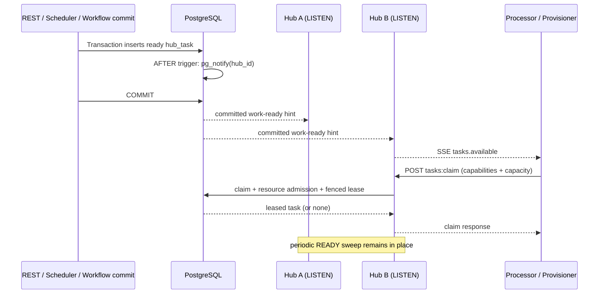

# PostgreSQL LISTEN/NOTIFY for cross-Hub SSE wake-ups

**Status:** Implementation candidate, branched from `master` (`feat/hub-postgres-notify-sse`).  
**Scope:** Hub gateway transport and database schema only; no changes to remote
processor/provisioner HTTP contracts, task leases or workflow state ownership.

## 1. Decision and motivation

The SaaS runtime has a deliberately small number of Hub pods holding bounded
PostgreSQL connections. Remote workflow processors and provisioners only use
REST and SSE; they do **not** have PostgreSQL credentials. The Hub already
broadcasts ephemeral `tasks.available` SSE hints locally and scans for ready
hubs every two seconds. The scan is essential for recovery but imposes an
avoidable delay when work committed by Hub A must wake clients connected to
Hub B.

**Decision:** Keep PostgreSQL as the only source of durable queue/lease/state,
and use transaction-coupled `LISTEN/NOTIFY` as a cross-Hub notification layer.
Use a dedicated listener connection per Hub pod and preserve the two-second
polling/reconciliation sweep. Do not deploy NATS/Redis/Kafka for this use case
until measured fan-out or database notification costs justify it.

### Non-goals

- Notifications do not assign a task to a worker or reserve capacity.
- No globally durable event stream, guaranteed delivery, exactly-once activity
  execution or cross-region active/active state ownership is introduced.
- SSE payloads do not carry workflow inputs, outputs, credentials or task data.
- No changes to the client-side `tasks.available` SSE event or the
  `POST /api/hub/workers/tasks:claim` protocol.
- The embedded timer scheduler continues to own durable deadlines, not `NOTIFY`.

## 2. Commit-to-claim flow



The trigger runs in the **same SQL transaction** as the task state change.
PostgreSQL sends notifications only for committed transactions; rollback
therefore produces no actionable wake-up. Multiple identical notifications in
one transaction are coalesced by PostgreSQL. Notifications are not stored
durably for disconnected listeners.

## 3. Concrete implementation

### SQL migration 014

`scaling/sql/014_hub_work_ready_notifications.sql` defines a trigger on
`wfc_scale.hub_task`:

| State transition | Notification rule | Explanation |
| --- | --- | --- |
| Insert READY with `due_at <= now()` | Yes | New work may be claimable |
| Insert future READY | No | Timer/due sweep remains responsible |
| Update future task to due NOW | Yes | Existing work became eligible |
| Change non-READY to due READY | Yes | Retry/requeue may be claimable |
| Release an active lease (1 -> 0/2/3) | Yes | Resource permits may unblock peers |
| Claim READY -> LEASED | No | Another worker already owns the lease |
| Update heartbeat/metadata only | No | Avoid irrelevant wake-ups |

The signal payload is **only the hub ID**. The Hub validates its length before
forwarding it to the local SSE broadcaster. Treat the payload as untrusted
advisory data; authorization and fencing still happen through REST+SQL.

A due time passing by wall clock alone does not update a row and therefore does
not emit a notification. The existing sweep handles it. The same is true for
a lease expiring without a row update, and for some capacity/policy-only changes.

### Hub service

`PostgresHubNotificationListener`:

1. Builds one separate `NpgsqlConnection` with `Pooling=false`.
2. Registers the notification handler and executes `LISTEN wfc_hub_task_ready`.
3. Performs an immediate `ReadyHubsAsync` catch-up scan **after** `LISTEN`
   becomes active, avoiding the subscription/snapshot race.
4. Uses a bounded, drop-oldest channel and a 25 ms coalescing window to
   forward unique hub IDs to `HubReadinessBroadcaster.Publish`.
5. Keeps the connection alive through Npgsql's asynchronous `WaitAsync`
   rather than repeatedly polling.
6. On errors, logs and retries with exponential backoff (1–30 seconds);
   each successful reconnect performs another catch-up scan.
7. On shutdown, closes the session and drains/finishes the channel.

The existing `HubReadinessBroadcaster` remains the **only** local SSE fan-out
mechanism. It continues to send initial hints on subscription and periodic
hints from the database sweep. Its per-subscriber bounded channels already
protect against unbounded backpressure. Worker-side hint channels have
capacity one and retry claims periodically.

### Opt-out

`WFC_HUB_PG_NOTIFY_ENABLED=false` or `0` disables the LISTEN service
without affecting REST/SSE or the periodic sweep. The SQL trigger still
emits notifications after migration 014; disabling only the listener does
not remove the database-side trigger overhead. If the trigger itself must
be rolled back, use the migration rollback instructions below.

### PostgreSQL connection budget

Hub task stores continue using `WFC_HUB_DB_POOL` (default 12). LISTEN adds
**one separate session per Hub process**, not one session per remote worker.
For example, 3 Hub pods with pool size 12 have a theoretical maximum of 39
connections from these components (36 pooled + 3 dedicated listeners), plus
other clients, migrations and PostgreSQL overhead.

The LISTEN connection requires session affinity. Do not use a PgBouncer
**transaction-pooling** address for it. Use a direct PostgreSQL endpoint or a
session-pooled endpoint.

## 4. Invariants and recovery

1. **Authoritative claim:** only the Hub's PostgreSQL work claim/lease can
   grant ownership. An SSE hint carries no token and may be duplicated.
2. **At-least-once notification:** a disconnect, process pause, network loss
   or overflowed bounded channel can lose a hint. Initial, reconnect and
   periodic reconciliation recover persisted work.
3. **Transaction boundaries:** notifications never indicate a rolled-back
   task creation, but two independent commits can be observed in different
   orders. No global ordering assumptions are valid.
4. **Policy admission:** FIFO, resource capacity, task version capabilities,
   workflow revision and lease fencing are still checked by the existing
   authoritative stores. No admission decision is cached in the listener.
5. **Timers:** delayed tasks and lease expiry are woken by the existing
   periodic sweep or the durable timer scheduler. A trigger cannot emit
   messages merely because the wall clock advances.
6. **Idempotency:** workers may receive multiple hints and attempt empty
   claims. The Hub preserves the same at-least-once external execution
   semantics; downstream side effects require idempotency and reconciliation.
7. **Multi-Hub:** PostgreSQL publishes to all subscribed Hub sessions.
   Each Hub only fans out to remote subscribers registered for that hub ID.
8. **Deployment compatibility:** older Hub builds continue to function
   without the listener; a new Hub build without migration 014 continues
   to operate with the periodic sweep. Deploy migration before expecting
   the low-latency path to work.

## 5. Deployment and rollback

### Deploy

1. Verify `WFC_PG` points to the actual PostgreSQL server/session pool and
   `WFC_HUB_DB_POOL` leaves space for the extra listener sessions.
2. Apply SQL migrations through `014_hub_work_ready_notifications.sql`.
   The migration is re-runnable and does not rewrite existing tasks.
3. Deploy Hub pods gradually. Existing workers and SSE clients need no
   coordinated upgrade.
4. Check Hub logs for `PostgreSQL work-ready notification listener connected`.
5. Validate a workflow created via Hub A wakes a worker attached to Hub B.
6. Verify that lost notifications do not strand tasks and monitor DB sessions.

`scripts/dev.ps1 db-schema`, the integration-test workflow and the local
observability Compose migration service install migration 014 automatically.

### Listener-only rollback

Set `WFC_HUB_PG_NOTIFY_ENABLED=false` and restart Hub pods. This preserves
all workflows, registrations, history and the existing SSE/polling fallback.

### Remove database-side trigger (maintenance rollback)

```sql
DROP TRIGGER IF EXISTS trg_hub_work_ready ON wfc_scale.hub_task;
DROP FUNCTION IF EXISTS wfc_scale.notify_hub_work_ready();
```

This only removes advisory notifications, not durable tasks. Coordinate with
running pods to avoid confusing intermittent latency changes. No database
state migration backfill is needed.

## 6. Validation matrix

| Test | Pass criterion |
| --- | --- |
| Real PostgreSQL: insert/commit, 2 listeners | Both listeners receive the same hub ID |
| Real PostgreSQL: transaction rollback | No hint for rolled-back hub, no task row |
| Real PostgreSQL: future -> due now | Notification delivered after due update |
| Real PostgreSQL: leased -> complete | Notify waiting workers when capacity released |
| Multi-Hub/remote SSE smoke | Worker attached to second Hub receives hint and claims |
| Kill/reconnect listener | Sweep still recovers pending work |
| Restore listener after tasks accumulate | Immediate reconciliation triggers a claim |
| Restart Hub during active work | Leases/fencing preserve at-least-once correctness |
| 1/3/5 Hub pods; 1,000 workflow load | No stranded work, no excessive empty claims |
| Notifications disabled | Existing functionality and 2-second sweep preserved |

CI runs PostgreSQL integration tests and the existing 1,000-workflow test
through the updated SQL migration. Runtime-level multi-pod latency and
reconnect chaos should also be benchmarked in a real deployment before
claiming a production latency SLO.

## 7. Metrics and performance experiment

Added low-cardinality OTel instruments:

- `workflow_hub_pg_notify_received_total`: raw notifications consumed by the listener.
- `workflow_hub_pg_notify_forwarded_total`: coalesced per-hub hints sent to SSE broadcaster.
- `workflow_hub_pg_notify_failures_total`: listener connection/read failures.
- `workflow_hub_pg_notify_listeners`: currently active listener sessions.

Keep existing `workflow_hub_sse_notifications`, claim-duration, backlog,
throughput, PostgreSQL connection and timer fire-lag metrics.

Suggested lab matrix: 1, 3 and 5 Hub pods, each with 12 DB pooled connections,
with the listener disabled/enabled, 100/1,000/10,000 ready tasks, different
numbers of subscriber workers, and batches versus individual enqueues.
Measure **database commit -> SSE delivery** and **database commit -> successful
claim** p50/p95/p99. Also measure CPU, `pg_stat_activity`, idle/empty
claim frequency and PostgreSQL `pg_notification_queue_usage()`.

Hypotheses to verify (not measured outcomes):
- Notifications remove most idle cross-pod discovery delay when workers are
  already connected and ready.
- Claim throughput/FIFO contention may become the new dominant limit.
- Small workloads benefit most; extreme write/fan-out rates may favor an
  external message broker or batch-based notification strategy.

Do not promise end-to-end low latency for workflows with intentional sleeps,
resource contention or external API processing delays.

## 8. Future extraction path

`LISTEN/NOTIFY` is an implementation detail of an advisory
`IWorkAvailabilityNotifier` abstraction if/when a broker is justified.
A future NATS/Service Bus design needs a transactional outbox and delivery
reconciliation; it must not replace database-authoritative claims, resource
permits, leases, idempotency, or history. Keep the SSE API stable during that
migration.
