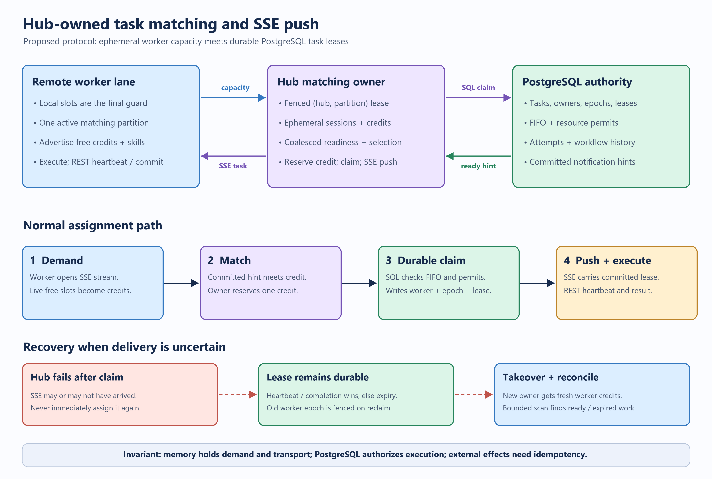

# Hub-owned task matching and SSE push

Status: **experimental opt-in implementation with limited v1 behavior**. The
existing adaptive claim/SSE and long-poll paths remain the fallback. The prose
below records the larger design; this status section identifies the behavior
currently implemented where it differs from the proposed protocol.

Each native lane uses one credit, even if its configured concurrency is larger.
Registration uses `POST /workers/push-sessions`, stream attachment uses
`GET /workers/push-sessions/{id}/events`, and sequenced updates use
`PUT /workers/push-sessions/{id}/capacity`; routes have the `/api/hub` prefix.
The credit update includes the previously finished delivery ID so a refresh
cannot recreate a credit while that delivery is in flight. The owner limits
sessions to 8192, matches through a bounded event-gated dispatcher and performs
single-task claims with a partition-owner row lock and epoch check inside the
claim transaction. A bounded cursor advances the reconciliation scan.

There is no durable received acknowledgement or separate delivery-attempt
budget. A failed send leaves the lease untouched and consumes the ordinary
attempt, so repeated failures can exhaust attempts without execution; this is a
limited experimental policy and requires operator recovery for dead tasks. The
PostgreSQL test covers a send failure, takeover, expiry and stale completion.
The worker handles completion and heartbeat independently of the stream, uses a
local single-slot guard and remembers recent `(task, epoch)` deliveries. Normal
multi-partition rotation revokes credit and waits for the owner's barrier that
no claim or delivery remains. After an uncertain disconnect, the worker waits
for running work and then 75 seconds, and additionally requires an old-session
revocation or a changed/expired owner epoch before granting credit again.
The direct-owner allowlist is `WFC_HUB_PUSH_TRUSTED_OWNERS`. This implementation
has not established production readiness or exactly-once external side effects.

The [editable Excalidraw scene](diagrams/hub-push-matching.excalidraw) is the
source for the diagram. Solid arrows are normal delivery; the lower recovery
lane shows what survives a lost stream or Hub process.

## 1. Decision

Keep task state, admission, leases, attempts, workflow revisions, resource
permits, FIFO ordering and history in PostgreSQL. Move *worker demand* and
*delivery connections* into the matching owner for each `(hub namespace,
matching partition)`. A matching service in the Hub process pairs committed
readiness hints with live worker credits, invokes the existing transactional
claim operation, then sends the committed lease to the selected worker over
SSE. Workers still heartbeat and commit results through REST.

An in-memory task ID, candidate, version or assignment is only a hint. It must
never authorize execution, survive ownership takeover as authoritative state,
or replace a database lease epoch. An SSE message is a delivery channel, not a
queue. A worker may execute only an assignment containing a current committed
task lease addressed to its worker identity.

This is an extension of the existing [event-gated claim dispatcher](../src/WorkflowCore.Hub.Gateway/HubEventGatedClaimDispatcher.cs),
which already holds demand in memory and coalesces readiness notifications.
It changes the transport from an HTTP long-poll response to a worker SSE stream.
It does **not** remove SQL for successful claims, heartbeats or completions.

## 2. Goals and boundaries

Goals:

- Reduce empty claim SQL, unnecessary claim admission waits and worker claim
  requests while preserving schedule-to-start latency.
- Recover from Hub, worker, SSE, notification and database interruptions without
  losing a durable task or accepting a stale completion.
- Bound delivery retries and avoid turning lost transport messages into many
  execution attempts or concurrent side effects.
- Preserve resource concurrency, strict FIFO, partition ordering, workflow
  revision fencing and the existing durable attempt/history model.
- Allow staged opt-in and immediate fallback to the current pull transport.

The first version targets one Hub namespace and one matching partition per
worker lane session. It does not change the upstream Workflow Core runtime,
make arbitrary sequential-v1 workflow constructs available, provide exactly
once external effects, or establish production identity/tenant isolation.

## 3. Current baseline and reason for change

The native worker currently calculates free slots before asking for at most 16
tasks. With matching enabled, it has one outstanding long poll and rotates
partitions; otherwise it uses adaptive claims and SSE readiness hints. The
long-poll response carries the lease. PostgreSQL `LISTEN/NOTIFY` and periodic
scans recover missed hints. Matching ownership is separately leased and fenced
in PostgreSQL. See the [current runtime guide](current-runtime.md),
[worker loop](../src/WorkflowCore.RemoteExecution/HubRuntimeWorkers.cs) and
[matching ownership](../src/WorkflowCore.Hub.Gateway/HubMatchingOwnership.cs).

The event-gated experiment was motivated by high empty-call counts. Later
profiling found task queue and policy/resource SQL could dominate matching
ownership SQL. Thus reduced HTTP polling is not a sufficient success measure;
the database and end-to-end latency must both be measured. See the
[event-gated report](hub-matching-event-gated-drain.md) and
[throughput investigation](throughput-investigation-report.md).

## 4. Ownership and capacity model

### Matching ownership

One owner holds the existing PostgreSQL lease for each `(hub, partition)`.
Workers discover the current owner through a load-balanced Gateway endpoint,
then open an authenticated internal SSE connection to that owner. A Gateway
proxy is possible if direct owner addresses are unavailable, but is not the
first implementation because it doubles long-lived connections. On a 409/503,
redirect, disconnect or lease change, the worker repeats discovery.

The owner checks its database ownership epoch before matching. The push path
should additionally verify the ownership epoch **inside the claim transaction**
or use an equivalent SQL fence. The present pre-claim check alone leaves a
check-to-claim race during takeover. Even with that race, task row locking and
epochs prevent two simultaneous valid task claims; the stronger owner fence
avoids a stale Hub leasing work it cannot deliver.

### Worker session and credits

Each workflow or activity lane has a stable `workerId` for its process lifetime
and a new random `sessionId` on each registration. The session identifies the
matching owner epoch, one namespace, one partition, capability/version set,
definition pins and a monotonically increasing capacity sequence. A session is
eligible only while its SSE stream is connected and its credit TTL is fresh.

The worker is the source of truth for its local execution semaphore. It sends
`freeCredits = maxConcurrency - running - locallyReserved`, capped by protocol
limits. The owner holds `available`, `reservedForClaim` and `sentInFlight`
counters; it reserves a credit **before** entering SQL claim and returns it on
an empty or rejected claim. It does not infer a free slot merely from task
completion; the worker publishes a new capacity sequence after releasing its
local slot. Stale or out-of-order sequences are ignored. Local worker slot
acquisition is a final guard against stale remote credit.

**A credit belongs to exactly one partition.** In v1, a lane advertises all
its free credits to only one partition at a time. It chooses an initial
partition using a stable hash plus jitter. It rotates after a bounded idle
period or work quantum so a busy partition cannot permanently monopolize
workers while another has ready tasks. A graceful move sends zero credit and
waits for the old owner to acknowledge that no claim is reserved or in flight;
only then does it grant credits to the next partition. After an unreachable
owner, the worker waits for the old session TTL and owner fencing before
granting credits elsewhere. Moving a lane does not move or cancel its running
task leases; they continue through REST heartbeats and completion. Any late
event carrying an old session ID is rejected before execution. Later
multi-partition sessions may divide credits into disjoint grants, but must
explicitly revoke a grant and receive acknowledgement before reusing those
credits at another owner. Replicating the full capacity to every partition
would overassign work.

Sessions and credits are intentionally ephemeral. They are reconstructed by
workers after takeover. The Hub never persists a worker-capacity row for every
heartbeat, because that would replace empty claim I/O with capacity-write I/O.

## 5. Normal delivery protocol

The table below describes the intended protocol; see the implementation status
above for the current endpoints and limitations.

| Step | Actor and action | Durable effect |
| --- | --- | --- |
| 1 | Worker discovers `(hub, partition)` owner, `POST /worker-sessions` with capabilities, lane limit and worker ID; owner returns session ID and owner epoch. | None. Registration alone gives no usable credit. |
| 2 | Worker opens `GET /worker-sessions/{id}/events` as SSE, then `PUT /worker-sessions/{id}/capacity` with sequence and free credits. | None. Owner counts credits only after the stream is live. |
| 3 | A task transaction commits; PostgreSQL notification carries namespace/type/version/partition. Owner coalesces the hint. A periodic scan covers dropped hints and expired leases. | Task row is already durable. |
| 4 | Owner selects a compatible live session with credit, reserves one or a small bounded batch of credits, verifies ownership and invokes `ClaimAsync` under existing task/resource/FIFO locks. | Task becomes leased to `workerId` with a new task epoch and expiry; attempt/history records are written. |
| 5 | Owner emits `task.assigned` containing task ID, payload, task epoch, lease expiry, worker ID, session ID and a delivery ID. Worker deduplicates `(taskId, epoch)`, acquires its local slot and starts execution. | SSE and delivery ID are not durable. The task lease is. |
| 6 | Worker sends optional `task.received` for visibility, heartbeats by REST, and submits its fenced result/commit. It then advertises the newly free credit. | Heartbeat and completion are durable SQL changes; result/history remain authoritative. |

The delivery ID is for stream diagnostics and duplicate SSE suppression. It is
not the task identity or the idempotency key for an external side effect. The
stable task/dispatch identity remains the idempotency key. A claimed task must
be delivered promptly; do not accumulate leased work in a Hub memory queue.
Start with one assignment per credit and a small per-session send buffer.

If an SSE send fails after claim, the Hub has an *uncertain* delivery. It must
not assume the worker did not receive the event. The task remains leased until
heartbeat, fenced completion, explicit safe rejection, or expiry. The worker
can reconnect while running and continue REST heartbeats independently of the
stream. A received acknowledgement improves diagnosis but does not justify
early reassignment when it is absent.

## 6. Recovery and duplicate-control rules

| Event | Required behavior | Bound on duplication / delay |
| --- | --- | --- |
| Owner dies before claim | Another owner takes the matching lease; workers reconnect and re-advertise. Ready task stays unleased. | No execution duplicate; takeover and reconciliation determine delay. |
| Owner dies after claim, before/while sending | New owner does not reconstruct a speculative delivery from memory. Task remains leased, then expires if no heartbeat or completion arrives. | One uncertain attempt; recovery waits for lease expiry unless a safe explicit rejection is recorded. |
| Assignment or `task.received` is duplicated/lost | Worker deduplicates `(taskId, epoch)` within its process. Missing acknowledgement never triggers immediate reassignment. | Same-epoch duplicate SSE does not start a second execution. |
| Worker dies or loses network | Session credits expire. Existing task lease expires unless heartbeats continue. Old epoch is fenced after reclaim. | At-least-once retry; a side effect completed before loss can repeat. |
| Stale worker continues after lease expiry | REST heartbeat/completion rejects old worker/epoch/expired lease. Worker cancels local execution on failed renewal. | State remains consistent; external side effects still need idempotency. |
| PostgreSQL notification is dropped or LISTEN disconnects | Reconnect using subscribe-then-scan and run a bounded periodic ready/expired sweep. | Schedule-to-start delay is bounded by reconciliation plus claim latency. |
| Database is unavailable | Stop claiming; retain bounded hints, let sessions reconnect/re-advertise, and retry reconciliation after recovery. | No memory-only assignment or successful completion claim. |
| Capability or policy changes | Re-register capabilities; SQL evaluates the current durable workflow/policy/task constraints at claim time. | No stale in-memory eligibility authority. |

The current 45-second task lease plus a recovery sweep can make an uncertain
post-claim delivery take longer than 45 seconds to become available again.
Tune that interval against actual activity duration, heartbeat reliability and
the schedule-to-start SLO. A shorter lease without reliable worker renewal
would increase overlapping execution and side-effect duplication.

The existing claim increments `attempts` before the worker receives a task.
Repeated failures between claim and delivery could exhaust `max_attempts`
without execution. Before enabling push, define an explicit delivery-versus-
execution attempt policy. The recommended policy is:

- Preserve the current task epoch increment on every durable claim or reclaim.
- Record `deliveryOutcome` as `Unknown`, `Received`, `RejectedBeforeStart` or
  `LeaseExpired`, without treating an absent SSE acknowledgement as proof of
  non-execution.
- Budget execution retries separately from delivery uncertainty, or make a
  demonstrably pre-start rejection return the task without consuming an
  execution retry. Keep an overall delivery churn limit and surface dead work
  for operator recovery rather than retrying forever.
- Keep the existing stable native dispatch key across task redelivery. An
  activity handler must reconcile or deduplicate external effects using it.

This likely needs a forward-only migration and changes to the attempt journal.
It must preserve existing rows and distinguish old attempts whose delivery
status is unknown. A simpler initial release can retain today's attempt count
and lease-expiry behavior, but should be labelled experimental and tested for
the post-claim/pre-send crash window before promotion.

## 7. Matching and scheduling rules

- Put the push dispatcher beside the existing Hub matching service, separate
  from the embedded **timer scheduler**. Timers still persist and enqueue tasks;
  the push matcher does not run workflow definitions or business activities.
- Use committed typed notifications as a latency hint, then a low-frequency,
  paginated recovery scan. The current 512-hint recovery limit needs pagination
  before claiming a strict recovery bound at larger cardinalities.
- Coalesce hints by `(hub, partition, type, version)` and allow one bounded
  claim drain per partition. An empty claim consumes its hint until a new
  commit, permit release or recovery probe. A successful claim may continue
  draining while live credits and eligible work remain.
- Select workers fairly within a compatible lane, with round-robin or oldest
  available credit. Matching is advisory: SQL must recheck workflow status,
  definition pins, due time, max attempts, resource capacity and FIFO order.
- Preserve `task.partition_id % matchingPartitionCount` routing. Business
  resource/FIFO scopes do not change when matching ownership changes.
- Keep claim admission and connection pool budgets so a backlog of hints cannot
  starve heartbeat or completion operations. No unbounded in-memory task or
  session queue is allowed.

## 8. Proposed REST/SSE contract details

All requests use the existing Hub auth boundary. Production authorization and
tenant isolation remain separate work. The owner verifies `workerId`, namespace,
partition and capabilities; a session token is scoped to one owner epoch.

| Contract | Required fields / behavior |
| --- | --- |
| Session registration | `workerId`, `lane`, `hub`, `matchingPartition`, capability/version list, workflow definition pins, max concurrency, client generation. Return `sessionId`, owner epoch, credit TTL and stream URL. Reject topology mismatch. |
| SSE stream | Event `task.assigned` with `deliveryId`, `sessionId`, `taskId`, task epoch, lease expiry and the existing leased-task payload. Keepalives; no intermediary buffering. Only a live stream can receive credit-backed claims. |
| Capacity update | `sessionId`, monotonically increasing `sequence`, `freeCredits`; idempotent on the same sequence/payload, reject conflicting replay. Zero on graceful drain. Server never increases credit from an old sequence. |
| Receipt | `task.received(deliveryId, taskId, epoch)` is optional telemetry; it is not a start fence. A rejected assignment must say `RejectedBeforeStart` and be fenced before early requeue. |
| Existing task APIs | Heartbeat, fail, completion, native commit and task lease checks retain their current worker ID/epoch/revision fencing. |

Close the SSE stream and set credits to zero on graceful shutdown. For hard
failures, expire credits after a short bounded TTL. Running task leases are
independent of session lifetime. Keep the direct claim and long-poll endpoints
available for fallback and for multi-Hub lanes until equivalent push routing
exists. A worker must not use pull and push concurrently with the same free
slots; transport selection is per lane.

## 9. Database work and I/O expectation

Required persistence changes are limited to the owner-epoch claim fence and,
if adopted, delivery-versus-execution attempt accounting. Do not persist each
capacity change or SSE event. The task row plus lease is the recovery record;
a separate durable SSE outbox would add a write per assignment without
removing the fundamental ambiguous-delivery window.

Expected savings come from fewer **empty** claim queries and less claim
admission contention. Successful task claim, lease heartbeat, result commit,
resource permit checks and periodic reconciliation still touch PostgreSQL.
The claim query may remain the dominant cost, especially for constrained FIFO
work. Push also adds long-lived connections, per-session memory and connection
management. Measure before asserting a net database or throughput win.

## 10. Verification and rollout gates

Implement behind an opt-in flag with the existing paths as rollback. Roll out
in this order: session/credit protocol, owner-fenced claim, SSE assignment,
recovery/attempt accounting, then performance promotion. Do not change old
transport semantics in the first stage.

Correctness tests should use PostgreSQL integration tests and two Hub replicas:

1. Credit conservation under parallel notifications, claim failures, worker
   capacity updates, session reconnect and partition rotation; no lane gets
   more leases than local slots.
2. Kill an owner before claim, after DB claim before SSE send, and after SSE
   send before acknowledgement; verify takeover, bounded recovery and journal.
3. Drop SSE, NOTIFY and REST responses; verify dedupe, periodic recovery,
   heartbeat fencing and no permanent stranded ready task.
4. Run worker crash, slow handler, lease expiry and stale completion races;
   verify task epochs, workflow revisions, resource permits and FIFO ordering.
5. Exercise multi-version capabilities, native workflow and activity lanes,
   delayed tasks, dead tasks, policy updates and empty backlog.
6. Validate old adaptive claim and long-poll workers against the new Hub, and
   new workers falling back to the old transport.

Performance A/B/C should compare adaptive claim, current event-gated long poll
and push on the same topology and workload. Record PostgreSQL statement count,
CPU and wait time per completed task; empty claims; claim and completion p95/p99;
schedule-to-start p95/p99; throughput; lease expiries before first heartbeat;
delivery uncertainty; duplicate side effects; SSE reconnect rate; owner
takeover time; and session memory. Include unconstrained, partition FIFO and
keyed FIFO workloads. A push release is ready only if correctness/failover gates
pass and the measured database and user-visible latency tradeoff is acceptable.

## 11. Decisions for later promotion

- Whether worker owner URLs are reachable directly in every deployment. If
  not, specify a streaming Gateway proxy and account for its connection cost.
- Whether to separate delivery and execution attempt accounting. V1 retains the
  existing budget and can exhaust it on repeated uncertain deliveries.
- Credit TTL, owner lease duration, reconnection backoff and reconciliation
  period, chosen from measured recovery and connection-load targets rather
  than copied blindly from current polling intervals.
- Whether a later version should support disjoint simultaneous credit grants
  to multiple partitions. V1 deliberately keeps one partition per lane.
