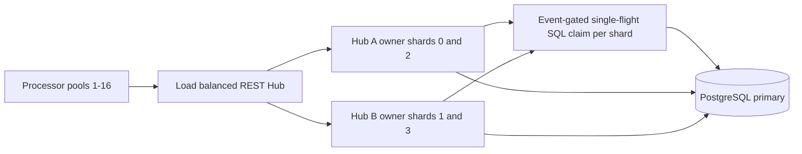

# Linear processor scaling: PR #22 baseline and incremental optimization plan

**Baseline:** PR #22, `perf/matching-event-gated-claim-drain` at commit
`37f4611c4cfcb59eb34a4b09dafb948f280c8e7f`.
**Experiment:** PR #26, `perf/linear-processor-scaling-from-pr22`.
**Status:** Opt-in first experiment; throughput, correctness and safety must be confirmed by CI.
No changes to PR #22 defaults.

## Scaling objective and its mathematical boundary

Goal: at fixed representative workload, completing workflows per second should
grow roughly proportionally with independently provisioned processor capacity
until a *measured* limit of PostgreSQL, Hub CPU, network I/O, workflow
dependencies, or resource constraints is reached.

For processors `N`, define `S(N) = completed_workflows_per_second(N) /
completed_workflows_per_second(1)`; efficiency is `E(N) = S(N) / N`.
Measure `N = 1, 2, 4, 8, 16`; on dedicated hardware extend to 32.
Targets to investigate: >0.8 efficiency at 2, 4 and 8 when the workload,
physical resources and explicit policy limits permit. `E(N) < 0.8` is a
diagnostic trigger, *not* automatic failure if PostgreSQL has been shown to
reach a capacity limit or the workload has genuine business serialization.
Track workflow p50/p95/p99, throughput, queue schedule-to-start, retry count,
and correctness together.

**Do not infer scale-out from a 4-vCPU GitHub runner with 16 containers.**
The CI matrix is a regression/tracing aid. Use dedicated independent
processor/Hub/DB resources for a meaningful capacity curve.

## PR #22 observed architecture

PR #22 has a confirmed successful 3-way CI run:
[run 42308250417](https://github.com/thanhhaictld/workflow-core/actions/runs/42308250417).
It completed 600 workflows per strategy and uses identical two-Hub,
four-matching-shard resources. One event-gated sample reports these *workflow
p95* observations:

| Policy | 8 processors | 16 processors |
|---|---:|---:|
| unordered | 11.977 s | 9.742 s |
| partition FIFO | 15.581 s | 8.621 s |
| keyed FIFO | 6.046 s | 5.994 s |

There is no 1/2/4 processor curve in this source, and this matrix must
not be interpreted as evidence of linear scaling.

## Architectural blockers, ranked

| Severity | Location | Mechanism | Proof/measurement needed |
|---|---|---|---|
| P0 | `HubEventGatedClaimDispatcher.LongPollAsync` | One active SQL drain per (Hub, matching shard), regardless of worker count | Drain busy %, pending demand, successful tasks per drain |
| P0 | `HubTaskStore.ClaimAsync` | Up to 96 candidates selected per attempt; separate transaction per candidate; permit query for each | Actual candidate count/claimed, SQL RPCs/task, PG CPU/locks |
| P0 | `HubRuntimeWorkers.ExecuteAsync` | One outstanding matching HTTP poll per worker lane, shard rotation after 4s | Idle worker slots while a different shard has runnable backlog |
| P1 | `HubTaskStore` shared claim gate | Claim admission is limited to max(1, pool/4) per Hub process | `hub.task.claim.admission_wait` p95/p99 |
| P1 | `HubNativeWorkflowStore.CommitAsync` | Event-lane Hub advisory lock for subscription-sensitive workflow commits | `workflow_hub_native_event_lane_lock_wait_seconds`; no unsafe lock removal |
| P1 | PostgreSQL task candidate filtering | `partition_id % shard_count` and string-concatenated capabilities cannot cleanly seek by indexed shard/type | EXPLAIN ANALYZE BUFFERS WAL, actual row scans |
| P2 | PR #22 recovery scan | 10s reconciliation query capped at 512 hints, missed notifications can cost schedule-to-start | Lost-hint recovery test at high capability cardinality |

An ownership partition is **not** an activity ordering partition. Matching
shards are purely routing/HA; resource-key FIFO and workflow-row revisions
remain PostgreSQL-authoritative. Do not introduce a global lock to make
matching or ordering simpler.

## Phase 1: batched, unconstrained SQL claim (implemented, flag default OFF)

`WFC_HUB_BATCH_UNCONSTRAINED_CLAIMS=true` on both Hubs.

- One transaction selects up to `MaxTasks` eligible rows using
  `FOR UPDATE OF t SKIP LOCKED`, and advances epochs/leases with a single
  `UPDATE ... RETURNING`.
- Explicit `NOT EXISTS hub_task_constraint` ensures this path cannot bypass
  keyed or strict FIFO resource permits.
- Append durable attempts and workflow task claimed events inside the same
  PostgreSQL transaction. Preserve lease takeover and old attempt closure.
- Fill unused worker capacity via the untouched constrained claim path.
- Existing benchmark behavior is available with the flag OFF.
- Telemetry: `workflow_hub_claim_unconstrained_batch_count` and
  `workflow_hub_claim_unconstrained_batch_duration_seconds`.

Expected value: fewer SQL round trips and lock acquisitions per task. The
query might make an empty poll more expensive because the old claim path
still runs on misses; instrument and quantify before promoting.

Safety tests in
`HubUnconstrainedBatchClaimTests.cs` cover concurrent claim uniqueness,
epochs, completion, mixed constrained/unconstrained routing and strict FIFO.
Additional native workflow event-journal/failover coverage should be checked
through the full distributed CI suite.

## Phase 2: remove matching serialization only after Phase 1 proof

A next *separate* experiment should schedule demand by
`(Hub,matching shard,capability)` rather than use one SQL drain lock per
matching shard. Bound independent capability claim drains to the Hub's
effective DB transaction budget; do not allow unbounded speculative claims.
Choose concurrency using measured DB service time and completion pressure,
not `processor_count` alone.

Alternate experiment: keep single-flight but batch claim up to available
worker capacity and directly transfer leases across already registered worker
slots. A successful batch should wake only compatible waiters; do not issue a
claim per waiter and do not maintain authoritative task eligibility in memory.

Never assert a task is leased based solely on NOTIFY; only committed
PostgreSQL UPDATE grants a lease.

## Phase 3: eliminate shard-rotation discovery cost

Workers should register idle capacity once and be discoverable by all
matching shards. That is **one capacity credit, not four simultaneous SQL
claims**. Hub transfers a compatible work hint/claim opportunity to a
waiting worker; a durable lease still precedes activity execution. Add
fenced owner handoff and recovery for a Hub crash after lease commit but
before HTTP response.

## Phase 4: measure DB/CPU saturation and choose next changes

- Per-Hub: active claim SQL, completion transactions, pool used/idle/wait,
  admission-wait p95/p99, task age, successful vs empty claims, RPCs/lease.
- Per-matching shard: pending workers, backlog by capability, claim drain
  busy time, tasks/drain, missed-hint recovery duration, owner epochs.
- Per-workflow: queue-to-start p95/p99, processing p95/p99, completion p95/p99,
  native commit duration, event-lane locks, DB row locks, retries/replays.
- PostgreSQL: `pg_stat_statements`, wait events, connection count,
  `pg_locks`, `pg_stat_io`, WAL bytes/s, CPU/disk/IOPS, query plans and
  buffer hits/reads. Count statements and transaction commits per completed
  workflow. Look for index misses in ready/expired task selection.
- Include realistic external I/O workloads, plus separate synthetic
  no-I/O and strict FIFO controls. A genuinely exclusive resource should
  **not** scale linearly; independent keys should.

## Reproducible CI smoke benchmark

New workflow:
`.github/workflows/workflow-hub-linear-scaling.yml`

Two equal-resource matrix cases:
`WFC_HUB_BATCH_UNCONSTRAINED_CLAIMS=false` vs `true`.
Both use PR #22's event-gated four-shard, two-Hub topology. For each case,
execute 1, 2, 4, 8, 16 processors at constant workflow count per policy;
test unordered, partition FIFO, keyed FIFO. Verify completeness, zero
unexpected retries, and ordering using `verify_ordering.py`. Persist
PostgreSQL wait samples and throughput/latency per cohort.

`summarize_linear_scaling.py` calculates actual throughput,
`S(N)`, `E(N)`, workflow p95 and p99 from durable k6 summaries.

Before enabling by default require **repeated** controlled runs, acceptable
p95/p99, zero policy overlap, durable history consistency, no stale-epoch
completions, and HA crash/takeover. Rollback is a single flag change on all
Hub replicas.
