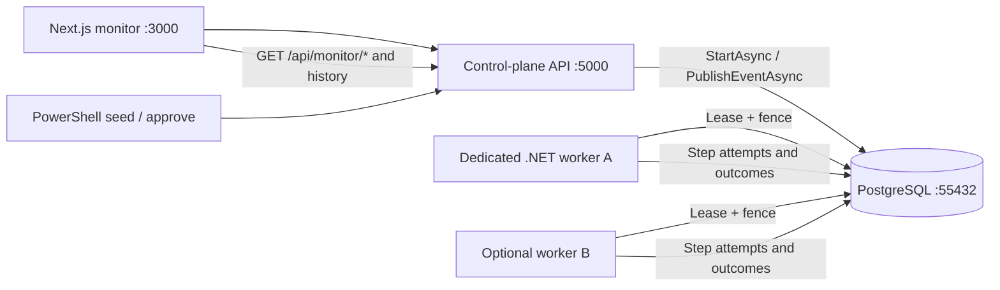
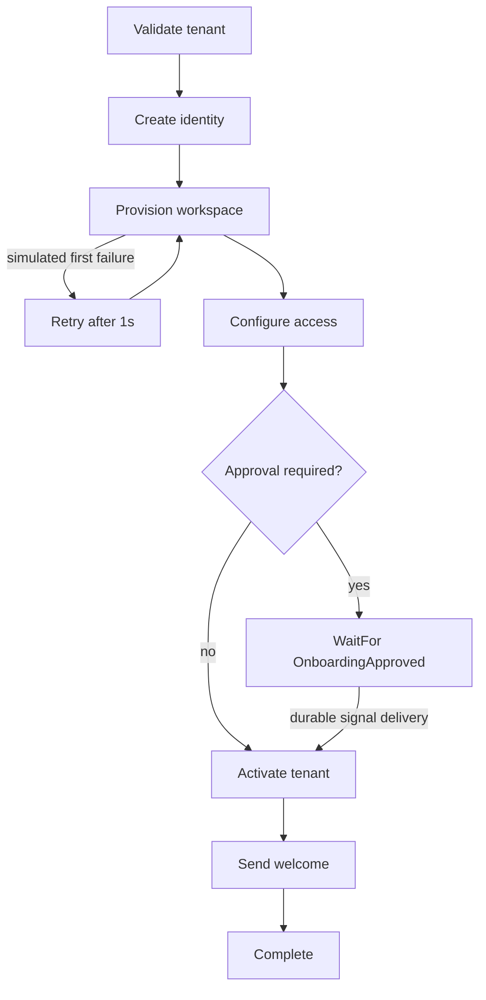
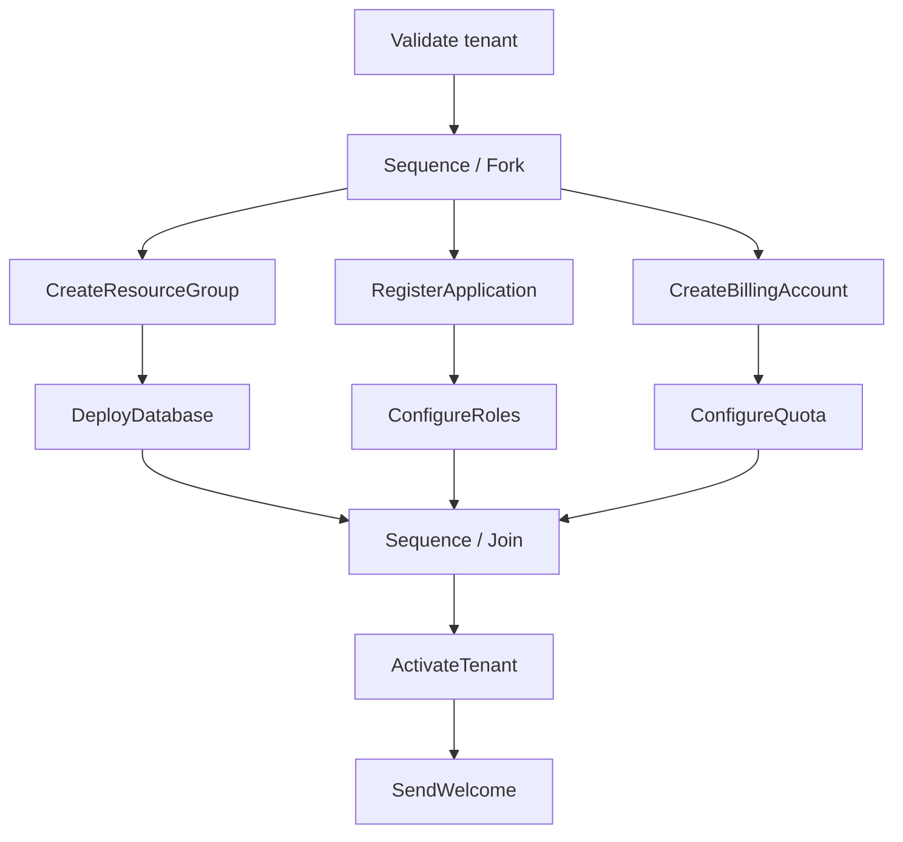

# Tenant onboarding demo — Workflow Core distributed monitor

> Scope: **direct PostgreSQL runtime** (`WorkflowCore.Scaling.PostgreSQL`).
> For the Hub native runtime, task transport and matching, start with the
> [current runtime guide](current-runtime.md). Historical branch/baseline notes
> below refer to this document's original review.

This deliberately synthetic demo exercises an actual persisted, fenced workflow.
It is not a real tenant provisioning integration, and no external systems
are called. Its purpose is to populate the monitoring UI with real execution
history (successful, retried, waiting, resumed).

## Runtime topology



The API configures `WFC_EMBEDDED_WORKER=false` when launched through
`scripts/dev.ps1`; this prevents the producer from also executing work.
The separate .NET worker registers *the same definitions* as the API.
Running `pwsh ./scripts/dev.ps1 worker` in another terminal adds a replica,
not another consumer of the legacy Workflow Core poller.

## State transitions and examples



Three workflow definitions implement the sample:

- `tenant-onboarding-auto`: no manual approval
- `tenant-onboarding-approval`: waits for a tenant-keyed signal
- `tenant-onboarding-parallel`: three logical branches and one join

The workflow state persists step flags and `ProvisionAttempts`. An optional
first-time exception triggers `WorkflowErrorHandling.Retry`. The journal
captures `StepBodyThrew` and a new attempt ID on retry. The approval
workflow pauses after access configuration, allowing inspectors to see
`StepWaitingForEvent`, and resumes after event delivery.

## Parallel fork/join review

The shared [ParallelOnboarding.cs](../sample/onboarding/WorkflowCore.Scaling.Samples/ParallelOnboarding.cs)
implements the same fluent API pattern as
`StartWith(...).Parallel().Do(...).Do(...).Do(...).Join().Then(...)`.
Each branch has two simulated steps with different delays.



The **trace hierarchy** is derived from `/api/monitor/workflows/{id}/topology`
for the exact version that started the run: the `Sequence` definition has
three `Children` branch roots, while its `Outcomes` point to activation
after the join. In the Next.js waterfall:

- **Parallel · 3 branches** is a collapsible fork group.
- Each branch header contains nested step-attempt rows and retry spans.
- **Join · all branches** is a synchronization *marker*. There is no
  separate `Join` step in the Workflow Core executor.
- The join is labeled "Joined" only when the Sequence execution pointer
  is actually complete. No fake join timestamps or durations are emitted.
- The post-join continuation is outdented to the parent workflow level.

This is **logical concurrency**: the current PostgreSQL workflow gate fences
a workflow execution, and branch steps are processed by the Workflow Core
executor. The lanes are not proof of physical concurrency across worker
replicas or of OpenTelemetry parent/child spans. The attempt durations and
ordering always come from the append-only journal.

The PowerShell acceptance script asserts that all three branch roots have
durable `StepAttemptStarted` events and the Sequence container's join has a
committed `StepCompleted` record before the overall workflow completes.

## Hub provisioner parallel sample

The Hub provisioner also registers `tenant-onboarding-parallel` version 1 in
the `onboarding` Hub. It follows the same three two-step branches and join,
then checks that database, roles, and quota branches finished before activation
and the welcome activity. Activities are simulated and do not provision real
resources. This is a separate Hub workflow from the legacy sample above; Hub
runs appear under **Workflow runs**, not in the legacy definition archive.

Rebuild and start the observability stack from the repository root as described
in [the observability guide](../observability/README.md), then run a small
end-to-end workload (the existing `.env` supplies the Hub token):

```powershell
docker compose -f scaling/observability/compose.yaml --env-file scaling/observability/.env --profile load run --rm -e K6_DEFINITION=tenant-onboarding-parallel -e K6_VERSION=1 -e K6_WORKFLOWS=1 -e K6_VUS=1 k6
```

Open `http://localhost:3002/workflows?hub=onboarding` and select the new run.
The k6 check validates branch completion, activation, and welcome in the
persisted native snapshot. Hub trace rendering uses recorded activities; it
does not currently provide the legacy topology fork/join view.

## Run

```powershell
pwsh ./scripts/dev.ps1 up
# A second terminal:
pwsh ./scripts/dev.ps1 seed
# Copy the approval workflow UUID from the output:
pwsh ./scripts/dev.ps1 approve -WorkflowId 00000000-0000-0000-0000-000000000000
```

Replace the UUID with the printed value; the example zero UUID is not a real
workflow. Or use the dashboard's **Onboarding workflow playground** to create
and approve workflows without a CLI.

To verify durable history automatically (API and worker must be running):

```powershell
pwsh ./scripts/test-onboarding.ps1
```

## Reviewing the UI

1. Create a Happy path run, select its row and inspect the step waterfall.
2. Create a Transient retry run. Open its *Event history*: a thrown attempt
   should be followed by a second attempt to provision the workspace.
3. Create an Approval run. Observe the waiting pointer and lack of
   `WorkflowCompleted`; click *Approve sample onboarding* in the trace.
4. Observe `SignalDelivered`, renewed step activity and completion.
5. Run multiple `worker` processes and inspect work queue lease owners.

The elapsed bars cover the demo's artificial step delays, not network traces.
The history is *append only*, not an executable deterministic replay log. All
control endpoints are **development-only and unauthenticated**; do not deploy
the demo API to a public or multi-tenant environment.
