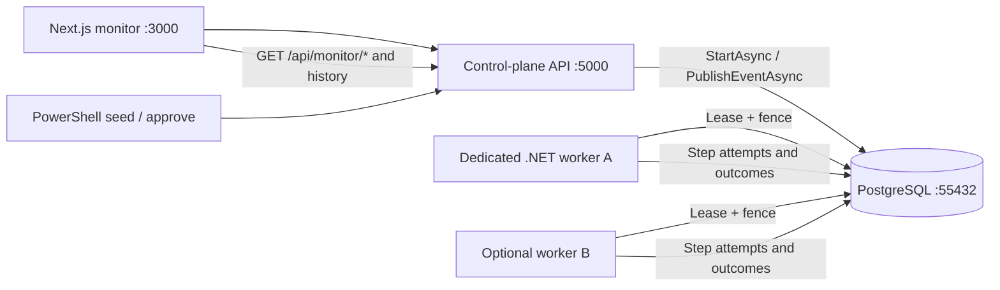
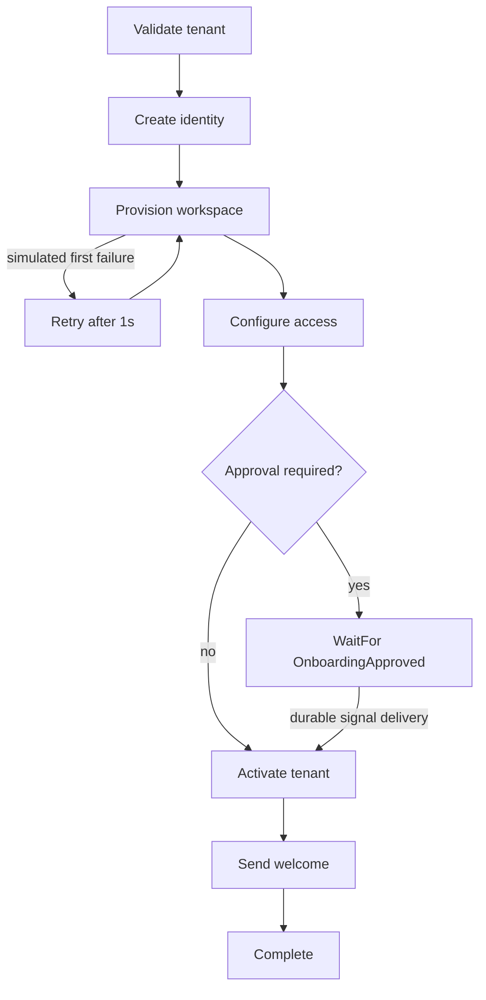

# Tenant onboarding demo — Workflow Core distributed monitor

This deliberately synthetic demo exercises an actual persisted, fenced workflow.
It is not a real tenant provisioning integration, and no external systems
are called. Its purpose is to populate the monitoring UI with real execution
history (successful, retried, waiting, resumed).

## Runtime topology



The API configures `WFC_EMBEDDED_WORKER=false` when launched through
`scripts/dev.ps1`; this prevents the producer from also executing work.
The separate .NET worker registers *the same definitions* as the API.
Running `pwsh ./scripts/dev.ps1 worker` in another terminal adds a replica,
not another consumer of the legacy Workflow Core poller.

## State transitions and examples



Two workflow definitions implement the branch:

- `tenant-onboarding-auto`: no manual approval
- `tenant-onboarding-approval`: waits for a tenant-keyed signal

The workflow state persists step flags and `ProvisionAttempts`. An optional
first-time exception triggers `WorkflowErrorHandling.Retry`. The journal
captures `StepBodyThrew` and a new attempt ID on retry. The approval
workflow pauses after access configuration, allowing inspectors to see
`StepWaitingForEvent`, and resumes after event delivery.

## Run

```powershell
pwsh ./scripts/dev.ps1 up
# A second terminal:
pwsh ./scripts/dev.ps1 seed
# Copy the approval workflow UUID from the output:
pwsh ./scripts/dev.ps1 approve -WorkflowId 00000000-0000-0000-0000-000000000000
```

Replace the UUID with the printed value; the example zero UUID is not a real
workflow. Or use the dashboard's **Onboarding workflow playground** to create
and approve workflows without a CLI.

To verify durable history automatically (API and worker must be running):

```powershell
pwsh ./scripts/test-onboarding.ps1
```

## Reviewing the UI

1. Create a Happy path run, select its row and inspect the step waterfall.
2. Create a Transient retry run. Open its *Event history*: a thrown attempt
   should be followed by a second attempt to provision the workspace.
3. Create an Approval run. Observe the waiting pointer and lack of
   `WorkflowCompleted`; click *Approve sample onboarding* in the trace.
4. Observe `SignalDelivered`, renewed step activity and completion.
5. Run multiple `worker` processes and inspect work queue lease owners.

The elapsed bars cover the demo's artificial step delays, not network traces.
The history is *append only*, not an executable deterministic replay log. All
control endpoints are **development-only and unauthenticated**; do not deploy
the demo API to a public or multi-tenant environment.
