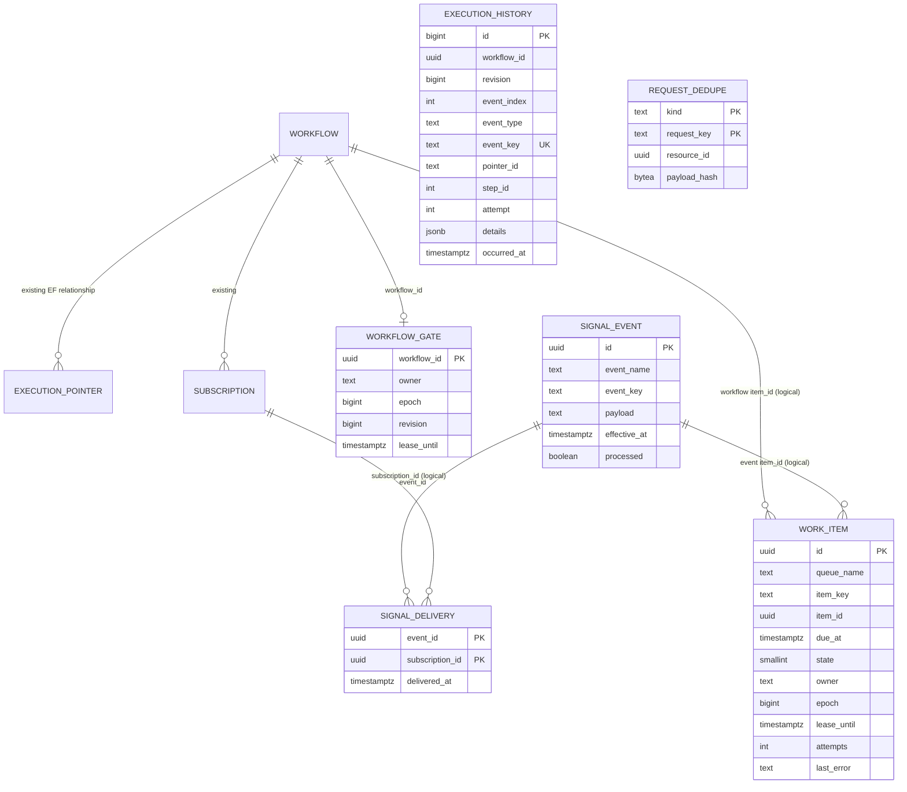

# PostgreSQL persistence and invariants

## Database layout

Two schemas are used by the default implementation:

- `wfc`: existing EF Core `Workflow`, `ExecutionPointer`, `Subscription`,
  `ExecutionError` and related tables. Created by the original PostgreSQL
  provider migrations.
- `wfc_scale`: this branch's new distributed runtime tables, created by
  `scaling/sql/002_distributed_runtime.sql`, `003_signal_delivery.sql` and
  `004_request_dedupe.sql` and `005_execution_history.sql` **in that order**.



**Diagram keys marked logical are not SQL foreign keys.** Do not assume the
database enforces them. The only new explicit FK in these migrations is
`signal_delivery.event_id -> signal_event.id` with cascade delete.

## Tables and indexes

### `work_item`

`queue_name` is currently `workflow` or `event`. `item_key` is a logical
idempotency key and is unique within queue. Work enters ready as `state=0`.
A claim increments `epoch` and `attempts`, sets lease owner/deadline and
changes state to 1. Success changes state to 2; retry/defer returns 0;
exhaustion eventually moves to 3. A manual dead-letter replay resets state
to 0 and increments epoch.

Indexes:
- partial ready: `(queue_name,due_at,id) WHERE state=0`
- partial expired lease: `(queue_name,lease_until,id) WHERE state=1`
- uniqueness: `(queue_name,item_key)`

### `workflow_gate`

`workflow_id` primary key; `epoch` is the **lease fencing generation**;
`revision` is the **committed workflow state revision**. They are different
counters. New ownership increments epoch, successful fenced state commits
increment revision. Gate release clears owner and expiry without decrementing
either value.

### `signal_event` and `signal_delivery`

The signal store intentionally keeps unprocessed events for replay when a
subscription is created later. `signal_delivery(event_id,subscription_id)`
prevents duplicate application to the same subscription. The new event
store is separate from the legacy EF `Event` table.

### `request_dedupe`

Unique `(kind,request_key)`. `payload_hash` is SHA-256 of a serialized
argument tuple; a repeated key with changed arguments throws. This is
idempotency of **intent creation**, not exactly-once effects.

### `execution_history`

Append-only audit journal. Rows contain stable event types and minimal
non-sensitive metadata. `id` is the chronological cursor; `revision` is the
state generation and is **not unique** because a crashed attempt may be retried
without advancing state. Durable dispatch records are written before external
step invocation; completed state transitions, signal delivery, and queue
retry/dead-letter records share their respective database transactions.

No history retention/archival job is implemented.

## Atomicity boundaries

All of the following must commit together for a workflow step:
1. Conditional workflow-gate revision update.
2. Conditional work-item ACK.
3. EF workflow and pointer updates.
4. Generated subscriptions and execution errors.
5. Work-item intents for the next execution.
6. Backfill of retained signals for newly generated subscriptions.
7. Journal records for the committed pointer/step/status transitions.

`ExecuteWorkflowAsync` uses `PostgresContext.Database.BeginTransactionAsync`
for this path. External HTTP/provisioning calls cannot participate.

Event fan-out is **per-subscription transactional**, not one global transaction.
After each subscription, the marker and workflow wakeup are committed. The
event work ACK and processed marker occur afterward, supporting re-delivery
of an unfinished fan-out.

## Useful read-only diagnostic SQL

```sql
SELECT queue_name, state, count(*) AS items,
       min(due_at) AS oldest_due
FROM wfc_scale.work_item
GROUP BY queue_name, state
ORDER BY queue_name, state;

SELECT id, queue_name, item_id, attempts, epoch, owner, lease_until, last_error
FROM wfc_scale.work_item
WHERE state = 3
ORDER BY updated_at DESC LIMIT 100;

SELECT workflow_id, owner, epoch, revision, lease_until
FROM wfc_scale.workflow_gate
WHERE owner IS NOT NULL
ORDER BY lease_until NULLS FIRST LIMIT 100;

SELECT event_name, event_key, count(*)
FROM wfc_scale.signal_event
WHERE processed = false
GROUP BY event_name, event_key
ORDER BY count(*) DESC LIMIT 50;
```

## Growth, vacuum, retention and safety

There is **no implemented retention/archival job**. `work_item` rows in state
2, signal deliveries, request dedupe keys, and stale signal events may grow
indefinitely. Before production, define retention per business SLA and
workflow replay window, add bounded background deletion/archiving and
monitor vacuum/index bloat.

Do **not** manually delete:
- signal events while a live subscription or replay might require them;
- request dedupe keys before the permitted idempotency horizon;
- pending/leased work before confirming whether the underlying workflow state
  already advanced.

Tune `max_connections`, pool sizes, vacuum and WAL volume under measured
multi-replica load. The CI database uses one PostgreSQL 17 service, not HA.
