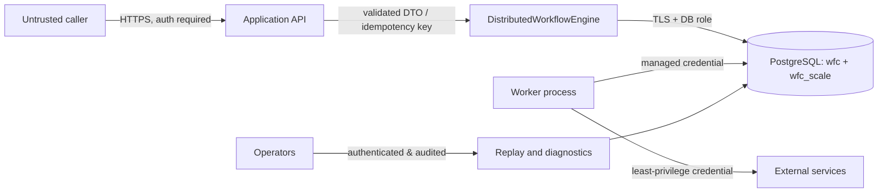

# Security and trust-boundary review

> Scope: **direct PostgreSQL runtime** (`WorkflowCore.Scaling.PostgreSQL`).
> For the Hub native runtime, task transport and matching, start with the
> [current runtime guide](current-runtime.md). Historical branch/baseline notes
> below refer to this document's original review.

**Assessment:** architecture-level threat checklist, not a completed audit.

## Trust boundaries

**Current code exception:** the benchmark HTTP sample is unauthenticated.
It is **not** suitable for production ingress. The diagram's authentication,
operator service and network restrictions are required controls, not shipped
middleware.

## Main risks and mitigations

| Risk | Current state | Requirement |
|---|---|---|
| Unauthorized workflow start/event injection | Sample has no authentication | OIDC/OAuth/JWT or trusted service auth, RBAC and rate limiting |
| Cross-tenant access/overload | No tenant authorization or quotas | Tenant-bound workflow ownership and admissions |
| Unsafe deserialization | Workflow Core Newtonsoft serializer has type metadata | Trusted type binder/allowlist; reject unsafe input |
| DB credential compromise | Connection string provided to app | Dedicated runtime role, secret manager, TLS, short-lived credentials |
| SQL misuse | SQL statements use parameters/interpolation for values | Keep schema/table names trusted; no user-controlled SQL identifier |
| Dead-letter replay | Requeue API does not do auth/audit | Secured operator endpoint + approval + immutable audit trail |
| Non-idempotent external effects | Step code may repeat after timeout/retry | Stable idempotency keys, reconciliation and compensation |
| Payload leakage | Event and workflow data persist | Encryption-at-rest, data minimization, retention/PII controls |
| Resource exhaustion | Configurable concurrency, no tenant rate limit | Quotas, limits, request size validation and load shedding |
| Rogue worker | Leases protect commits, not external credentials | Workload identity, network policies, scoped API tokens |

## Database role split (recommended, not configured)

- **Migration role:** schema DDL in `wfc` and `wfc_scale`, used only in
  deployment job.
- **Runtime role:** minimum needed DML on workflow, pointer, subscription,
  errors and distributed tables. No CREATE/DROP/ALTER.
- **Read-only ops role:** SELECT-only views for dashboards and diagnostics.
- **Operator role:** replay through audited application methods, not a blanket
  writable SQL console.

Database connections should use encrypted transport with certificate
validation appropriate to the infrastructure. Run secret rotation and backups
through managed infrastructure, not hard-coded GitHub workflow dev secrets.

## Idempotency and request isolation

`request_dedupe` keys are unique per `kind` globally, not per tenant. A
production API must namespace or derive keys from authenticated tenant and
request identity to prevent accidental cross-tenant key collision. The
fingerprint includes provided request fields serialized using the runtime's
settings; avoid putting secrets in logs/exception messages.

## Security test cases needed

- Reject invalid tenants, oversized bodies, malicious type-metadata payloads.
- Validate duplicate key collision behavior across tenant identities.
- Enforce authz on workflow status query and event publication.
- Verify DLQ requeue cannot be invoked by ordinary users.
- Rotate DB and downstream API credentials while workers run.
- Prove logs/traces do not serialize sensitive workflow payloads.
- Verify retention and backups meet privacy and disaster recovery policies.
