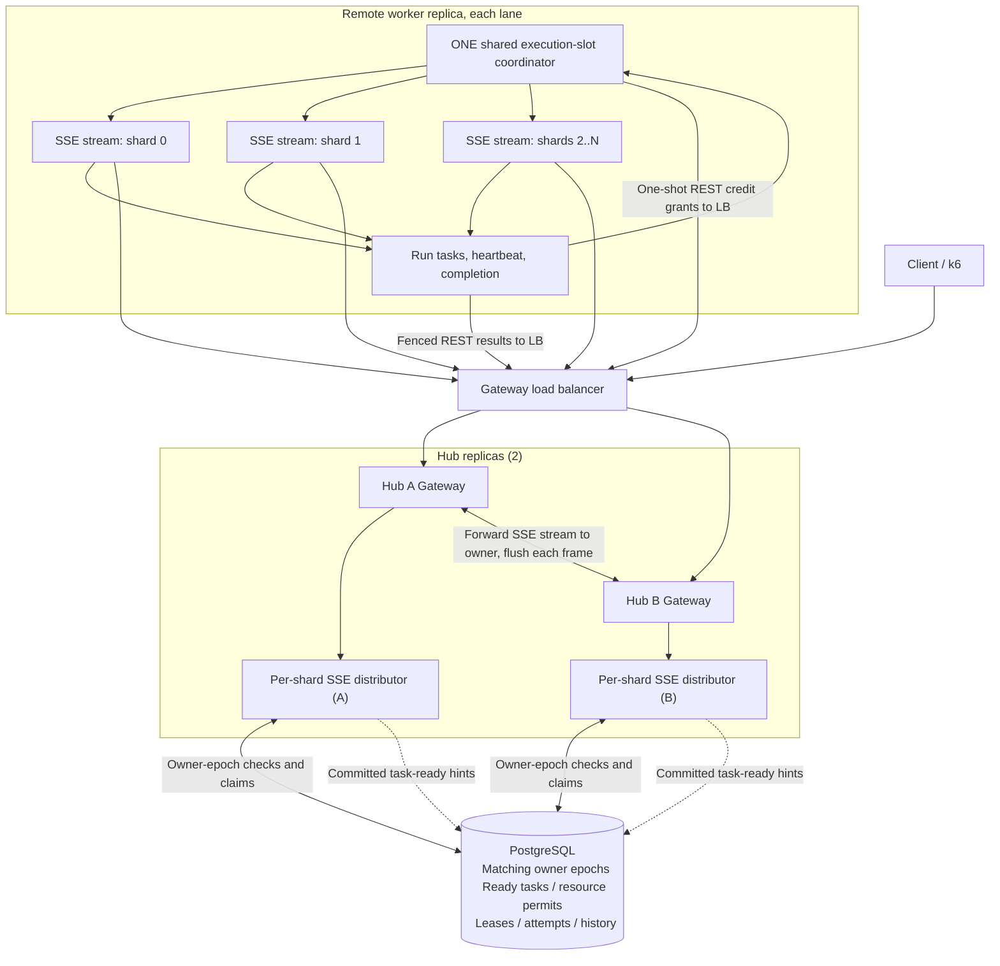
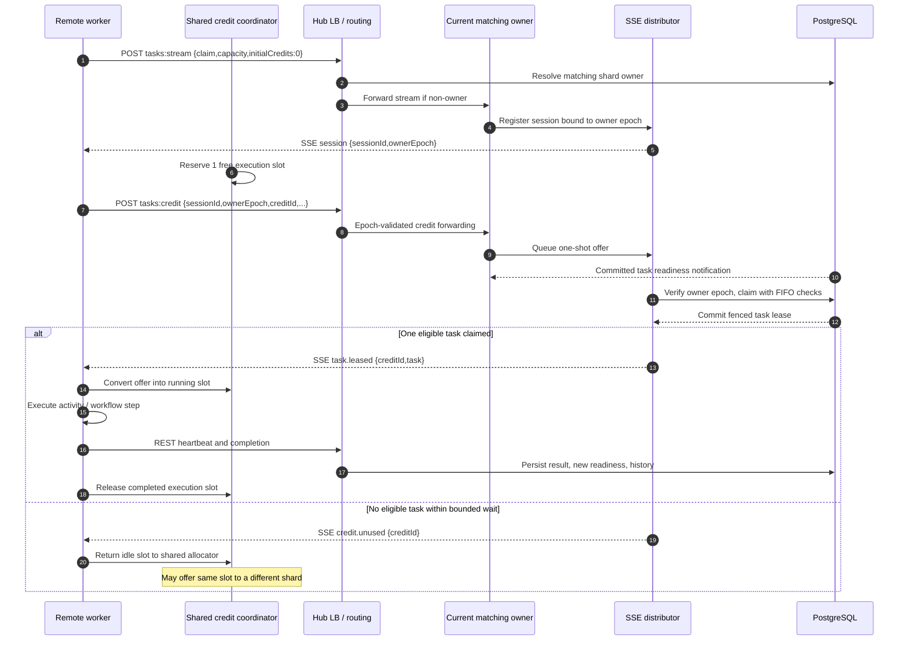
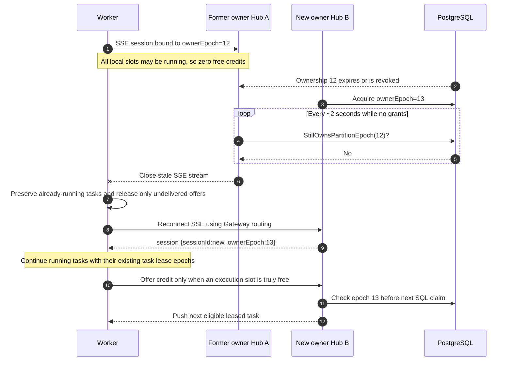

# Hub SSE Task Distributor — owner-fenced sessions and dynamic worker credits

**Status:** Experimental, **default OFF**. [Hardening PR #30](https://github.com/thanhhaictld/workflow-core/pull/30) is stacked on [SSE transport PR #29](https://github.com/thanhhaictld/workflow-core/pull/29), [long-poll fanout PR #28](https://github.com/thanhhaictld/workflow-core/pull/28), and the PostgreSQL optimizations from PR #27 (migrations 020–022).

The Hub **pushes a PostgreSQL-leased task over SSE**. This differs from the old `workers/events` endpoint, which only pushed `tasks.available` hints, and from the worker-initiated `tasks:poll` long-poll.

## 1. Architecture and routing



Each worker opens one outbound SSE subscription per matching shard via the same public Hub LB. A Gateway that is not the PostgreSQL-fenced matching-shard owner forwards the stream to the owner. A worker does **not** have to be registered on every Hub replica. Each owner maintains *only* its own ephemeral sessions.

**Key invariant:** `executing tasks + undelivered one-shot credits <= worker lane capacity`. There is no fixed quota per shard; credits can move to a busier shard after a no-work response. PostgreSQL still decides eligibility, FIFO admission, lease epoch and durable completion.

## 2. One-shot credit and push sequence



Each grant authorizes **at most one delivery**, rather than letting a Hub indefinitely consume a worker's local capacity. Empty matching waits use a two-second budget before returning an unused grant. This adds REST and SSE overhead compared with the older reusable static shard credit model, but safely permits dynamic reallocation.

## 3. Fencing and reconnect with zero worker credits



The stream's **matching owner epoch** and the task's **execution lease epoch** are different fencing domains. Reconnecting never resets a running task's execution lease; current HTTP heartbeat/completion retains its original PostgreSQL fencing.

On stream loss, the worker drops only undelivered credit grants associated with the abandoned session. Tasks already executing remain in the global slot budget. Any SSE task frame received after its credit/session was revoked is **not executed**; its PostgreSQL lease waits for normal expiry/recovery. We never immediately reassign it just because the stream disconnected.

A credit rejected by an owner after reassignment returns a non-success status and causes the worker to reconnect rather than blindly applying the credit to a different generation.

## 4. Transport contract

- `POST /api/hub/workers/tasks:stream`: authenticated `{claim,capacity,initialCredits:0}` with `claim.maxTasks=1` and one Hub namespace. Returns a long-lived `text/event-stream` with `session {sessionId,ownerEpoch}`, `task.leased {creditId,task}`, `credit.unused {creditId}`, plus keepalive comments. The Hub validates its captured ownership epoch every ~2 seconds while waiting for a credit, and before and after SQL claims.
- `POST /api/hub/workers/tasks:credit`: authenticated *one-shot offer* `{sessionId,ownerEpoch,workerId,hubId,matchingPartition,creditId}`. A successful response means **the distributor accepted the offer, not that any task was leased**. Duplicate IDs are idempotent within a session's bounded deduplication window. Wrong owner epoch, session, capacity or worker identity is rejected.
- `POST /api/hub/tasks/{id}/heartbeat`, `/complete` and failure endpoints remain unchanged.
- The stream is forwarded from a non-owner Gateway to the current owner via a trusted peer URL. Nginx buffering is disabled on this SSE route, and the non-owner Hub flushes each relay chunk to preserve actual push latency.

The flag remains `WFC_HUB_TASK_SSE_PUSH=true`; otherwise existing event-gated long-poll/SSE *hint* fallback remains available. Multiple Hub namespaces in a single worker lane continue using the old fallback. Unlike the first SSE prototype, a lane with fewer worker slots than shards can use the globally shared credits.

## 5. Limitations and important tradeoffs

1. **No durable worker sessions:** disconnect invalidates ephemeral credits; PostgreSQL is authoritative for task leases. Delivery after claim can still be lost before the worker receives it, requiring lease expiry and idempotent external handlers.
2. **No true two-way stream:** SSE sends tasks; the worker sends one-shot grants, heartbeats and completion over REST. One HTTP credit offer per leased task (and per empty wait) may cost more than batching or a gRPC stream.
3. **Rebalancing is heuristic, not optimal:** recently active shards receive preference, but a periodic fair rotation protects other shards. Empty offers can occupy a slot for up to 2 seconds before being transferred.
4. **SSE owner checks add DB reads:** checking the matching epoch every ~2 seconds per idle stream improves HA safety but can increase PostgreSQL load; measure before production enablement.
5. **No durable delivery ACK, tenant-level fair scheduling or exactly-once external effects:** event arrival is not durable completion, and resource policies must still be enforced on every PostgreSQL claim.
6. **Do not infer throughput advantage from functional E2E:** compare OFF → SSE → OFF with stable controls and separate Hub/PostgreSQL/processor CPU budgets.

## 6. Run locally (GNU Make with pwsh)

```powershell
make obs-setup
# Configure scaling/observability/.env
make obs-offboarding-sse-up OFFBOARD_PROCESSORS=8
make obs-offboarding-sse-ps
make obs-offboarding-sse-logs
make obs-offboarding-sse-test K6_OFFBOARD_COUNT=1000 K6_OFFBOARD_VUS=200
make obs-offboarding-sse-down
```

The Make targets combine `compose.yaml`, `compose.matching-ha.yaml`, and `compose.matching-shards.yaml` for two Hub replicas and four matching shards. Standard observability commands and the previous capacity-aware long-poll transport remain unchanged.

### Validation

[Dedicated SSE E2E CI](../../.github/workflows/workflow-hub-sse-push-e2e.yml) builds the .NET code, checks global credit and epoch-specific unit tests, completes 100 real unordered / partition FIFO / keyed FIFO workflows, then stops Hub A, waits for matching ownership expiry and verifies a fresh keyed-FIFO cohort under the surviving Hub.

Related: [Original capacity-aware long-poll investigation](capacity-aware-matching-experiment.md) and [old long-poll diagrams](capacity-aware-matching-diagrams.md).
