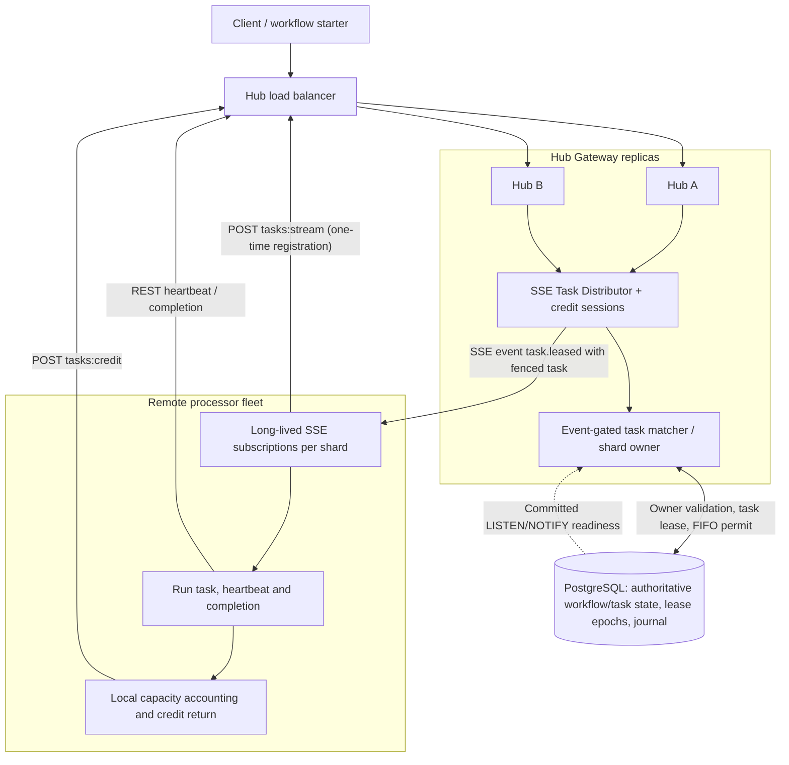
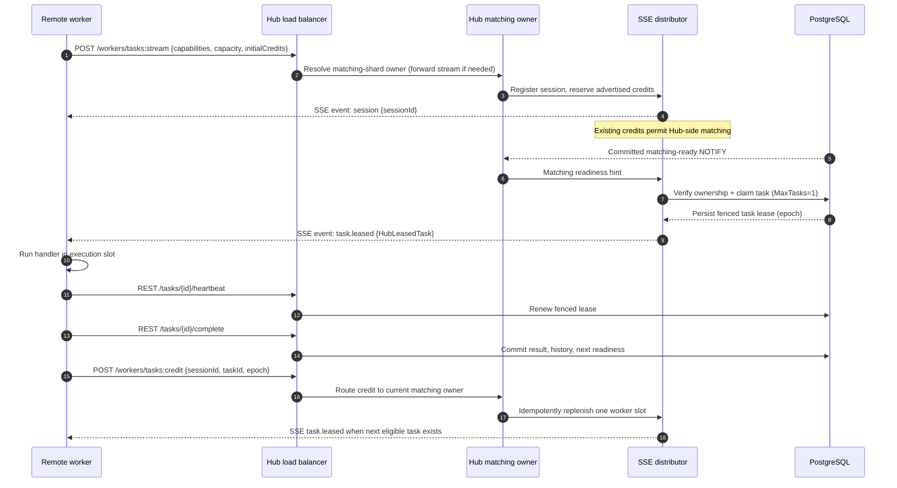

# Hub SSE task distributor — first implementation

**Status:** Experimental, default OFF. Stacked on PR #28 (capacity-aware long polls) and PR #27 (PostgreSQL claim optimizations 020–022). This design **actually pushes leased work** from a Hub-side task distributor; it is distinct from earlier `tasks.available` SSE hints and multi-shard REST long-polls.

## Architecture



In the implementation, the distributor is a service inside each matching Hub replica. It holds **ephemeral worker sessions** with available credits and calls the existing event-gated matcher internally when readiness intersects demand. PostgreSQL remains the source of truth for task leasing, FIFO eligibility and history; a successful SSE send **does not constitute durable task completion**.

## Task-dispatch sequence



## Transport contracts

- `POST /api/hub/workers/tasks:stream`: authenticated, one **persistent** `text/event-stream` response per single-Hub matching shard. Accepts `{claim, capacity, initialCredits}`, with `claim.maxTasks=1`. Server events: `session` (guid), `task.leased` (JSON `HubLeasedTask`) and SSE keepalive comments. Subscription requires Hub matching partitions > 1.
- `POST /api/hub/workers/tasks:credit`: authenticated `{sessionId,workerId,hubId,matchingPartition,taskId,epoch}`. Idempotently replenishes credit after the worker's task execution has finished. Credits are bounded by the session capacity. If a stream reconnects while older tasks are still running, it advertises only **free** slots; the prior tasks may replenish the new session as they complete.
- On Hub owner transition, a stream disconnects/reconnects and a new session generation is registered. Credits and sessions are **in-memory**, not a durable queue.
- Each worker lane distributes its configured concurrency across matching shards and opens one SSE connection per shard. This **static per-shard allocation can reduce utilization under skew**; it is deliberately simpler than a globally fair credit-aware router.
- Multi-Hub workers, or lanes with fewer execution slots than matching shards, use existing long-poll/SSE-adaptive fallback. Existing `WFC_HUB_WORKER_CAPACITY_FANOUT` retains its prior meaning; the new mode uses `WFC_HUB_TASK_SSE_PUSH=true`.

### Reliability/fencing boundaries

1. Lease acquisition is committed in PostgreSQL **before** emitting `task.leased`. The worker executes only the leased task; existing epoch-based heartbeat/completion APIs reject stale owners.
2. A dropped SSE frame can leave a lease temporarily stranded until lease expiry. The Hub does **not** immediately reassign it on disconnect. This is at-least-once execution with the existing fencing/idempotency requirements, **not exactly-once delivery**.
3. Credit return is separate from task completion and uses task ID/epoch for retry idempotency. A credit HTTP failure can temporarily reduce dispatch capacity; reconnecting the stream recalculates free worker slots.
4. Worker sessions are replaced by generation on reconnect; one active session per worker ID / Hub / matching shard per owner. Owner changes invalidate old local sessions and use PostgreSQL ownership checks before claims.
5. This first version has no durable delivery acknowledgment, tenant-fair worker placement, dynamic credit redistribution across shards, or reliable gRPC-style bidirectional session. SSE is one-way by design.
6. `MaxTasks=1` per claim may **increase** SQL transactions versus batched long-poll; compare PostgreSQL commits/workflow and p95/p99 before promoting.

## Local run (pwsh is Make's recipe shell)

```powershell
make obs-setup
# Configure scaling/observability/.env with your development secrets.
make obs-offboarding-sse-up OFFBOARD_PROCESSORS=8
make obs-offboarding-sse-logs
make obs-offboarding-sse-test K6_OFFBOARD_COUNT=1000 K6_OFFBOARD_VUS=200
make obs-offboarding-sse-down
```

These targets compose `compose.yaml`, `compose.matching-ha.yaml` and `compose.matching-shards.yaml`, enable `WFC_HUB_TASK_SSE_PUSH` and event-gated matching, and keep multi-shard long-poll fanout OFF. Verify the processor log contains `SSE task push enabled`.

## Evaluation gate

Dedicated [SSE Task Push E2E CI](../../.github/workflows/workflow-hub-sse-push-e2e.yml) builds/tests the distributor and runs 100 durable workflow instances for each ordering policy with 2 Hubs, 4 matching shards and 8 SSE-enabled processors. Check zero FIFO overlap, persisted journal, correct completion and recovery. Only after repeatable **OFF / push / OFF** comparisons with separate PostgreSQL/Hub/worker compute budgets should this be considered for default enablement.

**Existing reference:** [Capacity-aware long-poll experiment](capacity-aware-matching-experiment.md) is **not** server push. [High-level prior diagrams](capacity-aware-matching-diagrams.md) depict that older long-poll path, not these SSE events.
