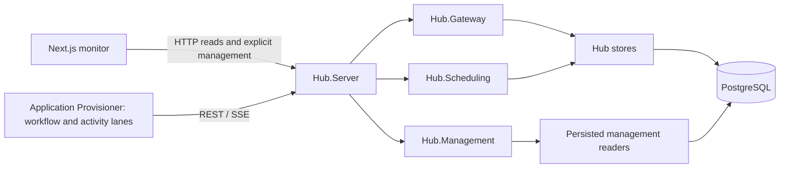

# Plan: Generic Hub Server and reusable Management module

Status: approved for autonomous implementation by the user; handed to GPT-6.1 Terra high in this worktree.
Updated: 4 November 2026. This revises the existing monitoring extraction plan in place.
Detailed implementation checklist: [todo.md](todo.md).

## Goal and recommended shape

Application developers should configure and deploy Hub infrastructure, then spend
application work on workflow definitions, processor decisions, and activity handlers.
They should not edit the Hub host or copy onboarding registrations into infrastructure.

Adopt the proposed project names, with one ownership distinction:

| Current location | Target | Responsibility |
| --- | --- | --- |
| `scaling/monitor/api` | `scaling/src/WorkflowCore.Hub.Management` | Reusable management/monitoring services, DTOs, and endpoint mapping; a library, not another executable |
| `scaling/sample/onboarding/WorkflowCore.Hub.Host` | `scaling/src/WorkflowCore.Hub.Server` | Generic ASP.NET executable composing Gateway, Management, telemetry, and embedded scheduling |
| `scaling/monitor` | unchanged | Next.js UI and server-side backend adapters |
| `WorkflowCore.Provisioner.Host` and `WorkflowCore.Provisioner.Workflows` | remain under `scaling/sample/onboarding` | Application-owned runtime configuration, native workflows, and typed activities |

The Server becomes the default backend for both the UI and remote application
hosts. A separate Management executable is unnecessary for this deployment; the
library can be embedded elsewhere if a concrete deployment requires that later.
The obsolete standalone `WorkflowCore.Processor.Host` has been removed from the
solution and is not a target to recreate. Inspect current files before execution
because another agent may be completing its source/reference cleanup.

## Grounding in the current implementation

- [`Hub.Host/Program.cs`](../scaling/sample/onboarding/WorkflowCore.Hub.Host/Program.cs)
  already composes generic Gateway and Scheduling without business registrations.
  This is primarily a host move, rename, and addition of management composition.
- [`monitor/api/Program.cs`](../scaling/monitor/api/Program.cs) is not a generic
  management module today. It registers `WorkflowCore.Scaling.Samples`, starts a
  `DistributedWorkPump` by default unless disabled, reconciles metadata from an
  executable registry, and exposes demo starts and approvals alongside reads.
- [`WorkflowMonitorReader.cs`](../scaling/monitor/api/WorkflowMonitorReader.cs)
  reads the separate PostgreSQL runtime's workflow state, work ledger, and history.
  Moving it does not turn those records into Hub native runs.
- [`DefinitionCatalog.cs`](../scaling/monitor/api/DefinitionCatalog.cs) mixes
  metadata capture with persisted reads/diffs. Topology prefers stored metadata,
  but the API currently falls back to locally registered executable definitions.
- [`HubGatewayEndpoints.cs`](../scaling/src/WorkflowCore.Hub.Gateway/HubGatewayEndpoints.cs)
  already owns `/api/hub` runtime APIs, including worker claims/commits, events,
  status, history/trace, operational reads, and policy capacity updates. Do not
  duplicate or transfer these transactional implementations during extraction.
- The Next.js `/backend` rewrite and unified feed use `WORKFLOW_API_URL`, while
  Hub adapters use `WORKFLOW_HUB_URL` and a server-only token. Both data sources
  must continue working after they point to one Server origin.
- Observability Compose currently launches `hub`, `monitor-api`, and an EF-only
  `monitor-api-migrate` job. `scripts/dev.ps1`, `scripts/test-hub-native.ps1`, and
  both scaling CI workflows encode old project paths or binary names.

These observations are a planning baseline, not a claim that the target exists.

## Architecture and boundaries



- **Server** is a composition root: configuration, telemetry, module registration,
  endpoint mapping, health/readiness, and an explicit migration entry point. It
  has no reference to a business sample, remote executor, or Provisioner assembly.
- **Gateway** retains the existing REST/SSE runtime protocol and authentication
  behavior. Hub stores retain transactions, fencing, permits, durable journal,
  policy revisions, and inbox/timer arbitration. Management commands for native
  workflows use these existing services; they never edit native state directly.
- **Management** supplies persisted read models and read endpoints plus explicit
  optional legacy management commands where consumers still require them. Its
  normal registration must not call `AddDistributedWorkflowCore`, register
  `IWorkflowHost`, reconcile an executable registry, or add workflow consumers.
- **Scheduling** stays Hub infrastructure with database access and the current
  enable/disable configuration. Do not add a separate scheduler deployment here.
- **Application hosts** own workflows, mappings, activities, versions and
  application policy declarations; they access Hub through REST/SSE with no
  PostgreSQL credentials. The combined Provisioner remains the default example.
- Existing legacy read compatibility may reference persistence types from
  `WorkflowCore.Scaling.PostgreSQL` or upstream persistence assemblies. Assembly
  reuse must not register its execution services. Isolate optional legacy command
  registration so the default management module cannot start that runtime.

Proposed public composition surface (names to implement, not existing APIs):

```csharp
services.AddHubGateway(connectionString);
services.AddHubManagement(options => options.ConnectionString = connectionString);
services.AddHubScheduling(configuration.GetSection("WorkflowHub:Scheduler"));

app.MapHubGateway();
app.MapHubManagement();
```

`AddHubManagement` registers readers/options only. `MapHubManagement` maps retained
read contracts. Keep any required legacy command registration separate and
explicit, with writes disabled by default and no worker started. Introduce further
interfaces only when required for hosting or tests.

## Contract and data decisions

1. Keep `/api/hub/*` worker and native workflow contracts unchanged. Native
   start/event/status APIs and capacity updates continue to use their existing
   stores; preserve revision and epoch checks, retry behavior, and history.
2. Preserve useful read contracts: `/api/monitor/*`, workflow instance/history,
   `/api/definitions` versions/diffs, and topology. Preserve JSON casing, IDs,
   filtering, pagination, not-found/error behavior, and native/legacy source
   identity. Two namespaces on one origin must not collapse two persistence models.
3. Remove business endpoints such as `/api/demo/onboardings`, approval,
   `/api/demo/versioned-onboardings`, and benchmark-specific `POST /api/workflows`
   only with their UI, script, and CI callers migrated. Inventory generic
   `/api/events` and `/api/manage/*` individually; retain used legacy commands
   explicitly or document intentional retirement. Do not silently redirect
   legacy requests into the native runtime with different semantics.
4. Read metadata from persisted snapshots. Remove startup capture and executable
   registry fallback from management. Before deleting legacy definitions, run an
   explicit archive preparation with their matching old code. Missing topology
   stays visibly unavailable; do not invent metadata or make all runs unreadable.
5. Preserve database schemas, ordered migrations through 013, rows, workflow and
   activity versions, implementation fingerprints, policy revisions, history,
   and named Compose volumes. This is not a database migration between runtimes.
6. Native v3 workflow/step code remains in `WorkflowCore.Provisioner.Workflows`.
   Moving infrastructure must not rebuild/change or republish those implementations
   unnecessarily. No new sample version is required solely for a Server rename.
7. Old v1/v2 runs still require matching old binaries if unfinished. The current
   combined sample does not advertise those versions. Keep reusable compatibility
   code where needed; do not claim automatic coexistence or add sample aliases
   just to make old tests pass.
8. Preserve existing credential handling and inspect route authorization when
   mounting management on the Server. Keep tokens server-side in Next.js and
   verify unauthorized Hub access still fails. This refactor does not claim
   production authentication or tenant isolation.

## Deployment and migration design

Target observability topology: `hub` runs `WorkflowCore.Hub.Server.dll`; `monitor`
uses that backend for both origins; `provisioner` remains application-owned. Keep
service name `hub`, existing Hub port, environment names and scheduler settings
where possible. Rename the project/assembly and update its callers together.

1. Extract the Management library while the current API still hosts it. Prove
   readers and default registration first, with no business dependency.
2. Move/rename the existing Hub host to `scaling/src/WorkflowCore.Hub.Server` and
   update solution, build and startup callers in the same verifiable slice.
3. Add Management to Server and test both API families from one origin before
   redirecting the monitor or removing its old backend.
4. Keep the existing `monitor-api-migrate` responsibility during transition. Add
   an explicit Server migration-only invocation for required legacy EF schemas,
   preserving the existing schema and migration history. It must exit before
   opening HTTP listeners, starting hosted services, or running business code.
   The existing ordered Hub SQL job stays authoritative for Hub SQL; do not
   introduce a second automatic startup migration loop.
5. Switch `WORKFLOW_API_URL` and `WORKFLOW_HUB_URL` to Server in Compose and local
   scripts. Keep `/backend` proxy URLs used by the browser stable. Audit the
   Next.js rewrite/build configuration to verify the new origin actually reaches
   the running application; do not assume an environment change alone is enough.
6. Remove `monitor-api` and its obsolete image/build path after UI parity is
   verified. Rename or replace the explicit EF migration job once its new
   invocation is proven. Preserve PostgreSQL/observability volume and project names.
7. Remove `scaling/monitor/api` and the old Hub host directory after all active
   callers have moved. No permanent forwarding project or duplicate host remains.

Configure DB pools explicitly when cohosting readers with Gateway/scheduler.
Validate concurrent management reads and timer/activity progress; do not silently
combine previous pool limits into an assumed capacity budget.

Rollback retains previous deployable artifacts and restores previous process/origin
configuration without restoring or deleting data. Never run an old Hub binary
against unsupported schema/protocol versions. Host-only rollback does not require
changing application workflow identities.

## Legacy demo cleanup retained from the previous plan

Remove onboarding/benchmark creation and approval controls from the monitor so
infrastructure does not depend on one business domain. Preserve generic workflow
lists, details, definitions, status controls where supported, and real error states.

Retire `WorkflowCore.Scaling.Samples`, direct-PostgreSQL demo execution, and
`WorkflowCore.Scaling.Worker` only after auditing their remaining readers, CI,
benchmark, and REST/SSE activity callers. Replace verification with test-owned
fixtures or retained native tools before deleting callers. Do not assume the
current Provisioner provides old worker capabilities or exact v1 result shapes.
Reusable upstream and scaling runtime libraries remain out of deletion scope.

## Ordered delivery

The checklist gives observable acceptance and verification for each slice:

1. Inventory routes, references, schemas, consumers, and current response fixtures.
2. Separate persisted metadata reads from executable capture; prepare old archives.
3. Extract reusable Management services and endpoint mapping into the current API.
4. Move the generic Hub executable to Hub.Server and update its direct callers.
5. Compose Management into Server; prove API parity and explicit migration-only mode.
6. Migrate/remove business UI controls and display unavailable metadata explicitly.
7. Switch Compose and local development to the Server backend.
8. Repoint runtime and observability CI/smokes/benchmarks to generic/native fixtures.
9. Delete old API/host directories and unused sample executables after caller audits.
10. Update guidance and prove the final architecture and deployment.

Each slice ends in a buildable state with its focused checks passing. Checkpoints
follow extraction, combined hosting, and deployment. This document does not ask
for an implementation checkpoint beyond the user's current request for a plan.

## Completion evidence required during implementation

- Release scaling solution build and PostgreSQL tests with `WFC_TEST_PG` pointing
  at a configured database. Unset-variable early returns do not count as coverage.
- HTTP contract checks for retained read routes, metadata snapshots/diffs, missing
  metadata and backend failures. No executable sample assembly in Server/Management.
- Start Management alone against queued test work; verify no work is claimed and
  no workflow revision changes. Inspect DI for execution consumer registrations.
- Start Server with Management enabled/disabled and Scheduler enabled/disabled;
  verify advertised readiness, route inventory, and retained Gateway behavior.
- Native workflows and durable timer recovery pass through renamed Server and
  existing Provisioner using `scripts/test-hub-native.ps1 -ManageHosts`.
- Capacity update/stale revision/lease preservation tests remain green. Run
  retained v1 protocol checks with test fixtures where applicable, without
  pretending the default native Provisioner can execute old pinned versions.
- Next.js typecheck, topology tests, build, and browser verification of the unified
  list, native/legacy details, definitions, generic management and failure states.
- Compose config, PowerShell syntax/help and existing-volume deployment smoke:
  migrations apply, both data sources remain readable, new native runs complete,
  restarts recover timers and no data is reset.
- Reference search finds no active callers of old project paths/DLL names;
  historical mentions are marked. Review the final dependency graph and diff.

Windows/Docker clock skew previously affected five separate-runtime immediate-claim
tests. Use a synchronized runner/database environment and report actual results;
do not weaken tests to hide this constraint.

## Risks and scope limits

| Risk | Required mitigation |
| --- | --- |
| Folder move preserves business execution accidentally | DI and pending-work behavioral checks; no sample project references |
| Cohosted routes overlap or expose writes differently | Freeze route/method inventory and compare authorization/default-write behavior |
| Removing registrations hides historical topology | Archive with old binaries, then verify reads without executable definitions |
| Server rename breaks smoke or migration process discovery | Update path and DLL resolution together; run real process restart smoke |
| Combined queries starve scheduler or Gateway | Explicit pool budget and concurrent read/activity/timer verification |
| Deletion removes a required old worker capability | Audit and replace callers before removal; retain supported reusable runtime code |

No new workflow engine, storage redesign, live definition migration, scheduler
extraction, public API renumbering, or production identity redesign is included.
No application code, project paths, deployments, or databases are changed by
writing this plan.
